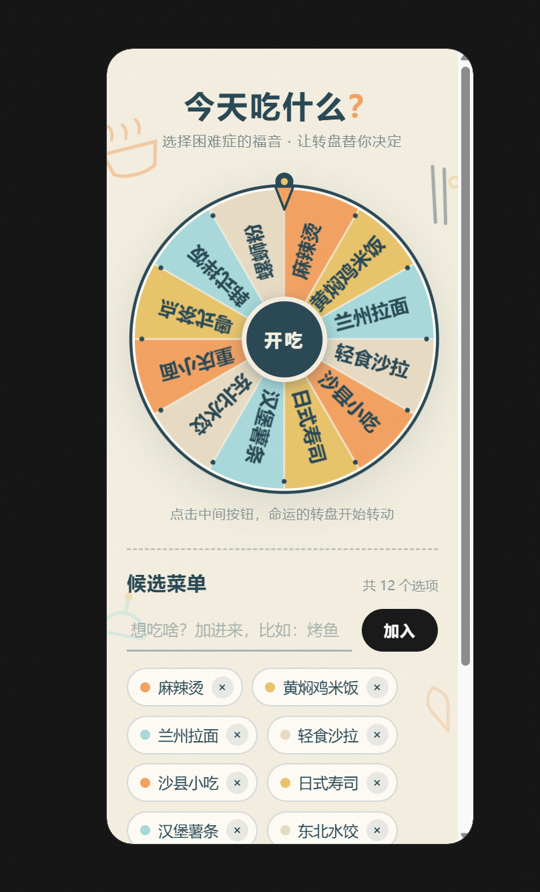

# 今天吃什么首版产品需求草案

- 项目：eating-everyday（今天吃什么）
- 成果 ID：A-001
- 关联任务：[T-001](../TASKS.md#t-001产品需求首轮澄清)、[T-003](../TASKS.md#t-003整理首版需求与架构师交接)、[T-006](../TASKS.md#t-006写回用户确认的七项规则)；本次范围变更见 [T-007](../TASKS.md#t-007调整为全手动候选需求)。
- 负责人：product-manager
- 版本：0.9
- 更新日期：2026-10-20（Asia/Shanghai）
- 状态：draft
- 适用范围：个人用餐决策的微信小程序首版需求；候选完全由用户输入，作为系统架构师同步设计的输入。
- 来源及输入版本：A-001 v0.8、A-007 v0.2 及用户 2026-10-20 的明确变更 [D-016](../DECISIONS.md#d-016首版改为全手动候选并移除定位搜索)；D-005、D-011、D-014 及 D-016 重申的保留规则；用户[转盘截图](references/meal-wheel-reference.png)。[A-005 v0.2](architecture-data-verification.md)、[A-006 v0.2](system-architecture.md)仍为变更前资料，尚未适配本版。
- 存储位置：OPC projects/eating-everyday/artifacts/product-requirements.md；截图为本成果的参考输入。
- 批准依据：D-016 明确确认全手动输入并取消定位搜索；未变的结果、本机留存、菜单边界及职责继续按 D-005、D-011、D-014 和 D-016 执行。这是具体需求变更确认，不代表整份架构或产品实现已批准，文档仍为 draft。
- 交接定位：当前正文 UTF-8、LF 归一化 SHA-256 见 [H-005](../HANDOFFS.md#h-005按全手动候选需求同步架构)；旧 v0.7/v0.8 的输入指纹保留在历史交接中。

## 产品目标

先服务用户本人每天到饭点不知道吃什么的场景。用户在微信小程序里自行输入想吃的候选名称，由转盘随机选出一个；常用候选可以保存为多份命名菜单，下次在当前手机直接加载继续使用。

核心闭环是“输入候选 → 转盘抽取 → 保存完整菜单 → 再次加载和抽取”。小程序不获取定位信息，不提供附近餐厅搜索，也不根据位置、距离或第三方餐厅数据生成候选。首次没有本机已保存菜单时，当前候选为空，不自动填入演示或预设餐厅。

## 首版范围与变更

本版共有 **11 项有效需求、11 条有效操作规则、27 项有效验收条件**。保留旧编号以便架构师追溯，已撤销编号不复用。

首版包含名称输入与删除、最多 24 项候选、等概率转盘、多份命名菜单、本机保存和原样加载，以及菜单管理和必要异常处理。视觉沿用用户截图方向。候选仅由用户输入或从其已保存菜单加载，不要求名称必须对应地图上的真实门店。

按 D-016，定位权限与位置获取、1/3/5 公里或任何距离限制、附近搜索、地图餐厅自动加入及更新、用餐类别筛选、距离排序和地图最多 12 家规则全部移出本版。餐厅数据源选型、免费额度与保存授权核实、林萃桥覆盖验证、成功样本/分页规则、跨来源同名处理和来源标注也不再是本版待办。

长期免费仍是使用偏好，但本版无需餐厅数据接口；不据此承诺小程序注册、运行和发布的全部成本永远为零，也不授权开通付费服务。微信小程序平台、本机存储、字符计数及实际运行能力由架构师按新范围验证，系统边界、数据结构和实现方式仍由其设计。

首版不要求跨设备同步、换机找回或清除本机数据后恢复。抽中结果仅显示候选名称，不要求地址、距离、评分、人均或导航。

## 已确认需求

| 编号 | 需求与使用规则 | 确认依据 |
|---|---|---|
| R-01 | 产品形态为微信小程序，先服务用户本人每天饭点的选餐场景。 | D-016 重申原产品形态 |
| R-03 | 从当前候选中随机抽取一个；所有候选等概率，每次独立，允许再次抽取和重复结果。 | D-016 重申原转盘规则 |
| R-04 | 候选全部由用户手动输入名称，只填名称即可添加，无需地址、位置、类别等信息；同一份当前候选中去首尾空白后同名的不重复加入。 | D-016 |
| R-05 | 抽中结果仅显示候选名称。 | D-005、D-016 |
| R-06 | 保存当前整份非空候选为菜单，下次可以直接加载；0 项不能新建或覆盖菜单。 | D-014、D-016 |
| R-07 | 支持多份菜单的命名、重命名、切换、加载和删除；菜单名去首尾空白后为 1～20 个可见字符，不允许不同菜单重名。不另设菜单份数业务上限，实际空间不足时保留旧菜单。 | D-014、D-016 |
| R-08 | 加载时原样恢复所选菜单保存时的完整候选；仅加载、抽取或小程序重新进入不自动修改该菜单。 | D-016 重申原样加载 |
| R-10 | 菜单只保存在当前手机，正常关闭后下次仍可加载；不要求换机找回、跨设备同步或清除本机数据后恢复。 | D-005、D-016 |
| R-11 | 视觉样式参考用户提供的转盘截图。 | D-016 重申截图方向、D-011 |
| R-14 | 当前候选及每份保存菜单最多 24 项；达到 24 项后添加新项需先删除已有项，不挤掉旧候选。全部 24 项均可由用户输入，不设 12 项限制。 | D-016 重申总上限 |
| R-16 | 不获取定位信息、不请求定位授权，不提供距离选择或附近搜索，不自动获取餐厅数据或生成候选；核心使用不依赖定位、地图账号或餐厅查询服务。在平台能够打开小程序的前提下，断网仍可输入、抽取和使用本机菜单。 | D-016 |

### 已撤销需求编号

| 原编号 | 撤销内容 | 本版处理 |
|---|---|---|
| R-02 | 当前定位、1/3/5 公里直线半径及边界 | D-016 取消；由 R-16 明确无需定位和距离功能。 |
| R-09 | 重新搜索替换地图项、失败保留混合候选 | 搜索和地图项退出本版，不再设计搜索成功/失败分支。 |
| R-12 | 自动餐厅品类筛选 | 不按门店类别筛选用户输入的名称。 |
| R-13 | 样本去重、距离排序、地图最多 12 家和完整性提示 | 餐厅接口取数退出；保留 R-14 的全部候选 24 项上限。 |
| R-15 | 餐厅接口的长期免费、优先验证开放数据及高德候选 | 不再需要餐厅数据接口或验证其费用、保存许可；不等于曾经验证通过。 |

## 候选与菜单的含义

当前候选是此刻参与抽取的一组名称，全部来自用户手动输入或其已保存菜单。用户只提供名称，产品不要求补充地址、位置、门店标识或来源资料，也不区分地图项和手动项。

已保存菜单是用户命名并保存的一份完整候选。加载后原样恢复名称和候选顺序；修改当前候选不会自动覆盖已保存菜单，必须明确保存。抽取仅产生结果，不修改候选。

同一份候选内，名称去首尾空白后逐字相同的重复输入被拒绝并提示，不利用同名项增加概率；不同菜单可以包含相同的候选名称。旧“手动项与地图项同名可分别保留”的例外已退出本版。

## 核心使用流程

### 准备并抽取

1. 打开小程序，没有已保存菜单或尚未加载菜单时，从空候选开始；也可以选择加载本机已保存菜单。
2. 用户填写名称并添加，按非空和同名规则校验；可继续添加至 24 项，也可删除不想参与抽取的项。
3. 点击转盘中心“开吃”，抽中结果只显示候选名称；可继续抽取，允许连续抽中同一项。
4. 当前候选非空时，可用合法且不重名的菜单名保存整份候选；保存失败不报成功、不丢失当前编辑状态和旧菜单。

整个流程没有定位申请、距离选择、附近搜索或自动补充餐厅。用户在平台能够打开小程序的前提下，可在断网时继续使用上述流程与本机菜单。

### 使用已保存的菜单

1. 选择一份已命名菜单；当前有未保存改动时，先选择保存并切换、放弃改动并切换，或取消切换。
2. 加载后恢复该菜单保存时的完整候选，可直接抽取，也可手动增删。
3. 修改后的候选由用户明确选择覆盖当前菜单或另存为新菜单；加载和抽取均不自动改写保存记录。

### 管理和保存菜单

菜单名去首尾空白后为 1～20 个用户可见字符；去空白后逐字相同的不同菜单名视为重名。新建或重命名重名时提示换名，不自动覆盖；重命名为自身原名不算重复，明确覆盖当前菜单也不算新增重名。20 字符上限仅约束菜单名，不约束候选名称。

0 项不能新建或覆盖菜单，但可以删除当前最后一个候选。保存被阻止时保留当前编辑状态和旧保存记录。“保存并切换”只有保存成功才继续，空候选或空间不足时不能报成功或继续切换。不设固定菜单份数上限，实际空间不足时不得自动淘汰旧菜单。

删除当前菜单前说明仅删除保存记录；确认后保留当前完整候选为未保存副本，并解除与已删除记录的关联，不自动另存。取消时保存记录和当前编辑状态均不变。后续保存需另存，不会复活已删除记录。保存前退出不要求保留该未保存副本供下次加载。

删除或重命名某份菜单不改变其他菜单。正常关闭后再次进入，可找到并加载本机已保存菜单；用户清除本机数据后不要求恢复。

## 视觉参考

沿用奶油色纸纹背景、深蓝绿色文字和轮廓，以及橙色、黄色、浅蓝色和米色相间的转盘。主区域突出顶部指针、大转盘及中心“开吃”按钮，下方提供名称输入、添加、候选标签与删除、菜单保存和切换入口。

界面移除定位状态、定位授权、距离选择、附近搜索、来源标签和搜索完整性提示。24 项及长名称场景仍须可读、可操作；空候选状态应引导用户输入，不自动填充示例候选。

[A-004 v0.1](interface-plan.md) 及其 HTML 仅作为历史视觉参考；其中搜索和模拟餐厅不属于本版功能，不是微信小程序实现。后续页面与系统设计由 architect 依据本版更新，产品经理不改写架构原稿。

## 已确认操作规则

保留原编号，P-01（距离）和 P-08（地图筛选及最多 12 家）按 D-016 撤销；以下 11 条为本版有效规则。

| 编号 | 操作规则 | 对应验收 |
|---|---|---|
| P-02 | 每次对 N 个当前候选独立等概率抽取，每项概率 1/N，允许重复结果；0 项提示先添加，1 项直接显示唯一名称。 | AC-04、AC-09、AC-10 |
| P-03 | 名称去首尾空白后不能为空；同一份候选不重复加入逐字同名项，拒绝时原候选不变。 | AC-03、AC-11、AC-12 |
| P-04 | 允许删除当前任一候选，包含最后一项；已保存菜单支持重命名和删除，删除当前菜单按 P-13 处理。 | AC-13、AC-14、AC-29、AC-32 |
| P-05 | 增删当前候选或抽取不自动覆盖保存记录；保存时明确覆盖或另存，切换前处理未保存改动。 | AC-15、AC-16、AC-17、AC-35 |
| P-06 | 核心流程不要求定位权限、地图账号或餐厅查询；平台能打开小程序时，断网仍能输入、抽取、本机菜单保存/加载和管理。 | AC-18、AC-37 |
| P-07 | 正常关闭后保留本机已保存菜单；清除本机数据后不要求恢复。未明确保存的候选不承诺退出后保留。 | AC-07、AC-20 |
| P-09 | 当前候选及每份菜单上限 24 项，不设 12 项门槛；满额添加时提示先删除，不挤掉或覆盖已有项。 | AC-25、AC-30、AC-36 |
| P-10 | 菜单名去首尾空白后为 1～20 个可见字符；不同菜单重名时拒绝新建或重命名，自身原名和明确覆盖当前菜单除外。不自动截断或隐式覆盖。 | AC-27、AC-28 |
| P-11 | 0 项不能新建或覆盖菜单；保留当前编辑状态和旧记录，保存失败不能继续“保存并切换”。 | AC-29、AC-35 |
| P-12 | 不设固定菜单份数业务上限；实际空间不足时提示保存失败，保留当前内容、未保存状态和全部旧菜单，不自动删除旧项。 | AC-30、AC-31、AC-35 |
| P-13 | 确认删除当前菜单只删除保存记录，当前候选保留为未保存副本，不自动另存；取消全部不变，再次保存需另存，其他菜单不变。 | AC-32 |

## 验收条件

以下 **27 项**用于后续微信小程序实现验收。编号有意不连续，撤销编号保留在后表，不复用或当作通过。文档自查不能代替实际小程序上的菜单留存、断网、权限和存储失败验证。

| 编号 | 操作与输入 | 应观察到的结果 | 对应需求 |
|---|---|---|---|
| AC-03 | 在空候选及已有候选时，只填写名称并添加。 | 无需地址、位置或其他资料；有效名称加入转盘并可抽取。 | R-04、P-03 |
| AC-04 | 对多个用户输入的候选发起抽取。 | 结果为其中一个名称，结果区域仅显示名称。 | R-03、R-05、P-02 |
| AC-05 | 将完整候选保存为 M，再将另一份候选保存为 N，来回切换。 | M、N 均按名称可找到，分别恢复各自完整名称和顺序。 | R-06、R-07、R-08 |
| AC-06 | 保存 M 后修改当前候选，明确放弃改动，再重新加载 M。 | 恢复 M 原保存内容，不自动生成、查询或替换候选。 | R-08、R-16、P-05 |
| AC-07 | 同一手机保存多份菜单，正常关闭后重新进入。 | 菜单名称和完整候选可找到并加载，不要求其他手机恢复。 | R-10、P-07 |
| AC-08 | 对照截图，用 12 项、24 项及含长名称的候选操作。 | 保留约定纸纹配色、大转盘和候选区域；名称可辨认，添加、删除、保存及切换入口可用，无定位、距离或搜索入口。 | R-11、R-14、R-16 |
| AC-09 | 对至少 2 个不同名称连续抽取，并核对概率依据。 | 每次每项概率 1/N，历史结果不改变下次概率，允许连续重复；不要求有限次数出现次数完全相同。 | R-03、P-02 |
| AC-10 | 分别准备 0 项和 1 项后抽取。 | 0 项提示先添加且不产生名称结果；1 项直接显示唯一名称。 | R-03、R-05、P-02 |
| AC-11 | 提交空名称、纯空白、带首尾空白的有效名称。 | 前两者拒绝；后者去首尾空白后加入，不要求补充其他字段。 | R-04、P-03 |
| AC-12 | 当前已有“面馆”，再输入“面馆”和“ 面馆 ”；在另一份不同名菜单中输入“面馆”。 | 同一份候选不重复加入，原候选和保存记录不变；不同菜单可包含同一候选名称。 | R-04、P-03、P-05 |
| AC-13 | 删除当前一个候选。 | 该项不再参与抽取，其他候选保留，保存前不改写旧菜单。 | P-04、P-05 |
| AC-14 | 重命名 M，再确认删除 M。 | 名称按操作更新，删除后不可再加载；其他菜单不变。 | R-07、P-04 |
| AC-15 | 加载 M 后增删候选和抽取，期间不保存。 | 当前候选按增删变化，M 原保存记录不变；仅抽取不改候选。 | R-08、P-05 |
| AC-16 | 修改 M 后明确覆盖保存，再修改并另存为 N。 | M 保存覆盖后的完整内容；新增 N，保留 M 的已保存内容。 | R-06、R-07、P-05 |
| AC-17 | 有未保存改动时切换，分别选择保存、放弃、取消。 | 保存成功后切换并可恢复修改后的原菜单；放弃后切换且旧记录不变；取消保留当前编辑状态。 | P-05 |
| AC-18 | 在平台能打开小程序的前提下关闭网络，进行输入、抽取、保存、加载、重命名和删除。 | 核心流程仍可用，不等待定位或餐厅接口，不强制开通地图账号；持久保存及失败分支按对应规则处理。 | R-16、R-10、P-06 |
| AC-20 | 用户清除当前手机本机菜单数据后重新进入。 | 不要求恢复已清除菜单，不从其他设备找回或自动补入候选。 | R-10、P-07 |
| AC-25 | 已有 24 个不同名称，尝试加入第 25 项，再删除一项并添加。 | 满额时拒绝且提示先删除，原 24 项及保存记录不变；删后可加入，总数仍不超过 24。 | R-14、P-09、P-05 |
| AC-27 | 新建或重命名，输入空白、带首尾空白的合法名、20/21 个可见字符。 | 去首尾空白后仅 1～20 字符可用；空白或超长提示失败，不截断或改写旧记录；不把该上限用于候选名称。 | R-07、P-10 |
| AC-28 | 已有“午餐”，新建或把另一菜单改为“ 午餐 ”，再以自身原名重命名及明确覆盖。 | 不同菜单重名被拒绝；自身原名不算重复，明确覆盖允许；无隐式覆盖或新增同名记录。 | R-07、P-10、P-05 |
| AC-29 | 空候选新建；另加载非空 M 后删光候选并尝试覆盖。 | 两次保存均拒绝并提示先添加；当前编辑态保留，M 原记录不变；删除最后一项本身允许。 | R-06、P-11、P-04 |
| AC-30 | 已有 20 份菜单且空间足够，以合法不同名保存第 21 份非空菜单。 | 可新增，不因固定业务份数上限拒绝；每份仍最多 24 项，其他菜单不变。 | R-07、R-14、P-12 |
| AC-31 | 有未保存修改时，分别模拟新建或覆盖保存空间不足。 | 明确提示失败，不报成功或清除未保存状态；当前内容及全部旧记录不变，不自动删旧菜单。 | R-07、R-10、P-12、P-05 |
| AC-32 | 对当前菜单在有/无未保存改动时取消或确认删除，包含最后一份菜单及随后另存。 | 取消时全部不变；确认后目标不可加载，当前完整候选留为未保存副本；再次保存创建新记录，其他菜单不变。 | P-13、P-04、P-05 |
| AC-35 | 当前空候选时选“保存并切换”；另模拟非空保存空间不足。 | 均不报成功或加载目标菜单，当前编辑态及旧记录不变；仍可取消或明确放弃后切换。 | P-05、P-11、P-12 |
| AC-36 | 手动依次输入 12、13、24 个不同名称，包括不对应具体地图门店的名称。 | 第 13 项与第 24 项均可加入，无 12 项限制，不按位置、门店分类或地图收录情况排除。 | R-04、R-14、P-09 |
| AC-37 | 无本机菜单首次进入，并完成输入、保存、切换、抽取等全部核心流程，检查界面、权限和调用。 | 初始为空；没有定位授权请求、位置获取、距离或附近搜索入口、餐厅数据查询，也不自动加入预设候选；手动内容可完成整个闭环。 | R-16、R-01、P-06 |

### 已撤销验收编号

| 原编号 | 原验收主题 | 撤销依据 |
|---|---|---|
| AC-01、AC-21 | 距离选项及直线半径边界 | D-016 移除全部定位和距离功能。 |
| AC-02、AC-19 | 地图搜索替换、网络/分页或零结果处理 | 无餐厅搜索，不再验证地图列表更新。 |
| AC-22、AC-23、AC-24、AC-26 | 门店分类、地图最多 12 家、混合容量及少量结果 | 全手动输入；24 项边界以 AC-25、AC-36 验证。 |
| AC-33 | 地图与手动同名保留和合计概率 | 无混合来源；同名手动输入拒绝，见 AC-12。 |
| AC-34 | 成功受限样本与分页失败区分 | 无餐厅接口样本，旧主题不再适用。 |

### 需求与验收追溯

| 有效需求 | 验收依据 |
|---|---|
| R-01 | 全部功能在微信小程序个人选餐场景验收；AC-37。 |
| R-03 | AC-04、AC-09、AC-10。 |
| R-04 | AC-03、AC-11、AC-12、AC-36。 |
| R-05 | AC-04、AC-10。 |
| R-06 | AC-05、AC-16、AC-29。 |
| R-07 | AC-05、AC-14、AC-16、AC-17、AC-27 至 AC-32、AC-35。 |
| R-08 | AC-05、AC-06、AC-15。 |
| R-10 | AC-07、AC-18、AC-20、AC-31。 |
| R-11 | AC-08，结合截图。 |
| R-14 | AC-08、AC-25、AC-30、AC-36。 |
| R-16 | AC-06、AC-08、AC-18、AC-36、AC-37。 |

## 待定事项与历史验证清单处理

| 原编号 | 本版状态 | 后续处理 |
|---|---|---|
| TBD-01 | 已撤销：距离口径 | 不再获取位置或计算距离。 |
| TBD-02 | 部分撤销：地图筛选、排序、12 家及手动优先混合规则退出 | 保留全部候选最多 24 项，见 R-14、P-09。 |
| TBD-03 | 已撤销：餐厅数据源、免费额度、项目用途和保存许可验证 | 不选定数据源，也不记为已获许可或验证通过。 |
| TBD-04 | 已撤销：林萃桥真实覆盖与成功样本验证 | 不再要求取得餐厅数量或名单；此前失败和未验证结果仅作历史。 |
| TBD-05 | 业务规则已确认，平台能力待验证 | D-014/D-016 保留菜单命名、空保存、份数与空间、删除行为；architect 继续核对可见字符、本机留存和失败恢复。 |
| TBD-06 | 已撤销：跨来源同名 | 无地图项；全部手动候选按 P-03 去重。 |
| V-01 至 V-04 | 退出本版验证清单 | 旧餐厅费用、许可、覆盖和搜索验证不再是交付前置；保留历史报告，不将撤销写为通过。 |

当前没有需要用户重复确认的菜单业务选择。小程序账号和平台准入、本机存储、断网能力、长名称和 24 项可读性、性能及发布安排，仍由后续架构方案按实际条件说明；本次变更不授权注册、采购或部署。

## 交接与后续职责

本次变更通过 [H-005](../HANDOFFS.md#h-005按全手动候选需求同步架构) 向 architect 提供 A-001 v0.9、A-007 v0.3、D-016 及撤销编号映射。需按 11 项有效需求、11 条有效规则、27 项有效验收同步 A-006，移除定位、搜索、餐厅接口、来源处理等依赖，并区分已撤销验证与仍需验证的平台/本机菜单能力。A-005/A-006 v0.2 仍是改版前报告，不视为已适配本版。

[H-006](../HANDOFFS.md#h-006同步全手动首版范围与任务安排) 请 project-manager 同步 PROJECT.md、STATUS.md 及 T-002 的范围与下一步；旧摘要和 f838dab 的优先取餐厅样本安排不覆盖 D-016。旧 H-002 与 H-004 由本次变更替代，接收、设计改版和任务状态由实际负责人记录。

产品经理维护需求和验收，设计由系统架构师继续负责。当前 WORKSPACE.yaml 为 none；本次只写需求及治理交接文档，不开展产品开发、餐厅数据补测或跨会话通知。

## 版本记录

| 日期 | 版本 | 变化 | 状态 |
|---|---|---|---|
| 2026-10-16 | 0.1 | 整理 D-001 至 D-005 已确认需求、核心流程、截图参考、验收场景及待确认的建议规则。 | draft |
| 2026-10-16 | 0.2 | 按 D-006 纳入全部默认规则，细化菜单与候选的关系、搜索及保存流程，补齐 20 项验收条件，保留 3 项待定事项。 | draft |
| 2026-10-16 | 0.3 | 按 D-007 确认直线距离、餐厅筛选与 12/24 项上限，新增 6 项验收条件，共 26 项；高德记录为优先候选，数据授权、费用及接入条件待核实。 | draft |
| 2026-10-16 | 0.4 | 按 D-008 补充免费接口或免费额度优先，细化免费条件、额度及超额处理的核实要求；高德仍为待核实候选，功能规则及 26 项验收条件沿用 v0.3。 | draft |
| 2026-10-16 | 0.5 | 纳入 A-002 v0.1 的高德公开资料核实：记录 5,000 次/月、1 年免费及个人用途条件，明确本机菜单保存许可缺口；保留已确认功能规则及 26 项验收条件。 | draft |
| 2026-10-16 | 0.6 | 按 D-009 明确长期免费为优先目标，限时赠送额度不视为满足长期目标；同步 A-002 v0.2，保留全部功能及 26 项验收条件。 | draft |
| 2026-10-19 | 0.7 | 按用户交接整理要求补齐首版范围与优先级说明、需求验收追溯、V-01 至 V-04 数据源验证结果要求、林萃桥覆盖状态、未约定交互边界及 D-011 职责分工；保留 15 项需求、9 条操作规则及原 26 项验收条件。 | draft |
| 2026-10-19 | 0.8 | 按 D-012 至 D-015 写回用户选择 1A、2B、3A 至 7A；细化成功样本排序和失败保留，增加菜单命名/空保存/容量/删除当前菜单及同名概率规则。现为 15 项需求、13 条操作规则、35 项验收；具体来源、许可及真实覆盖仍未闭环。 | draft |
| 2026-10-20 | 0.9 | 按 D-016 改为全部手动输入候选，移除定位、距离、附近搜索、餐厅数据源和林萃桥覆盖验证；保留转盘、24 项上限、多份菜单及本机留存。旧编号撤销不复用，新增 R-16、AC-36/AC-37；有效需求/规则/验收为 11/11/27。 | draft |
