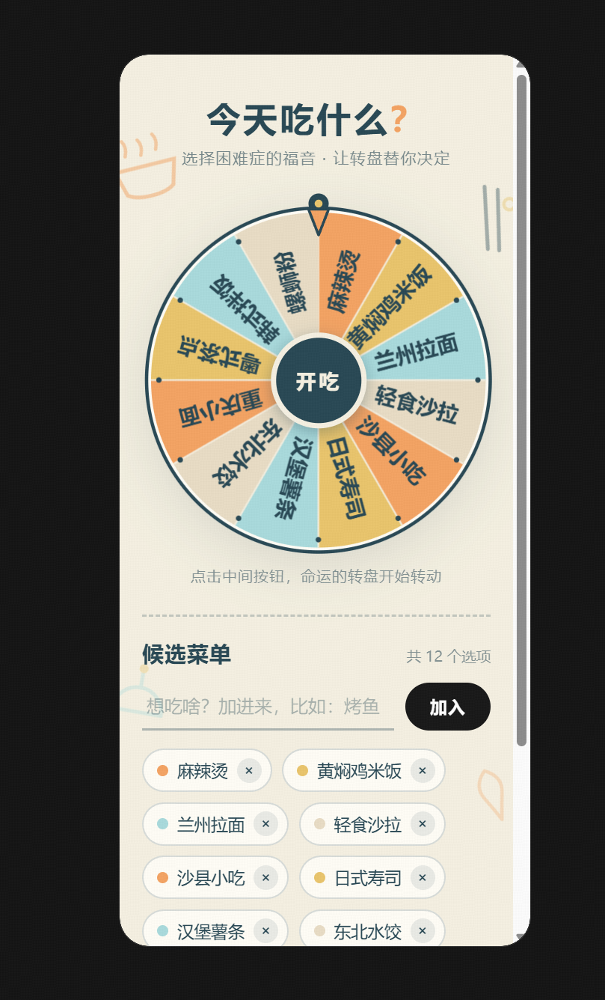

# 今天吃什么首版产品需求草案

- 项目：eating-everyday（今天吃什么）
- 成果 ID：A-001
- 关联任务：[T-001](../TASKS.md#t-001产品需求首轮澄清)、[T-003](../TASKS.md#t-003整理首版需求与架构师交接)、[T-006](../TASKS.md#t-006写回用户确认的七项规则)、[T-007](../TASKS.md#t-007调整为全手动候选需求)、[T-020](../TASKS.md#t-020更新内置默认菜单需求与验收)；本次启动恢复变更见 [T-032](../TASKS.md#t-032明确启动恢复上次菜单的需求与验收)。
- 负责人：product-manager
- 版本：0.11
- 更新日期：2026-11-03（Asia/Shanghai）
- 状态：draft
- 适用范围：个人用餐决策的微信小程序需求；启动恢复上次使用的已保存菜单，全新首次加载默认菜单，兼容旧版无选择记忆的存量菜单；供本轮设计、研发和独立测试使用。
- 来源及输入版本：A-001 v0.10、A-007 v0.4，以及用户 2026-11-03 确认的 [D-024](../DECISIONS.md#d-024启动时恢复上次使用的菜单) 和 T-032；保留 [D-019](../DECISIONS.md#d-019内置默认菜单并首次自动加载) 的一次性初始化及数据保护、D-005/D-011/D-014/[D-016](../DECISIONS.md#d-016首版改为全手动候选并移除定位搜索) 未变规则和用户[转盘截图](references/meal-wheel-reference.png)。原技术输入为 [A-006 v0.6](system-architecture.md) 第10节；新选择记忆/恢复契约由 T-033 补齐。只读产品输入基线为 3800e6dd8bc32b7d767bfc873a4b9ae57d10232b 的启动协调器及原页面测试文本，未执行测试或检查用户实际存储。D-018 不创建 GitHub Release 页面，既有标签按 D-020 至 D-023 的实际版本保持，本轮不改标签。
- 存储位置：OPC projects/eating-everyday/artifacts/product-requirements.md；截图为本成果的参考输入。
- 批准依据：D-024 确认启动恢复上次使用的已保存菜单，局部替代旧版再次启动须手动加载的行为；D-019 一次性初始化、不覆盖菜单内容及删除不重建继续有效。其余规则及职责按原决定保留，具体需求确认不代表整份成果批准或本轮实现/测试通过，文档仍为 draft。
- 交接定位：本版与 A-007 v0.5 由 T-032 的本地提交共同定位，正文指纹记录在 T-032；T-020 及 [H-005](../HANDOFFS.md#h-005按全手动候选需求同步架构) 中的旧版指纹及历史交接保持原记录。

## 产品目标

先服务用户本人每天到饭点不知道吃什么的场景。首次打开时可以直接用内置默认菜单抽取，后续启动直接恢复上次使用的已保存菜单；用户可自行输入、删除想吃的候选名称，由转盘随机选出一个，并管理多份本机菜单。

核心闭环是“首次加载默认菜单或手动准备候选 → 转盘抽取 → 保存完整菜单 → 再次加载和抽取”。小程序不获取定位信息，不提供附近餐厅搜索，也不根据位置、距离或第三方餐厅数据生成候选。仅在能够确认全新本机状态时，一次性建立并自动加载内置默认菜单；已有菜单、已使用后的空菜单库及异常读取不能被当作首次使用而重置。

再次启动恢复现存菜单的最新已保存内容，不重建原始 8 项，也不自动保存未保存编辑。菜单列表有默认菜单但旧版未记住选择时，按本版兼容规则直接加载该现有菜单，让转盘可用；无需用户先手动选择一次才能获得升级行为。

## 首版范围与变更

本版共有 **13 项有效需求、13 条有效操作规则、40 项有效验收条件**。保留旧编号及撤销表，不复用编号；本次新增 R-18、P-15、AC-43 至 AC-50，修订 AC-07/AC-39/AC-40 的启动选择语义，其余 29 项验收保持。旧 12/12/32 及初始化功能的专业结论按其版本和范围保留。

本版包含首次默认菜单、名称输入与删除、最多 24 项候选、等概率转盘、多份命名菜单、本机保存和原样加载，以及菜单管理和必要异常处理。视觉沿用用户截图方向。候选来自本次固定内置菜单、用户输入或其已保存菜单，不要求名称必须对应地图上的真实门店。默认菜单只提供初始内容，后续与其他本机菜单遵守相同的编辑和保存规则。

D-019 的固定默认菜单及一次性初始化继续有效；D-024 新增再次启动选择恢复。当前产品 main/v1.1.0 基线 3800e6dd8bc32b7d767bfc873a4b9ae57d10232b 包含旧默认菜单功能，尚不含本次启动恢复；按旧契约再次启动不自动加载的实现和测试保持原适用结论，不改写为测试失败。历史测试和已发布标签不作为本轮新功能证据。

按 D-016，定位权限与位置获取、1/3/5 公里或任何距离限制、附近搜索、地图餐厅自动加入及更新、用餐类别筛选、距离排序和地图最多 12 家规则全部移出本版。餐厅数据源选型、免费额度与保存授权核实、林萃桥覆盖验证、成功样本/分页规则、跨来源同名处理和来源标注也不再是本版待办。

长期免费仍是使用偏好，但本版无需餐厅数据接口；不据此承诺小程序注册、运行和发布的全部成本永远为零，也不授权开通付费服务。微信小程序平台、本机存储、字符计数及实际运行能力由架构师按新范围验证，系统边界、数据结构和实现方式仍由其设计。

首版不要求跨设备同步、换机找回或清除本机数据后恢复。抽中结果仅显示候选名称，不要求地址、距离、评分、人均或导航。

## 已确认需求

| 编号 | 需求与使用规则 | 确认依据 |
|---|---|---|
| R-01 | 产品形态为微信小程序，先服务用户本人每天饭点的选餐场景。 | D-016 重申原产品形态 |
| R-03 | 从当前候选中随机抽取一个；所有候选等概率，每次独立，允许再次抽取和重复结果。 | D-016 重申原转盘规则 |
| R-04 | 用户只填名称即可手动添加，无需地址、位置、类别等信息；同一份当前候选中去首尾空白后同名的不重复加入。首次内置候选见 R-17，后续用户输入规则不变。 | D-016、D-019 |
| R-05 | 抽中结果仅显示候选名称。 | D-005、D-016 |
| R-06 | 保存当前整份非空候选为菜单，下次可以直接加载；0 项不能新建或覆盖菜单。 | D-014、D-016 |
| R-07 | 支持多份菜单的命名、重命名、切换、加载和删除；菜单名去首尾空白后为 1～20 个可见字符，不允许不同菜单重名。不另设菜单份数业务上限，实际空间不足时保留旧菜单。 | D-014、D-016 |
| R-08 | 加载时原样恢复所选菜单保存时的完整候选；仅加载、抽取或小程序重新进入不自动修改该菜单。 | D-016 重申原样加载 |
| R-10 | 菜单只保存在当前手机，正常关闭后下次仍可加载；不要求换机找回、跨设备同步或清除本机数据后恢复。 | D-005、D-016 |
| R-11 | 视觉样式参考用户提供的转盘截图。 | D-016 重申截图方向、D-011 |
| R-14 | 当前候选及每份保存菜单最多 24 项；达到 24 项后添加新项需先删除已有项，不挤掉旧候选。全部 24 项均可由用户输入，不设 12 项限制。 | D-016 重申总上限 |
| R-16 | 不获取定位信息、不请求定位授权，不提供距离选择或附近搜索，不自动查询或更新餐厅数据；除 R-17 的固定内置菜单外不自动补充候选。核心使用不依赖定位、地图账号或餐厅查询服务，在平台能够打开小程序的前提下，断网仍可初始化默认菜单、输入、抽取和使用本机菜单。 | D-016、D-019 |
| R-17 | 确认全新本机状态后，一次性建立并自动加载名为“默认菜单”（暂名）的 8 项菜单，名称及顺序见下节；已有本机菜单（含同名）不覆盖、不合并、不追加默认记录。再次启动及后续用户编辑、重命名或删除不触发强制重建或重置；读写异常时保护已有数据并如实提示。 | D-019；T-020 |
| R-18 | 启动时按稳定菜单身份恢复上次成功使用的现存菜单及其最新已保存内容，可直接抽取；全新首次继续 R-17。无选择记忆或上次菜单已删除时，按下节有界顺序选择已有菜单；已有空库保持空。成功加载/保存后记住当前菜单，改名不丢关联，删除不复活，未保存编辑不承诺跨启动留存。菜单内容与选择记忆的读取/写入失败及结果不明须如实提示、保护旧数据。 | D-024；T-032 |

### 已撤销需求编号

| 原编号 | 撤销内容 | 本版处理 |
|---|---|---|
| R-02 | 当前定位、1/3/5 公里直线半径及边界 | D-016 取消；由 R-16 明确无需定位和距离功能。 |
| R-09 | 重新搜索替换地图项、失败保留混合候选 | 搜索和地图项退出本版，不再设计搜索成功/失败分支。 |
| R-12 | 自动餐厅品类筛选 | 不按门店类别筛选用户输入的名称。 |
| R-13 | 样本去重、距离排序、地图最多 12 家和完整性提示 | 餐厅接口取数退出；保留 R-14 的全部候选 24 项上限。 |
| R-15 | 餐厅接口的长期免费、优先验证开放数据及高德候选 | 不再需要餐厅数据接口或验证其费用、保存许可；不等于曾经验证通过。 |

## 候选与菜单的含义

当前候选是此刻参与抽取的一组名称，来自首次内置菜单、用户手动输入或其已保存菜单。用户只提供名称，产品不要求补充地址、位置、门店标识或来源资料，也不区分地图项和手动项。

已保存菜单是用户命名并保存的一份完整候选。加载后原样恢复名称和候选顺序；修改当前候选不会自动覆盖已保存菜单，必须明确保存。抽取仅产生结果，不修改候选。

同一份候选内，名称去首尾空白后逐字相同的重复输入被拒绝并提示，不利用同名项增加概率；不同菜单可以包含相同的候选名称。旧“手动项与地图项同名可分别保留”的例外已退出本版。

## 默认菜单与首次使用

菜单暂名“默认菜单”，沿用 D-019 的默认命名，名称未由用户另行指定。初始内容严格按以下顺序，不替换名称、排序或补入其他条目：

| 顺序 | 候选名称 |
|---|---|
| 1 | 肯德基 |
| 2 | 麦当劳 |
| 3 | 西域美食 |
| 4 | 醉面 |
| 5 | 吉野家 |
| 6 | 阿香米线 |
| 7 | 喜家德 |
| 8 | 麻辣烫 |

| 使用状态 | 可观察的产品行为 |
|---|---|
| 能够确认的全新本机状态 | 无需用户先输入或点击加载，成功初始化后当前候选即为上列 8 项；本机菜单列表可找到唯一一份“默认菜单”，可直接抽取并按普通菜单保存、加载及管理。初始化成功是后续可加载的前提，不只显示一份未留存的演示列表。 |
| 已有一份或多份菜单，包含用户自己命名的“默认菜单” | 不建立另一份默认记录，不覆盖、重命名、合并或增删旧菜单内容；按 R-18 选择并加载现有保存快照，允许留存选择记忆。用户同名菜单仍保留其原内容，不能用原始 8 项替换。 |
| 已初始化后重复启动，或用户删光候选/删除最后一份菜单 | 不重复建立默认菜单。启动按 R-18 恢复现存保存快照；删空候选但未保存时，重启可恢复原保存快照，这不属于重新播种。删除全部保存菜单后的已使用空库仍为空，不补回 8 项；不能单凭菜单数为 0 认定首次。 |
| 读取失败、数据损坏/格式未知、初始化写入失败或结果不明 | 不把读不到数据当作首次，不清库、不替换旧记录；提示实际失败或待核验状态，不宣称初始化成功。保留当前可用内容及已有编辑状态，安全恢复/重试后仍至多形成一份完整默认记录，不能留下可加载的半份菜单或复活用户已删除的记录。 |
| 用户主动清除全部本机数据后重新进入 | 不要求找回已清除的用户菜单；清除后若成为可确认的全新本机状态，按首次规则提供固定默认菜单。这不属于恢复旧菜单。仅通过菜单管理删除记录不等于清除全部本机数据。 |

首次自动建立/保存是 D-019 的一次性初始化例外。初始化后增删候选不自动覆盖保存记录，覆盖/另存仍需用户明确操作；默认菜单也可改名、删除，删除当前菜单继续保留未保存副本。每项按 1/8 独立等概率参与首次抽取，用户修改后按实际 N 项执行 P-02。无需为默认菜单新设不可删除、固定候选或自动复活规则。

首次识别、旧版有效空库和一次性初始化的原契约见 A-006 v0.6 第10节，原实现/测试结论按原版本保留；本轮启动选择恢复由 T-033 在其上补充。本需求规定行为与数据保护结果，不能证明可安全初始化或恢复时，保留旧数据、明确提示并先核验。

## 启动恢复与菜单选择记忆

“启动”指新建使用会话时的加载过程；同一页面从后台返回、关闭弹层、刷新菜单列表不重新恢复候选或丢弃未保存编辑。“上次使用”是最后成功加载并成为当前关联，或成功保存后成为当前关联的菜单身份，不是最后抽中的名称，也不根据菜单名或最后一次增删输入推断。启动读取该菜单现在的保存快照，候选名称及顺序完整恢复，菜单名显示现名，工作副本与保存基线一致且无未保存标记，可直接抽取；加载不改写菜单内容。

### 启动选择及兼容降级顺序

下表仅在菜单库与选择状态可可靠判断时应用。步骤按顺序匹配，选择到一份即可停止；兼容降级是本次 D-024 范围内的既有菜单选择，不新增菜单、不猜测旧版实际使用历史。

| 顺序/状态 | 选择与可观察结果 |
|---|---|
| 可确认全新本机状态 | 按 R-17 一次性建立并加载默认菜单，并记住该菜单；失败继续既有保护和核验规则。 |
| 有有效选择记忆，所指菜单仍存在且可读取 | 优先加载该身份当前的保存内容，即使菜单已改名、内容已修改或另有“默认菜单”。不得回放旧快照或原始 8 项。 |
| 选择记录明确缺失，或所指身份确认已不存在 | 优先加载可识别且仍存在的内置默认菜单（包括已改名的那一份）；无可识别内置身份时，使用名称去首尾空白后逐字等于“默认菜单”的现存菜单，保留其真实用户内容。无需先手动选择，覆盖旧版默认菜单已保存但启动空转盘的升级场景。 |
| 上述默认菜单不存在，但有其他完整有效菜单 | 加载当前菜单列表既有显示顺序中的第一份，不额外重排或新建；正常成功后记住此次选择，后续优先恢复它。加载时可显示正常菜单名；不能把兼容选择宣称为已知的旧版“上次使用”。 |
| 已使用过的合法空库 | 保持空候选并引导输入，不播种、不复活已删除菜单；清理失效选择记忆本身不得删除或创建任何菜单。 |
| 菜单或选择读取报错、损坏、未知格式或结果不明 | 不冒充“记录缺失”或“全新”，不静默跳过损坏记录而改选/覆盖另一份；保留原字节，提示失败并允许安全核验/重试。菜单库已可完整可靠读取、仅选择记忆不可用时，可由用户手动明确选择菜单继续，但不得假称本次自动恢复或选择留存成功。 |

存量菜单无需通过重新初始化或重新保存才能被恢复；已有一份同名用户菜单时也只加载其现存内容，不转成内置模板。已记忆身份被删除后，新建的同名菜单不能按旧身份认作原菜单，只能按上述兼容顺序作为现存记录选择。仅全部本机数据被主动清除且重新满足全新条件时，才按 R-17 建立初始菜单。

### 哪些成功操作更新选择

| 操作结果 | 选择记忆及后续启动 |
|---|---|
| 启动自动恢复、兼容加载或用户手动加载成功 | 当前菜单已完整加载后记住其身份；不能在点击目标、尚未读完时就记为已切换。 |
| 新建/另存/覆盖成功并关联当前菜单 | 记住保存后当前关联的菜单。另存为 N 后恢复 N；覆盖 M 后恢复 M 的最新保存内容。只抽取、输入或删候选不另改选择，也不自动保存。 |
| 有未保存改动时切换 | 取消或目标加载失败不记目标；放弃并成功加载 B 才记 B。保存 A 后切 B，只有 A 保存确认且 B 加载成功才记 B；A 保存成功而 B 读取失败时保留 A 的已保存事实与当前副本，选择仍以 A 为准。空保存或保存失败阻止切换，旧选择不变。 |
| 重命名 | 当前菜单身份不变，启动显示新名及原保存内容；改名另一份菜单不把当前选择改到该菜单，也不能因名称匹配把用户菜单当成旧身份。 |
| 删除 | 成功删除被记忆的菜单后该身份失效；删除当前菜单仍只删保存记录并保留本次未保存副本，不把副本自动另存。下次按兼容顺序加载其他现存菜单或空库；删除非当前且非记忆目标不改变选择。取消/明确失败不作成功删除处理。 |

选择记忆是独立于菜单内容的状态：正常成功路径应留存选择，不能只在当前页面显示已切换而未做持久留存。若菜单已经加载/保存成功，但选择记忆明确写入失败，保留当前可用菜单和已保存内容，分别如实反馈“本次菜单已加载/保存，启动选择未能记住，请重试”；不回滚已确认保存，不重复保存菜单补记选择，也不保证下次恢复这次未记住的目标。下次使用最后一次可确认的有效记忆，明确缺失/失效再走兼容顺序。

菜单保存或选择记忆的提交结果不明时，先安全核验实际结果，再继续可能覆盖存储或改变恢复目标的操作；不报完整成功、不盲目重试、清库或替换选择。重试只补齐仍适用于当前操作的选择，用户之后已切到其他菜单、编辑或删除时，迟到结果不得覆盖新工作副本、把选择倒退到旧目标或复活记录。具体一致性、存储格式和生命周期控制由 T-033 设计，需求不指定存储 key、算法或实现位置。

未保存改动仍不承诺跨启动留存：关联 M 后只改工作副本或删空候选而未成功保存，重新启动恢复 M 原保存内容；未保存的新副本不自动另存。正常在同一页面切后台再返回保留当前工作态，不以本次恢复功能替用户放弃编辑。

## 核心使用流程

### 准备并抽取

1. 全新首次按 R-17 建立并加载默认菜单；再次启动按 R-18 恢复上次菜单的保存内容，旧版无选择记录按有界顺序加载现有默认菜单或其他现存菜单。合法空库保持空；用户仍可手动输入或切换菜单。
2. 用户填写名称并添加，按非空和同名规则校验；可继续添加至 24 项，也可删除不想参与抽取的项。
3. 点击转盘中心“开吃”，抽中结果只显示候选名称；可继续抽取，允许连续抽中同一项。
4. 当前候选非空时，可用合法且不重名的菜单名保存整份候选；保存失败不报成功、不丢失当前编辑状态和旧菜单。

整个流程没有定位申请、距离选择、附近搜索或餐厅数据查询。固定内置默认菜单无需联网获取；用户在平台能够打开小程序的前提下，可在断网时初始化并继续使用上述流程与本机菜单。

### 使用已保存的菜单

1. 选择一份已命名菜单；当前有未保存改动时，先选择保存并切换、放弃改动并切换，或取消切换。
2. 加载后恢复该菜单保存时的完整候选，可直接抽取，也可手动增删。
3. 修改后的候选由用户明确选择覆盖当前菜单或另存为新菜单；加载和抽取均不自动改写保存记录。

### 管理和保存菜单

菜单名去首尾空白后为 1～20 个用户可见字符；去空白后逐字相同的不同菜单名视为重名。新建或重命名重名时提示换名，不自动覆盖；重命名为自身原名不算重复，明确覆盖当前菜单也不算新增重名。20 字符上限仅约束菜单名，不约束候选名称。

0 项不能新建或覆盖菜单，但可以删除当前最后一个候选。保存被阻止时保留当前编辑状态和旧保存记录。“保存并切换”只有保存成功才继续，空候选或空间不足时不能报成功或继续切换。不设固定菜单份数上限，实际空间不足时不得自动淘汰旧菜单。

删除当前菜单前说明仅删除保存记录；确认后保留当前完整候选为未保存副本，并解除与已删除记录的关联，不自动另存。取消时保存记录和当前编辑状态均不变。后续保存需另存，不会复活已删除记录。保存前退出不要求保留该未保存副本供下次加载。

删除或重命名某份菜单不改变其他菜单。正常关闭后再次进入，可找到并加载本机已保存菜单；用户清除本机数据后不要求恢复。

## 视觉参考

沿用奶油色纸纹背景、深蓝绿色文字和轮廓，以及橙色、黄色、浅蓝色和米色相间的转盘。主区域突出顶部指针、大转盘及中心“开吃”按钮，下方提供名称输入、添加、候选标签与删除、菜单保存和切换入口。

界面移除定位状态、定位授权、距离选择、附近搜索、来源标签和搜索完整性提示。24 项及长名称场景仍须可读、可操作；首次默认菜单成功加载后显示 8 项，用户操作产生的空候选状态继续引导输入，不自动补回默认内容或其他示例。

[A-004 v0.1](interface-plan.md) 及其 HTML 仅作为历史视觉参考；其中搜索和模拟餐厅不属于本版功能，不是微信小程序实现。后续页面与系统设计由 architect 依据本版更新，产品经理不改写架构原稿。

## 已确认操作规则

保留原编号，P-01（距离）和 P-08（地图筛选及最多 12 家）按 D-016 撤销；以下 13 条为本版有效规则，P-15 为本次新增，P-14 的不重复初始化约束继续有效。

| 编号 | 操作规则 | 对应验收 |
|---|---|---|
| P-02 | 每次对 N 个当前候选独立等概率抽取，每项概率 1/N，允许重复结果；0 项提示先添加，1 项直接显示唯一名称。 | AC-04、AC-09、AC-10 |
| P-03 | 名称去首尾空白后不能为空；同一份候选不重复加入逐字同名项，拒绝时原候选不变。 | AC-03、AC-11、AC-12 |
| P-04 | 允许删除当前任一候选，包含最后一项；已保存菜单支持重命名和删除，删除当前菜单按 P-13 处理。 | AC-13、AC-14、AC-29、AC-32 |
| P-05 | 增删当前候选或抽取不自动覆盖保存记录；保存时明确覆盖或另存，切换前处理未保存改动。 | AC-15、AC-16、AC-17、AC-35 |
| P-06 | 核心流程不要求定位权限、地图账号或餐厅查询；平台能打开小程序时，断网仍能输入、抽取、本机菜单保存/加载和管理。 | AC-18、AC-37 |
| P-07 | 正常关闭后保留本机已保存菜单；清除本机数据后不要求恢复。未明确保存的候选不承诺退出后保留。 | AC-07、AC-20 |
| P-09 | 当前候选及每份菜单上限 24 项，不设 12 项门槛；满额添加时提示先删除，不挤掉或覆盖已有项。 | AC-25、AC-30、AC-36 |
| P-10 | 菜单名去首尾空白后为 1～20 个可见字符；不同菜单重名时拒绝新建或重命名，自身原名和明确覆盖当前菜单除外。不自动截断或隐式覆盖。 | AC-27、AC-28 |
| P-11 | 0 项不能新建或覆盖菜单；保留当前编辑状态和旧记录，保存失败不能继续“保存并切换”。 | AC-29、AC-35 |
| P-12 | 不设固定菜单份数业务上限；实际空间不足时提示保存失败，保留当前内容、未保存状态和全部旧菜单，不自动删除旧项。 | AC-30、AC-31、AC-35 |
| P-13 | 确认删除当前菜单只删除保存记录，当前候选保留为未保存副本，不自动另存；取消全部不变，再次保存需另存，其他菜单不变。 | AC-32 |
| P-14 | 仅在确认全新状态时一次性建立并加载按原顺序排列的 8 项默认菜单；已有/同名菜单不变，后续启动、编辑、重命名、删候选或删全部菜单不重建。首次初始化是自动保存的唯一新增例外，之后继续 P-05/P-07/P-13；读取异常不判首次，初始化失败或结果不明时不报成功、不损失旧数据，恢复后不重复。 | AC-20、AC-37 至 AC-42 |
| P-15 | 每次启动优先恢复有效记忆所指菜单的最新保存快照；明确缺失/已删除时依次选现存内置默认身份、现存“默认菜单”、菜单列表首份，已使用空库保持空。成功加载及关联保存更新选择，取消/失败不误记目标，改名按身份保留、删除使旧身份失效；读取异常不当缺失，记忆写入失败单独提示且不丢已保存内容，结果不明先核验，迟到结果不倒退选择或覆盖编辑。 | AC-07、AC-39、AC-40、AC-43 至 AC-50 |

## 验收条件

以下 **40 项**用于后续微信小程序实现验收。编号有意不连续，撤销编号不复用；本次新增 AC-43 至 AC-50，修订 AC-07/AC-39/AC-40 的启动语义。旧测试按原版本有效，不把旧契约下的手动加载行为写成旧版测试失败，也不把旧 501 项通过当成本次启动恢复已经验证。文档自查不能代替实现及独立平台验证。

| 编号 | 操作与输入 | 应观察到的结果 | 对应需求 |
|---|---|---|---|
| AC-03 | 在空候选及已有候选时，只填写名称并添加。 | 无需地址、位置或其他资料；有效名称加入转盘并可抽取。 | R-04、P-03 |
| AC-04 | 对多个用户输入的候选发起抽取。 | 结果为其中一个名称，结果区域仅显示名称。 | R-03、R-05、P-02 |
| AC-05 | 将完整候选保存为 M，再将另一份候选保存为 N，来回切换。 | M、N 均按名称可找到，分别恢复各自完整名称和顺序。 | R-06、R-07、R-08 |
| AC-06 | 保存 M 后修改当前候选，明确放弃改动，再重新加载 M。 | 恢复 M 原保存内容，不自动生成、查询或替换候选。 | R-08、R-16、P-05 |
| AC-07 | 同一手机保存多份菜单，成功选择其中 M，正常关闭后重新进入。 | 当前直接恢复 M 的最新保存名称、完整候选及顺序，可直接抽取；其他菜单仍可找到并加载，不要求其他手机恢复。 | R-10、R-18、P-07、P-15 |
| AC-08 | 对照截图，用 12 项、24 项及含长名称的候选操作。 | 保留约定纸纹配色、大转盘和候选区域；名称可辨认，添加、删除、保存及切换入口可用，无定位、距离或搜索入口。 | R-11、R-14、R-16 |
| AC-09 | 对至少 2 个不同名称连续抽取，并核对概率依据。 | 每次每项概率 1/N，历史结果不改变下次概率，允许连续重复；不要求有限次数出现次数完全相同。 | R-03、P-02 |
| AC-10 | 分别准备 0 项和 1 项后抽取。 | 0 项提示先添加且不产生名称结果；1 项直接显示唯一名称。 | R-03、R-05、P-02 |
| AC-11 | 提交空名称、纯空白、带首尾空白的有效名称。 | 前两者拒绝；后者去首尾空白后加入，不要求补充其他字段。 | R-04、P-03 |
| AC-12 | 当前已有“面馆”，再输入“面馆”和“ 面馆 ”；在另一份不同名菜单中输入“面馆”。 | 同一份候选不重复加入，原候选和保存记录不变；不同菜单可包含同一候选名称。 | R-04、P-03、P-05 |
| AC-13 | 删除当前一个候选。 | 该项不再参与抽取，其他候选保留，保存前不改写旧菜单。 | P-04、P-05 |
| AC-14 | 重命名 M，再确认删除 M。 | 名称按操作更新，删除后不可再加载；其他菜单不变。 | R-07、P-04 |
| AC-15 | 加载 M 后增删候选和抽取，期间不保存。 | 当前候选按增删变化，M 原保存记录不变；仅抽取不改候选。 | R-08、P-05 |
| AC-16 | 修改 M 后明确覆盖保存，再修改并另存为 N。 | M 保存覆盖后的完整内容；新增 N，保留 M 的已保存内容。 | R-06、R-07、P-05 |
| AC-17 | 有未保存改动时切换，分别选择保存、放弃、取消。 | 保存成功后切换并可恢复修改后的原菜单；放弃后切换且旧记录不变；取消保留当前编辑状态。 | P-05 |
| AC-18 | 在平台能打开小程序的前提下关闭网络，进行输入、抽取、保存、加载、重命名和删除。 | 核心流程仍可用，不等待定位或餐厅接口，不强制开通地图账号；持久保存及失败分支按对应规则处理。 | R-16、R-10、P-06 |
| AC-20 | 在隔离环境清除全部本机数据后重新进入，并与只在菜单管理中删除全部菜单的情况比较。 | 不找回已清除的用户菜单或从其他设备恢复；可确认的全新状态只建立固定默认菜单。仅删除菜单后重进不自动补回，见 AC-40。 | R-10、R-17、P-07、P-14 |
| AC-25 | 已有 24 个不同名称，尝试加入第 25 项，再删除一项并添加。 | 满额时拒绝且提示先删除，原 24 项及保存记录不变；删后可加入，总数仍不超过 24。 | R-14、P-09、P-05 |
| AC-27 | 新建或重命名，输入空白、带首尾空白的合法名、20/21 个可见字符。 | 去首尾空白后仅 1～20 字符可用；空白或超长提示失败，不截断或改写旧记录；不把该上限用于候选名称。 | R-07、P-10 |
| AC-28 | 已有“午餐”，新建或把另一菜单改为“ 午餐 ”，再以自身原名重命名及明确覆盖。 | 不同菜单重名被拒绝；自身原名不算重复，明确覆盖允许；无隐式覆盖或新增同名记录。 | R-07、P-10、P-05 |
| AC-29 | 空候选新建；另加载非空 M 后删光候选并尝试覆盖。 | 两次保存均拒绝并提示先添加；当前编辑态保留，M 原记录不变；删除最后一项本身允许。 | R-06、P-11、P-04 |
| AC-30 | 已有 20 份菜单且空间足够，以合法不同名保存第 21 份非空菜单。 | 可新增，不因固定业务份数上限拒绝；每份仍最多 24 项，其他菜单不变。 | R-07、R-14、P-12 |
| AC-31 | 有未保存修改时，分别模拟新建或覆盖保存空间不足。 | 明确提示失败，不报成功或清除未保存状态；当前内容及全部旧记录不变，不自动删旧菜单。 | R-07、R-10、P-12、P-05 |
| AC-32 | 对当前菜单在有/无未保存改动时取消或确认删除，包含最后一份菜单及随后另存。 | 取消时全部不变；确认后目标不可加载，当前完整候选留为未保存副本；再次保存创建新记录，其他菜单不变。 | P-13、P-04、P-05 |
| AC-35 | 当前空候选时选“保存并切换”；另模拟非空保存空间不足。 | 均不报成功或加载目标菜单，当前编辑态及旧记录不变；仍可取消或明确放弃后切换。 | P-05、P-11、P-12 |
| AC-36 | 手动依次输入 12、13、24 个不同名称，包括不对应具体地图门店的名称。 | 第 13 项与第 24 项均可加入，无 12 项限制，不按位置、门店分类或地图收录情况排除。 | R-04、R-14、P-09 |
| AC-37 | 在可确认全新、平台能打开的隔离环境首次进入，检查界面/权限/调用；在断网下完成初始化、输入、保存、切换及抽取。 | 自动加载 AC-38 的固定默认菜单；没有定位授权、位置获取、距离/附近搜索入口或餐厅数据查询，后续仍可手动完成闭环，默认内容无需联网。 | R-16、R-17、R-01、P-06、P-14 |
| AC-38 | 可确认全新本机状态首次打开，不先输入或点击加载；核对当前候选与菜单列表，抽取后切走再加载该菜单。 | 唯一一份“默认菜单”（暂名）包含且仅包含按顺序排列的肯德基、麦当劳、西域美食、醉面、吉野家、阿香米线、喜家德、麻辣烫；8 项完整加载且可直接抽取，重载仍保留名称及顺序。每项按 P-02 的 1/8 参与，不另设权重。 | R-17、R-03、R-06、R-08、P-02、P-14 |
| AC-39 | 分别准备一份/多份旧菜单，以及内容不同且名为“默认菜单”的用户菜单，再首次打开新版本；前后比对菜单内容记录。 | 不新增内置默认记录，不覆盖、改名、合并或增删旧菜单内容；原名称、完整候选及顺序不变，旧同名菜单保持用户内容。启动选择按 R-18，允许单独留存选择记忆，不能要求旧用户先手动选择一次。 | R-17、R-18、R-07、R-08、P-14、P-15 |
| AC-40 | 初始化成功后反复启动；分别保存默认菜单的编辑、重命名、删除（含最后一份），以及仅删空当前候选但未保存后退出再开。 | 不重复建菜单或重置原始 8 项；恢复现存菜单的最新保存快照，已删除记录不复活，全部菜单删除后的合法空库仍为空。仅删空未保存时可恢复原保存内容，不自动保存空副本；删除当前菜单仍保留本次未保存副本。0/1/24/25 和空保存等原规则继续有效。 | R-17、R-18、R-04、R-07、R-14、P-05、P-07、P-11、P-13、P-14、P-15 |
| AC-41 | 分别模拟旧存储读取失败、损坏/未知格式，以及全新初始化时的空间不足或明确写入失败；保留前后数据与当前编辑态证据。 | 读取异常不当成首次、不自动清空或写入默认菜单；写入失败不报初始化/保存成功，不损失旧记录或已有编辑态，不提供可加载的半份默认菜单。提示与实际失败一致。 | R-17、R-08、R-10、P-12、P-14 |
| AC-42 | 模拟初始化中断或保存结果不明，再按技术契约安全核验/重试并多次启动；覆盖成功已落盘但成功反馈丢失，以及已有用户修改/删除的情况。 | 状态未核验时不盲目重复写入或报成功；确认安全后至多保留一份完整默认记录。恢复和重复启动不覆盖已有内容、不产生重复菜单或部分列表、不复活用户删除结果；已完成初始化不再强制加载原始 8 项。 | R-17、R-08、P-05、P-13、P-14 |
| AC-43 | 成功使用 M 后关闭重启；覆盖 M 的候选后再重启，另存其他菜单但最终使用 M，包含原默认菜单已保存修改的情况。 | 优先恢复 M 当前保存的完整名称/顺序及现名，关联与基线一致、无未保存标记，可直接抽取；不按菜单名猜测、不加载原始模板或历史快照，不改变其他记录。全新首次仍按 AC-38。 | R-18、R-08、R-03、P-15、P-02 |
| AC-44 | 准备旧版已保存默认菜单且无选择记录（包含内置身份可识别但已改名、仅有同名用户菜单且内容不同）；再测无默认菜单但有多份菜单、选择指向已删除身份及合法空库，启动后重复进入。 | 无需先手动选择：依 R-18 顺序直接加载现存默认菜单/列表首份并记住该身份；始终用其现存内容，不复制原 8 项、不新建或覆盖菜单。有效空库保持空。明确缺失/已删除才降级，不把读取错误当缺失，后续启动按已记住身份恢复。 | R-18、R-17、R-08、P-15、P-14 |
| AC-45 | 从已记忆 A 切 B，分别测直接成功、dirty 时保存/放弃/取消、空保存/明确保存失败、保存 A 成功但读取 B 失败；关闭重启比对。 | 成功加载 B 且选择留存成功才在下次恢复 B；取消或失败不记 B。A 已保存而 B 读取失败时保留 A 最新保存内容并恢复 A，空保存失败不切换；工作副本与已有保存失败保护继续有效。选择留存单独失败按 AC-50 提示。 | R-18、R-08、P-05、P-11、P-12、P-15 |
| AC-46 | 当前无关联时成功新建 M；从 M 成功另存 N、覆盖 N，重命名 N，再重命名另一份菜单；分别关闭重启并比对菜单身份。 | 新建/另存成功后恢复当前关联的 M/N，覆盖后用最新保存内容；当前菜单改名后按同一身份显示新名。改名其他菜单不改变选择，不按旧名称误选或改写同名记录。失败或未保存输入不记成新选择。 | R-18、R-07、R-08、P-05、P-10、P-15 |
| AC-47 | 删除当前/记忆目标、非目标、最后一份；分别取消、明确失败与确认成功；另建相同名称但不同身份的菜单，关闭重启。 | 取消/明确失败保留原选择；成功删除使旧身份失效，重启按有界顺序选其他现存菜单或保持空。已删除 ID 不复活，新同名记录不冒充旧身份。删除当前仍保留本次未保存副本且不另存，不清用户其他菜单。 | R-18、R-07、P-04、P-13、P-14、P-15 |
| AC-48 | 加载 M 后增删候选（含删空）、抽取但不保存，再关闭重启；另测未保存新副本，以及同一页面切后台后返回/刷新列表。 | 重启恢复最后已保存的选择快照，不恢复未保存编辑、不自动另存；同一页面后台返回/刷新不重新加载或丢当前编辑。未保存新副本不取代已有选择，抽取不改变概率或菜单内容。 | R-18、R-08、P-02、P-05、P-07、P-15 |
| AC-49 | 分别模拟菜单库、选择记忆或目标内容读取失败、损坏/未知格式，与明确无选择记录/目标已删除对照；安全重试后再次启动。 | 异常提示真实失败，不冒充缺失、全新或恢复成功，不清库/新建/覆盖数据或静默跳过坏记录改选。仅选择记忆不可用但菜单库已完整可靠读取时，允许用户手动选择；核验恢复后按实际现存内容加载，原用户数据保留。 | R-18、R-17、R-08、P-12、P-14、P-15 |
| AC-50 | 在加载/兼容恢复、保存后和切换时分别注入选择记忆明确写失败或提交结果不明；核验/重试，覆盖“已写入但反馈丢失”、随后切换/编辑/删除及页面退出的迟到结果。 | 明确写失败时保留已加载副本和已确认保存内容，单独提示选择未记住，不回滚/重复保存；下次仅用可确认的记忆或有界降级，不承诺恢复未记住目标。结果不明先核验，不盲写或报完整成功；重试不重复建菜单、不倒退到旧选择、不覆盖新编辑或复活已删记录，迟到回调不更新失效页面。 | R-18、R-08、P-05、P-13、P-15 |

### 已撤销验收编号

| 原编号 | 原验收主题 | 撤销依据 |
|---|---|---|
| AC-01、AC-21 | 距离选项及直线半径边界 | D-016 移除全部定位和距离功能。 |
| AC-02、AC-19 | 地图搜索替换、网络/分页或零结果处理 | 无餐厅搜索，不再验证地图列表更新。 |
| AC-22、AC-23、AC-24、AC-26 | 门店分类、地图最多 12 家、混合容量及少量结果 | 全手动输入；24 项边界以 AC-25、AC-36 验证。 |
| AC-33 | 地图与手动同名保留和合计概率 | 无混合来源；同名手动输入拒绝，见 AC-12。 |
| AC-34 | 成功受限样本与分页失败区分 | 无餐厅接口样本，旧主题不再适用。 |

### 需求与验收追溯

| 有效需求 | 验收依据 |
|---|---|
| R-01 | 全部功能在微信小程序个人选餐场景验收；AC-37。 |
| R-03 | AC-04、AC-09、AC-10。 |
| R-04 | AC-03、AC-11、AC-12、AC-36。 |
| R-05 | AC-04、AC-10。 |
| R-06 | AC-05、AC-16、AC-29。 |
| R-07 | AC-05、AC-14、AC-16、AC-17、AC-27 至 AC-32、AC-35。 |
| R-08 | AC-05、AC-06、AC-15。 |
| R-10 | AC-07、AC-18、AC-20、AC-31。 |
| R-11 | AC-08，结合截图。 |
| R-14 | AC-08、AC-25、AC-30、AC-36。 |
| R-16 | AC-06、AC-08、AC-18、AC-36、AC-37。 |
| R-17 | AC-20、AC-37、AC-38 至 AC-42；结合 AC-16/AC-27/AC-28/AC-32 的普通菜单管理及 AC-25 容量回归。 |
| R-18 | AC-07、AC-39、AC-40、AC-43 至 AC-50；结合 AC-17/AC-31/AC-32/AC-35 的切换、保存失败及删除回归。 |

## 待定事项与历史验证清单处理

| 原编号 | 本版状态 | 后续处理 |
|---|---|---|
| TBD-01 | 已撤销：距离口径 | 不再获取位置或计算距离。 |
| TBD-02 | 部分撤销：地图筛选、排序、12 家及手动优先混合规则退出 | 保留全部候选最多 24 项，见 R-14、P-09。 |
| TBD-03 | 已撤销：餐厅数据源、免费额度、项目用途和保存许可验证 | 不选定数据源，也不记为已获许可或验证通过。 |
| TBD-04 | 已撤销：林萃桥真实覆盖与成功样本验证 | 不再要求取得餐厅数量或名单；此前失败和未验证结果仅作历史。 |
| TBD-05 | 业务规则已确认，原平台验证按专业版本保留 | 菜单管理与一次性初始化规则不变；原技术输入为 A-006 v0.6，启动选择/升级/失败一致性由 T-033 至 T-035 补齐。旧专业结论按原版本适用，不重开或改写旧任务。 |
| TBD-06 | 已撤销：跨来源同名 | 无地图项；全部手动候选按 P-03 去重。 |
| V-01 至 V-04 | 退出本版验证清单 | 旧餐厅费用、许可、覆盖和搜索验证不再是交付前置；保留历史报告，不将撤销写为通过。 |

当前没有需要用户重复确认的业务选择。缺失/失效选择的兼容降级已在 D-024 授权范围内明确；T-033 需给出选择状态与菜单操作的一致性、存量兼容及异常核验契约，T-034/T-035 提供实现与独立证据。小程序账号及正式发布仍按项目边界处理，本轮不创建 GitHub Release 页面或执行微信上传发布。

## 交接与后续职责

本轮 T-032 交付 A-001 v0.11、A-007 v0.5、D-024 和 13/13/40 追溯。project-manager 核对并确认本成员停止后，依次协调 T-033 选择记忆/恢复技术契约、T-034 实现与开发自测、T-035 独立验证及 T-036 整合；各阶段引用精确输入版本，旧 501/501 及原手机反馈不作为新功能证据。T-033 必须覆盖现有默认菜单无选择记忆的升级路径、改名/删除/有效空库、菜单与记忆写入的部分成功/结果不明和迟到结果保护。

历史 [H-005](../HANDOFFS.md#h-005按全手动候选需求同步架构)/[H-006](../HANDOFFS.md#h-006同步全手动首版范围与任务安排) 分别承载 A-001 v0.9 的架构和摘要同步，尚未关闭，不因本次修订自动关闭或改写；H-002/H-004 的取消和 T-002 的已完成事实保留。D-019 只替代首次空列表/不预填约定，旧餐厅取数、许可及覆盖验证不恢复。

产品经理维护需求和验收，技术设计仍由 architect 负责。当前 [WORKSPACE.yaml](../WORKSPACE.yaml) 为 git，锁定产品 main/v1.1.0 基线 3800e6dd8bc32b7d767bfc873a4b9ae57d10232b；本阶段产品只读，仅在 OPC feature/eating-everyday/t-032-startup-restore 更新本人需求、索引条目和 T-032，本地提交后停止。项目摘要与团队计划由原维护人同步，本阶段不改产品、WORKSPACE、既有标签或旧交接，不联系其他会话。

## 版本记录

| 日期 | 版本 | 变化 | 状态 |
|---|---|---|---|
| 2026-10-16 | 0.1 | 整理 D-001 至 D-005 已确认需求、核心流程、截图参考、验收场景及待确认的建议规则。 | draft |
| 2026-10-16 | 0.2 | 按 D-006 纳入全部默认规则，细化菜单与候选的关系、搜索及保存流程，补齐 20 项验收条件，保留 3 项待定事项。 | draft |
| 2026-10-16 | 0.3 | 按 D-007 确认直线距离、餐厅筛选与 12/24 项上限，新增 6 项验收条件，共 26 项；高德记录为优先候选，数据授权、费用及接入条件待核实。 | draft |
| 2026-10-16 | 0.4 | 按 D-008 补充免费接口或免费额度优先，细化免费条件、额度及超额处理的核实要求；高德仍为待核实候选，功能规则及 26 项验收条件沿用 v0.3。 | draft |
| 2026-10-16 | 0.5 | 纳入 A-002 v0.1 的高德公开资料核实：记录 5,000 次/月、1 年免费及个人用途条件，明确本机菜单保存许可缺口；保留已确认功能规则及 26 项验收条件。 | draft |
| 2026-10-16 | 0.6 | 按 D-009 明确长期免费为优先目标，限时赠送额度不视为满足长期目标；同步 A-002 v0.2，保留全部功能及 26 项验收条件。 | draft |
| 2026-10-19 | 0.7 | 按用户交接整理要求补齐首版范围与优先级说明、需求验收追溯、V-01 至 V-04 数据源验证结果要求、林萃桥覆盖状态、未约定交互边界及 D-011 职责分工；保留 15 项需求、9 条操作规则及原 26 项验收条件。 | draft |
| 2026-10-19 | 0.8 | 按 D-012 至 D-015 写回用户选择 1A、2B、3A 至 7A；细化成功样本排序和失败保留，增加菜单命名/空保存/容量/删除当前菜单及同名概率规则。现为 15 项需求、13 条操作规则、35 项验收；具体来源、许可及真实覆盖仍未闭环。 | draft |
| 2026-10-20 | 0.9 | 按 D-016 改为全部手动输入候选，移除定位、距离、附近搜索、餐厅数据源和林萃桥覆盖验证；保留转盘、24 项上限、多份菜单及本机留存。旧编号撤销不复用，新增 R-16、AC-36/AC-37；有效需求/规则/验收为 11/11/27。 | draft |
| 2026-11-02 | 0.10 | 按 D-019/T-020 新增一次性默认菜单，首次自动建立并加载 8 项，已有/同名菜单保护，后续编辑删除不重置；局部替代 v0.9 首次为空/不预填及清库相关语义，新增 R-17、P-14、AC-38 至 AC-42，修订 AC-20/AC-37，有效数量 12/12/32。旧编号、撤销表及原版本记录保留；实现/独立测试待 T-021 至 T-023。 | draft |
| 2026-11-03 | 0.11 | 按 D-024/T-032 新增启动恢复上次菜单，覆盖已有默认菜单无选择记忆的升级降级、成功加载/保存/切换、改名删除、空库与未保存编辑、读写失败/结果不明/迟到结果；新增 R-18/P-15、AC-43 至 AC-50，修订 AC-07/AC-39/AC-40，有效数量 13/13/40。一次性初始化、旧编号及全部历史保留，旧版按原契约通过不改写为失败，新契约/实现/独立测试待 T-033 至 T-035。 | draft |
