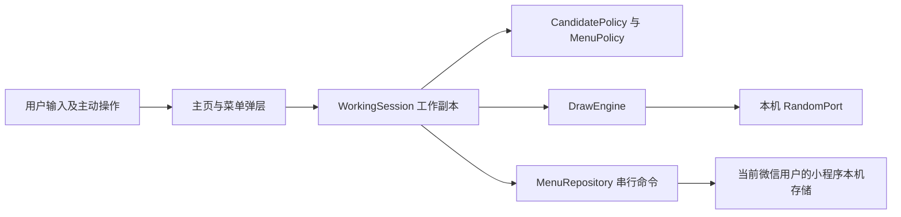
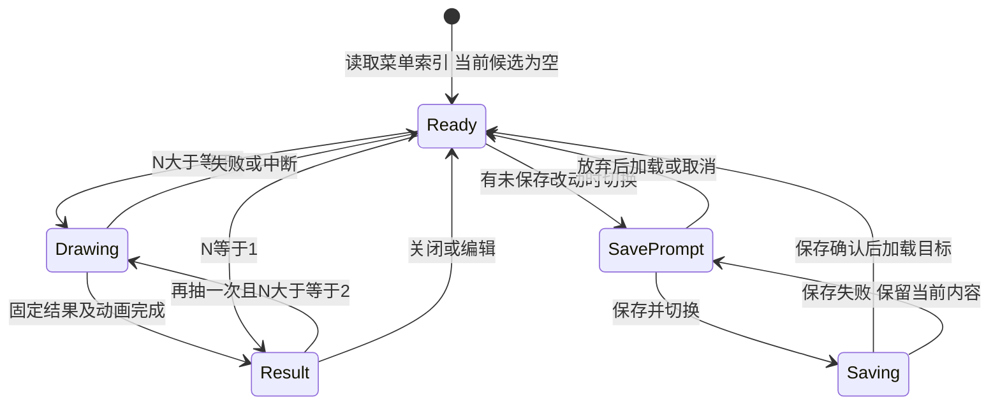

# 今天吃什么首版系统架构与交互设计

- 项目：eating-everyday（今天吃什么）
- 成果 ID：A-006
- 负责人：architect
- 关联任务：[T-002](../TASKS.md#t-002数据源可行性验证与首版界面方案)；变更交接 [H-005](../HANDOFFS.md#h-005按全手动候选需求同步架构)。
- 版本：0.3
- 更新日期：2026-10-20（Asia/Shanghai）
- 状态：draft
- 适用范围：全手动候选首版的系统、模型、接口、页面及验证设计；不是产品实现或真机验收。
- 来源及输入版本：[A-001 v0.9](product-requirements.md)、[A-007 v0.3](product-decision-options.md)、D-005、D-011、D-014、[D-016](../DECISIONS.md#d-016首版改为全手动候选并移除定位搜索)、T-007、H-005。实际接收位置为 feature/eating-everyday/t-002-architecture-design 的未提交工作树，基于 HEAD f838dab6506f5de0f598cba9991a9a065e50d3ef；不能把该提交当作新需求版本。
- 输入指纹：UTF-8、LF 归一化 SHA-256：A-001 为 b03a037cade0c90066ce18c9f72c222baf36f68250d09f114908687c611f731e；A-007 为 017838c96ee955b332fdb0ee46e43d8c08069247115e74a61c064a34ab08286c，已与 H-005 核对一致。
- 存储位置：OPC projects/eating-everyday/artifacts/system-architecture.md。
- 批准依据：D-016 确认范围变更，D-014 菜单规则继续有效；尚无整份架构批准。旧 v0.1/v0.2 的 15/9/26、15/13/35 设计通过 Git 历史保留，本版替代其现行设计。

## 1. 架构结论及边界

采用原生微信小程序，候选编辑、独立等概率抽取和菜单持久化均在当前设备完成。全部名称来自用户输入或其已保存菜单；首次进入从空候选开始。核心流程为“输入 → 抽取 → 明确保存 → 原样加载”，对应 11 项有效需求、11 条规则、27 项验收。

本版不包含定位、距离、附近搜索、餐厅数据入口、地图来源标识或许可策略，不设置餐厅查询网关，不发起餐厅数据请求。核心功能不需要用户注册产品账号、微信登录业务接口、地图开发者账号或云端菜单；小程序自身账号与 AppID 是后续平台测试/发布条件，详见 [A-008](accounts-access-checklist.md)。平台能够打开小程序后，核心流程不等待网络。

当前 WORKSPACE.yaml 为 none，仅形成治理性设计和验证计划。产品实现、依赖版本锁定、设备测试和发布须另有获授权成果物工作区及相应安排。官方文档支持拟用 API，不代表本项目已完成适配；不承诺平台注册、认证或发布永远免费。

## 2. 系统与模块



| 模块 | 职责及依赖 | 失败处理 |
|---|---|---|
| MainPage / Dialogs | 转盘、名称输入、完整候选列表、保存及菜单管理；派发命令，不直接改存储。 | 提示具体错误，保留输入、工作候选及旧菜单。结果区域仅名称。 |
| WorkingSession | 当前候选、加载菜单 ID、基线版本/内容、dirty、界面阶段和抽取代次。 | 迟到回调不覆盖当前状态；仅明确保存成功才替换保存基线。 |
| CandidatePolicy | trim、非空、同一列表逐字名称去重、24 项上限。 | 不查地图，不要求真实门店、地址或类别；拒绝时不改变已有项。 |
| MenuPolicy | 菜单名 1～20 可见字符、不同菜单名唯一、非空快照、覆盖/另存语义。 | 不截断、隐式覆盖或以固定菜单份数拒绝保存。 |
| MenuRepository / StoragePort | CRUD、不可变快照、容量检查、写入确认及格式验证。 | 不以删除旧菜单腾空间；失败保留编辑态和已提交版本，保存并切换停止。 |
| DrawEngine / RandomPort | 固定候选快照、均匀索引和动画结果分离。 | 熵源失败不出结果；不根据历史调整概率，不写回菜单。 |
| GraphemeSegmenter | 对菜单名称按固定 Unicode 扩展字素簇版本计数。 | 不依赖未经验证的运行时内建能力；分段不可用时不绕过菜单校验。 |

领域规则不依赖界面、网络和存储实现。StoragePort 与 RandomPort 便于后续故障注入；首版没有服务端部署单元或外部餐厅适配器。

## 3. 数据模型与不变量

| 对象 | 字段及含义 | 约束 |
|---|---|---|
| Candidate | candidateId、displayName。ID 为内部生成，用户只填名称。 | displayName 在添加时 trim 且非空；同列表逐字唯一，顺序稳定；0～24 项。 |
| MenuSnapshot | menuId、name、schemaVersion、revision、orderedCandidates、createdAt、updatedAt。 | name trim 后 1～20 个可见字符；不同 menuId 名称唯一；完整保存 1～24 项及顺序。 |
| WorkingSession | candidates、currentMenuId 可空、baselineRevision、baselineCandidates、dirty、phase、generation。 | 不持久化未保存副本或抽取结果。dirty 按有序名称内容与基线比较；内部 ID、动画和抽取不造成内容变更。 |
| DrawResult | drawId、generation、selectedCandidateId、displayName。 | 只属一次抽取；重新编辑候选或开始新抽取时清除旧结果。 |
| StoreRoot / StoredChunk | schemaVersion、storeRevision、索引/内容引用、校验值、最近提交信息。 | 存储格式校验、分块和版本恢复使用；不增加用户输入字段或菜单份数业务限制。 |

去重只在同一份当前候选中执行：trim 后字符串逐字相同则拒绝；不同菜单可包含相同候选。不做大小写、全半角、同音或模糊合并，不再有跨来源同名例外。菜单名唯一性与候选名称唯一性分别校验，重命名菜单排除自身 ID。

加载只校验保存格式和不变量，按保存顺序恢复，不重新 trim、分类、筛选或自动生成名称。异常快照中的空名、重复、超 24 项或未知格式不静默修复成另一份菜单；提示记录不可用并保留原存储。产品尚未实现，无现存 v0.2 数据需要执行迁移；旧设计字段移出本版不等于删除真实用户数据。

本版不保存位置、地址、门店来源/标识、许可、搜索状态、电话或历史抽取记录。菜单存储域按当前微信用户与小程序隔离；换微信用户不能被描述为同一存储域。正常关闭后可加载是目标，主动清除及平台清理后的找回不在承诺范围。

## 4. 输入与菜单接口

### 4.1 候选命令

| 命令 | 输入/成功结果 | 拒绝或异常 |
|---|---|---|
| addCandidate | 原始名称 → trim 后的名称及新 candidateId，追加末尾。 | 空白、同列表重名或已有 24 项时拒绝，原候选和旧菜单不变；不要求对应地图门店。 |
| removeCandidate | candidateId → 仅删除该当前项。 | 允许删除最后一项；不自动覆盖已保存菜单。未知 ID 不误删其他项。 |

名称没有 20 字符业务上限。官方 input 默认 maxlength=140，因此候选输入须显式取消该默认限制；菜单名称也先接收完整输入再按字素计数，不用控件 maxlength=20 冒充可见字符规则。[S-03](https://developers.weixin.qq.com/miniprogram/dev/component/input.html) 超长内容引起的平台资源/写入失败须明确反馈，不截断后假称原样保存；实际极端长度可用性待验证。

### 4.2 菜单仓储契约

所有菜单写操作通过同一串行队列执行，唯一性检查和 store revision 核对属于同一命令。每次操作固定 operationId、目标 ID 和 expectedRevision，重复提交不能创建两份菜单；重试先核对上次提交结果，不静默重放过期命令。

| 命令 | 成功语义 | 前置及失败语义 |
|---|---|---|
| listMenus | 返回 ID、名称、revision、候选数。 | 只读本机；读取失败不能被当作空库并覆盖原数据。 |
| loadMenu | 校验并完整恢复选定 ID 的名称和顺序，设定基线、dirty=false。 | 切换前处理未保存改动；读取失败保留原工作副本和当前关联。 |
| createMenu | 以新 ID 保存非空完整候选并关联新基线。 | 校验菜单名及唯一性、候选 1～24 项；不因第 21 份或其他固定份数拒绝。 |
| overwriteMenu | 用户明确覆盖指定 ID、版本成功后更新该记录与基线。 | 不能按重名推断目标；空候选、版本或空间失败保留全部旧记录与工作副本。 |
| renameMenu | 仅更改目标菜单名。 | 与新建相同的名称校验，排除自身 ID；自身原名无变化成功；不改候选内容和其他菜单。 |
| deleteMenu | 明确确认后仅删目标保存记录。 | 取消或写入失败全不变；若删当前菜单，保留当前完整候选，清 currentMenuId/基线，标未保存。再次保存须新 ID，不能复活已删关联。 |

菜单名使用 trim 后的原字符串比较，不自动标准化为另一名称。长度按 Unicode 扩展字素簇计数，采用 [UAX #29 修订 49](https://www.unicode.org/reports/tr29/tr29-49.html) 的固定分段口径；汉字、ASCII、组合字符与合法 ZWJ emoji 分别按规则验证。20 字符不约束候选名称。实现前锁定分段表/库版本及平台兼容性，不把文档建议当作已有可用实现。

切换时 dirty=true 提供保存并切换、放弃并切换、取消。保存并切换在命名、非空、写入和回读确认全部成功后才加载目标；任一步失败保持当前编辑态和菜单关联，不清 dirty、不加载目标。用户仍可另选取消或明确放弃。无关联的未保存副本须先另存命名。

删除当前菜单时，无论有无修改、是否最后一份，均保留当前候选为未保存副本；若候选已删空，继续保留 0 项并按空保存规则拒绝保存。退出前未保存不要求下次恢复。删除/重命名其他菜单不改变当前候选或其保存内容。

### 4.3 本机持久化与空间失败

官方文档支持本机键值读写，并说明同一微信用户、同一小程序的存储域上限；setStorage 给出普通存储单 key 1MB、总计 10MB，以及用户删除或系统空间清理的边界。[S-01](https://developers.weixin.qq.com/miniprogram/dev/framework/ability/storage.html)、[S-02](https://developers.weixin.qq.com/miniprogram/dev/api/storage/wx.setStorage.html) 这些是平台上限，不是本项目已测可用容量或永久留存保证。

采用不可变内容块与固定大小提交根的设计，避免把全部菜单打包到单个 key 而提前触及单 key 限制。序列化后按字节分块，初始建议每块不超过 128 KiB 的原始字节，再编码为存储值，核对含元信息后的实际长度；索引同样可分块。该数值是内部实现参数，不是候选长度或菜单份数业务上限。容量估算包括新块、索引、回退版本和元信息，实施时据实际计量校准。

写入流程：读取并校验当前根及 revision → 校验命令与容量 → 向新 key 写入候选副本/索引并回读校验 → 更新提交根并回读 → 才向界面报告成功和替换基线。新块全部确认前不替换可见根，不覆盖旧块，不先删除旧菜单腾空间。空间不足或准备阶段失败时，旧提交与当前编辑态保持不变；未提交块后续可清理，但不删除任何仍被有效根引用的内容。重命名、删除同样经此流程确认，不能仅改列表显示。

官方键值 API 没有在已读文档中承诺跨 key 事务或断电原子性；上述是待实现、待验证的恢复设计。提交根回调异常但回读为新版本时须按实际提交结果恢复，不能同时宣称保存失败且旧记录必然未变；无法判定时保留编辑态、阻止继续写入/切换，提示保存状态需核验。故障注入须分别验证准备阶段空间不足、根提交异常与进程中断，不能用准备阶段测试代替整个持久性保证。损坏/未知格式时不自动清空数据库，也不悄悄恢复为已确认删除前的列表。

getStorageInfo 可提供存储使用情况；仅作为预估，实际写入仍可能失败。[S-05](https://developers.weixin.qq.com/miniprogram/dev/api/storage/wx.getStorageInfo.html) 首版不主动启用加密存储或新建云服务；如后续增加此能力，需重新核对容量、依赖和需求。正常关闭再开、离线留存及失败恢复仍需同手机、同微信用户的真机证据。

## 5. 等概率抽取与状态控制

draw(candidateSnapshot, randomPort) 返回一次固定结果。0 项提示先输入且不产生结果，1 项直接显示唯一名称。N≥2 时，每次均从快照独立选择索引，不根据历史排除上次结果、调整权重或轮换。

RandomPort 拟用官方 wx.getRandomValues：文档标注基础库 2.15.0 起支持，返回指定字节数的随机内容。[S-04](https://developers.weixin.qq.com/miniprogram/dev/api/device/crypto/wx.getRandomValues.html) 每次取得 4 字节并按固定字节序解释成无符号 32 位整数 x，令 B=floor(2^32/N)×N；x<B 时返回 x mod N，否则重新取样。每个余数有相同数量的可接受输入，避免直接取模偏差。设置有限熵源重试预算，失败报错，不用动画角度或未经核对的替代算法产生结果。

初始平台适配下限据该 API 设为基础库 2.15.0，最终锁定版本及兼容设备在实施阶段验证。先选结果，再确定动画终点；动画帧数、时间和历史结果不影响选择。动画结束只提交一次 drawId；再次抽取必须新建 drawId。后台/页面销毁会使 generation 失效，迟到回调不能显示旧结果或改菜单。

候选增删、菜单切换及写入在抽取期间暂不可提交；菜单写入期间也串行化相互冲突的操作，界面保持内容可见并禁用重复动作。抽取中断恢复可操作状态，不自动保存。抽中结果区域仅完整名称，按钮为再抽一次、关闭，不增加地址、距离或来源说明。



状态图展示主要流程；N=0 保持 Ready 并提示，N=1 再抽仍直接返回唯一名称。加载目标失败不丢失切换前的工作副本。

| 错误类别 | 可恢复行为 |
|---|---|
| EMPTY_CANDIDATES / INVALID_CANDIDATE_NAME / DUPLICATE_CANDIDATE / CAPACITY_FULL | 提示先添加、检查名称或先删除；原候选和已保存记录不变。 |
| INVALID_MENU_NAME / DUPLICATE_MENU_NAME / EMPTY_MENU | 保留输入、编辑态及旧记录；不截断、不继续保存并切换。 |
| STORAGE_FULL / WRITE_FAILED / REVISION_CONFLICT | 不报已保存，不清 dirty，不自动删旧菜单；按实际提交结果判断可安全重试的命令。 |
| STORAGE_UNCERTAIN / STORAGE_CORRUPT / UNSUPPORTED_SCHEMA | 保留当前内容，停止可能覆盖原数据的操作并说明读取/保存状态；不当成空库。 |
| RANDOM_UNAVAILABLE / PLATFORM_UNSUPPORTED | 不产生抽取结果，恢复按钮；说明当前平台能力未满足。 |

## 6. 页面与交互

沿用截图中的奶油纸纹、深蓝绿色轮廓以及橙、黄、浅蓝、米色扇区，主区域为顶部指针、大转盘和中心“开吃”。A-004 及旧 HTML 保留为历史视觉参考，本版不继承其中搜索或演示候选。

```text
今天吃什么？
当前菜单 [未命名 / 菜单名]   [切换 / 管理]   未保存提示
                  指针
             大转盘 / 开吃
候选菜单                                  n / 24
[输入候选名称                            ] [加入]
01  完整候选名称，可换行                         [删除]
02  完整候选名称，可换行                         [删除]
[保存这份菜单]
```

| 场景 | 可检查的呈现及操作 |
|---|---|
| 首次进入 | 候选为 0，不自动加载或预填；保存菜单索引可见，提示输入或主动加载。没有定位、距离、搜索、来源或账号登录入口。 |
| 12/24 项与长名称 | 各项等角扇区；拥挤时以编号对应候选列表，短标签可辅助显示。完整列表始终展示完整名称并换行，编号一一对应；不把完整名称截断后仅留转盘标签。待真机检验窄屏、大字与键盘遮挡。 |
| 输入与删除 | 只填名称，成功追加并同步转盘；输入失败保留文本。删除只改当前候选，可删最后一项；达到 24 项提示先删除。 |
| 保存与切换 | 已加载菜单明确区分覆盖、另存；新副本先命名。dirty 切换提供三选项，失败停留；不通过点击另一个菜单隐式丢弃修改。 |
| 菜单管理 | 按菜单 ID 重命名/删除；明确确认删除。删除当前菜单说明候选仍在但未保存，成功后显示未保存副本。其他菜单保持可用。 |
| 抽取结果 | 名称完整可读，可再抽或关闭；只显示候选名称作为结果。 |

候选区域可滚动，删除入口有名称关联和辅助功能标签；输入框、错误和焦点处理须适配键盘。长名称完整性优先在列表和结果中保证，转盘的编号方案仍需 AC-08 的实际可辨认性验证，不把设计说明当作视觉通过。没有新增产品代码或模拟数据作为验收证据。

## 7. 有效需求和规则追溯

### 7.1 11 项有效需求

| 编号 | 设计落点 |
|---|---|
| R-01 | 原生小程序、个人选餐闭环；AppID/测试条件见 A-008。 |
| R-03 | 第 5 节固定快照、独立均匀索引、允许重复及 0/1 项。 |
| R-04 | Candidate 仅名称、trim 非空、同列表逐字去重，不查门店。 |
| R-05 | 结果区域仅完整 displayName。 |
| R-06 | 非空完整快照；0 项不新建或覆盖。 |
| R-07 | 多菜单 CRUD、唯一命名及字素计数，无固定份数业务门槛。 |
| R-08 | 工作副本与持久快照分离，loadMenu 原样恢复，抽取只读。 |
| R-10 | 当前微信用户/小程序本机仓储，正常关闭留存待真机，清除后不恢复。 |
| R-11 | 第 6 节截图配色、指针、大转盘、候选及菜单入口。 |
| R-14 | 所有候选共用 24 项上限，允许手动第 13～24 项，不挤掉旧项。 |
| R-16 | 无位置、距离、餐厅取数或预置候选依赖；平台能打开后核心流程离线。 |

### 7.2 11 条有效操作规则

| 编号 | 设计机制 |
|---|---|
| P-02 | 每次独立 1/N、允许重复；0 项提示、1 项直接返回。 |
| P-03 | 候选 trim、非空、同列表逐字同名拒绝，不作模糊合并。 |
| P-04 | 当前任一项含最后一项可删除；独立菜单重命名、删除。 |
| P-05 | 工作副本不自动覆盖，明确覆盖/另存，dirty 切换三选项。 |
| P-06 | 全部领域和仓储在本机，核心流程不等待联网服务。 |
| P-07 | 已保存记录正常关闭留存；未保存工作副本不承诺退出恢复。 |
| P-09 | 候选和快照不超过 24；满额拒绝第 25 项，无 12 项限制。 |
| P-10 | 菜单 trim 后 1～20 字素簇，跨 menuId 唯一，自身原名及明确覆盖例外。 |
| P-11 | 空候选可存在但不可保存；保存失败停止切换，旧内容不变。 |
| P-12 | 不设固定菜单份数，容量/写入失败保留旧菜单和编辑态。 |
| P-13 | 当前菜单确认删除仅删保存记录、解除关联，保留未保存副本，后续另存新 ID。 |

旧 R-02/R-09/R-12/R-13/R-15、P-01/P-08 与餐厅验证 V-01 至 V-04 已由 D-016 撤销，不是未完成技术待办，也不记为通过。旧来源设计及查询事实见 A-005 的历史归档说明。

## 8. 27 项有效验收的验证设计

下表是后续实现验收方法，尚未在真实小程序执行；设计覆盖和官方文档核实分别记录，不能填成验收通过。

| 编号 | 验证输入/操作与对应证据 |
|---|---|
| AC-03 | 空/非空列表仅输入名称，确认加入、参与抽取且无其他必填字段。 |
| AC-04 | 固定随机输入选中某候选，核对结果区域只有其完整名称。 |
| AC-05 | 保存不同内容 M/N，切换后逐项比对名称和顺序。 |
| AC-06 | 修改 M 后放弃并重新加载，核对原快照不变、无自动生成或查询。 |
| AC-07 | 同手机同微信用户保存多份、正常关闭再开，逐份读取并比对。 |
| AC-08 | 12 项、24 项及长名称，真机窄屏/键盘/大字检查截图风格、编号对应、完整名称和全部操作入口。 |
| AC-09 | 审查均匀索引与熵源，实现验证拒绝区间和边界；抽取统计不要求有限频数完全相同，检查历史结果不改变概率。 |
| AC-10 | 0 项无结果并提示；1 项直接显示唯一完整名称。 |
| AC-11 | 空、纯空白、首尾空格名称，核对 trim、拒绝及仅名称即可添加。 |
| AC-12 | 同列表重复“面馆”及带空格同名拒绝；另一菜单可包含“面馆”，旧快照不变。 |
| AC-13 | 删除任一当前项再抽取，确认其他项保留且旧菜单不变。 |
| AC-14 | 按 ID 重命名/删除 M，确认不能加载已删 M，其他菜单 N 不变。 |
| AC-15 | 加载 M 后增删与抽取但不保存，检查持久记录未变，抽取不改候选。 |
| AC-16 | 明确覆盖 M，再另存 N，比较两个 ID 和完整快照、无隐式覆盖。 |
| AC-17 | dirty 时依次验证保存成功后切换、放弃后切换、取消；对照工作状态及旧记录。 |
| AC-18 | 平台能打开小程序后断网，执行输入/抽取/保存/加载/重命名/删除；确认无网络前置或地图账号。 |
| AC-20 | 主动清除本机数据再开，当前为空且不从设备/云端恢复或预填。 |
| AC-25 | 24 项后添加第 25 项拒绝，删一再加可达 24，旧保存记录不变。 |
| AC-27 | 菜单名空白、trim、20/21 字素簇，覆盖汉字/ASCII/组合字符/ZWJ emoji；候选名称不受该上限，保存不截断。 |
| AC-28 | 新建/另一菜单改名为“ 午餐 ”冲突，自身原名成功、明确覆盖成功；检查无重名新记录。 |
| AC-29 | 0 项新建、加载 M 后删光再覆盖均拒绝；删最后项本身可成功，旧 M 不变。 |
| AC-30 | 空间足够时从 20 份增加第 21 份，不因份数拒绝，每份最多 24，其他菜单不变。 |
| AC-31 | 新建/覆盖分别注入准备阶段空间不足，核对不报成功、不清 dirty、不删旧记录；提交异常与中断另外验证。 |
| AC-32 | 当前菜单有/无修改、最后一份，分别取消/确认删除及随后另存；候选保留、关联清除、新 ID、其他菜单不变。 |
| AC-35 | 空候选和非空空间不足分别保存并切换，核对失败不加载目标；再验证取消/明确放弃。 |
| AC-36 | 12、13、24 个不同用户名称，含非门店名称，全部按容量规则加入，无类别/地图/距离门槛。 |
| AC-37 | 无菜单首次为空；静态配置、依赖及真机调用记录确认没有定位请求、距离/搜索界面、餐厅请求或预置候选；全手动闭环可完成。 |

旧 AC-01/AC-02/AC-19/AC-21/AC-22/AC-23/AC-24/AC-26/AC-33/AC-34 已撤销，编号保留而不复用，不以取消记录为验收通过。

## 9. 当前验证结果与实施前置

| 编号 | 已完成的设计/核实 | 尚需的实施证据 |
|---|---|---|
| PV-01 范围与追溯 | H-005 双指纹一致；设计改为全手动，11/11/27 映射。 | 本版专业评审和用户对完整方案的确认尚未安排/发生。 |
| PV-02 本机存储 | 已读取 S-01/S-02/S-05，核对存储域、容量、读写及清理边界。 | 实际适配器、关闭再开、离线和空间/写入失败/中断恢复；不能承诺底层 ACID。 |
| PV-03 字符与输入 | 固定扩展字素簇口径；S-03 确认控件默认长度需处理。 | 锁定分段实现，目标基础库和设备上 20/21 及长候选名称验证。 |
| PV-04 随机 | S-04 确认 API 和最低基础库；给出无模偏的索引推导。 | 平台支持、熵源错误和拒绝采样实现验证；不是已经通过概率测试。 |
| PV-05 界面与离线 | 页面与本机依赖设计覆盖首次空列表、24 项及无联网核心流程。 | 实际小程序的 AC-08/AC-18/AC-37、性能和辅助功能检查。 |
| PV-06 实施入口 | 账号/权限独立清单见 A-008；旧数据账号、定位和数据查询费用已退出。 | 获授权成果物工作区、AppID/体验方式、开发工具与测试设备；本轮未注册、采购或开发。 |

2026-10-20 直接读取微信官方页面，curl/系统 TLS 均保留有效校验；S-01/S-02/S-03 在 16:02:21～16:02:22 +08:00 返回有效 HTML，S-04/S-05 在 16:02:48～16:02:49 +08:00 返回。网页阅读通道此前失败不等于官方页面不存在，本版已通过直接只读方式补证。仅保存文档核实结论，未另存页面原文或业务数据。

实施顺序：确认成果物工作区及测试入口 → 锁定平台/分段依赖 → 实现领域与仓储并验证失败保护 → 形成小程序页面并执行 27 项验收 → 按实际安排评审、确认与发布。设计文档修订可先完成；产品实现/真机条件不齐仍需在 T-002 记录，不继续已撤销餐厅验证。PROJECT.md/STATUS.md 由其维护人按 H-006 同步。

## 版本记录

| 日期 | 版本 | 变化 | 状态 |
|---|---|---|---|
| 2026-10-19 | 0.1 | 形成系统边界、模块、模型、接口、异常和交互方案，覆盖 15 项需求、9 条规则和 26 项验收；列明来源与菜单边界待确认项。 | draft |
| 2026-10-19 | 0.2 | 接收 A-001 v0.8、A-007 v0.2 及 D-012 至 D-015；同步七项选择，区分成功样本与失败残留，落实唯一命名、可见字符、空保存、份数、当前菜单删除和同名概率，追溯扩为 15/13/35。 | draft |
| 2026-10-20 | 0.3 | 接收 A-001 v0.9、A-007 v0.3 和 D-016，改为本机全手动闭环；移除定位/餐厅来源依赖，重建 11/11/27 追溯，补官方存储、输入及随机 API 证据与新范围前置。 | draft |
