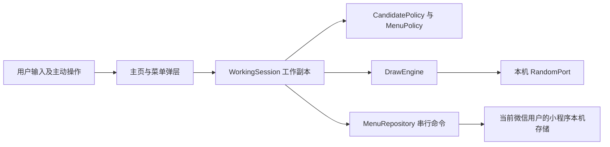
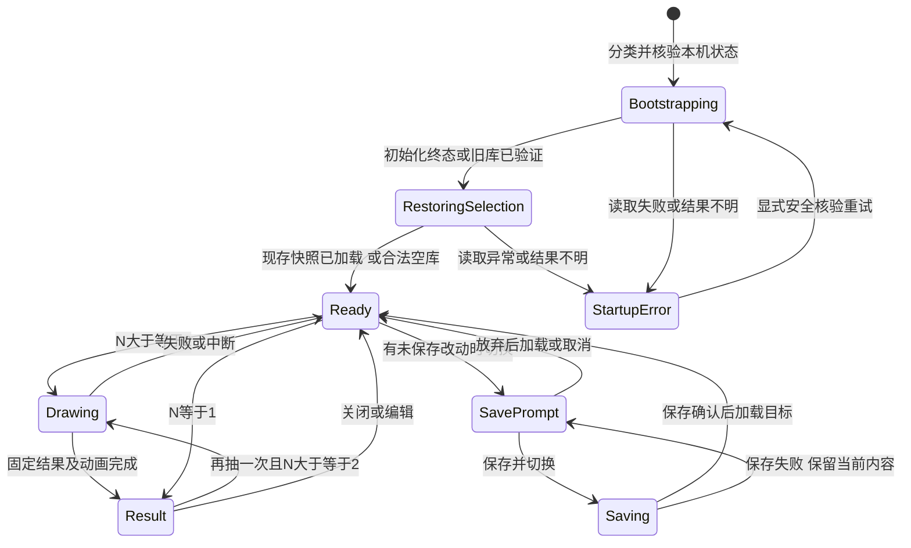

# 今天吃什么首版系统架构与交互设计

- 项目：eating-everyday（今天吃什么）
- 成果 ID：A-006
- 负责人：architect
- 关联任务：当前[T-033](../TASKS.md#t-033设计启动菜单选择记忆与恢复契约)；历史T-021/T-002及交接H-005保留。
- 版本：0.7
- 更新日期：2026-11-03（Asia/Shanghai）
- 状态：draft
- 适用范围：启动菜单选择记忆、旧数据兼容、保存/切换/删除的部分成功和恢复契约；保留一次性初始化及其余架构。第9节和第10节为旧专业时点，新契约以第11节为准；本轮只读源码和文档，未执行产品测试或平台/手机操作。
- 来源及输入版本：[A-001 v0.11](product-requirements.md)、[A-007 v0.5](product-decision-options.md)、T-032完成记录及提交2cf3714163a84e5b0fa68c93cc62a16bc7f87f46、T-033、D-024及D-019/其余仍有效决定；原A-006 v0.6/A-008 v0.4。接手OPC ea4a2436f96f41f49d6eec3a5710744c5faec4c0，feature/eating-everyday/t-032-startup-restore；产品同后缀分支的HEAD/main均为WORKSPACE声明的3800e6dd8bc32b7d767bfc873a4b9ae57d10232b，依据见第11.1节。旧正文及被测版本按原任务/第9～10节和Git保留，不重开或改写旧测试结论。
- 输入指纹：UTF-8/LF归一化SHA-256：A-001为989002414d6817db1b5539a4e27757972dac0408a0ee054741a0d18d1babb454；A-007为4864d15138e96d90d83ae5f17c728af6e13f5953ebcab8c30e51b034babffcdd，与T-032一致，旧指纹仅适用于旧版本。
- 存储位置：OPC projects/eating-everyday/artifacts/system-architecture.md。
- 批准依据：D-024确认启动恢复范围；D-019的一次性初始化及其他未变规则保持。T-033交付设计不表示T-034实现、T-035独立验证或整份架构已批准，成果仍draft；旧任务/成果结论限原版本。

## 1. 架构结论及边界

采用原生微信小程序，候选编辑、独立等概率抽取和菜单持久化均在当前设备完成。全新状态按D-019一次性建立并加载8项默认菜单；再次启动按稳定身份恢复上次成功使用的菜单当前保存快照，缺失/已删除才依现存内置默认身份、现存同名菜单、原列表首份降级，旧有效空库保持空。对应13项有效需求、13条规则、40项验收；选择记忆不自动保存编辑，不新建或覆盖菜单内容。

本版不包含定位、距离、附近搜索、餐厅数据入口、地图来源标识或许可策略，不设置餐厅查询网关，不发起餐厅数据请求。核心功能不需要用户注册产品账号、微信登录业务接口、地图开发者账号或云端菜单；小程序自身账号与 AppID 是后续平台测试/发布条件，详见 [A-008](accounts-access-checklist.md)。平台能够打开小程序后，核心流程不等待网络。

WORKSPACE.yaml当前锁定产品main/v1.1.0：git@github.com:yinzhongkai/eating-everyday.git，checkout=../eating-everyday，revision=3800e6dd8bc32b7d767bfc873a4b9ae57d10232b；实际产品checkout为feature/t-032-startup-restore，HEAD/main均同声明且工作树干净。原默认菜单已实现，现有StartupCoordinator再次启动不加载已有菜单；这是原契约行为，D-024恢复选择是本轮新增功能，不把旧通过改为旧版失败。本轮不改产品或WORKSPACE、不联网复测。

T-002及T-021～T-031完成事实和历史测试来源保留，旧B项解除、501/501及用户手机反馈不覆盖本次恢复功能。当前第11节交付T-033设计，实际实现和独立验证由T-034/T-035完成，整合交T-036。

产品公共配置当前SHA-256为27a614c100e150979107c9f648b67f757d81b586883c9eb89a46f2670c143bbf，工作树干净；本轮不改AppID/私有配置。启动记忆无需新账号、权限、网络或用户业务选择，历史政策资料未重新核实，正式发布资格仍后置。

## 2. 系统与模块



| 模块 | 职责及依赖 | 失败处理 |
|---|---|---|
| MainPage / Dialogs | 转盘、名称输入、完整候选列表、保存及菜单管理；派发命令，不直接改存储。 | 提示具体错误，保留输入、工作候选及旧菜单。结果区域仅名称。 |
| WorkingSession | 当前候选、加载菜单 ID、基线版本/内容、dirty、界面阶段和抽取代次。 | 迟到回调不覆盖当前状态；仅明确保存成功才替换保存基线。 |
| CandidatePolicy | trim、非空、同一列表逐字名称去重、24 项上限。 | 不查地图，不要求真实门店、地址或类别；拒绝时不改变已有项。 |
| MenuPolicy | 菜单名 1～20 可见字符、不同菜单名唯一、非空快照、覆盖/另存语义。 | 不截断、隐式覆盖或以固定菜单份数拒绝保存。 |
| MenuRepository / StoragePort | CRUD、不可变快照、容量检查、写入确认及格式验证。 | 不以删除旧菜单腾空间；失败保留编辑态和已提交版本，保存并切换停止。 |
| DrawEngine / RandomPort | 固定候选快照、均匀索引和动画结果分离。 | 熵源失败不出结果；不根据历史调整概率，不写回菜单。 |
| GraphemeSegmenter | 对菜单名称按固定 Unicode 扩展字素簇版本计数。 | 不依赖未经验证的运行时内建能力；分段不可用时不绕过菜单校验。 |
| StartupCoordinator / MenuRepository.ensureDefaultMenu | 一次性初始化已在当前基线存在；T-034需在其后接入第11节现存菜单选择与恢复。 | 保留bootstrap终态，不用重新播种修复旧版启动空候选。 |
| SelectionStore / SelectionCoordinator（待实现） | 同域独立记忆menuId、选择版本与意图；成功加载/关联保存后更新，恢复时只读最新菜单快照。 | 区分菜单与记忆结果；记忆不可用不破坏健康菜单库，结果不明先核验，见第11节。 |

领域规则不依赖界面、网络和存储实现。StoragePort 与 RandomPort 便于后续故障注入；首版没有服务端部署单元或外部餐厅适配器。

## 3. 数据模型与不变量

| 对象 | 字段及含义 | 约束 |
|---|---|---|
| Candidate | candidateId、displayName。ID 为内部生成，用户只填名称。 | displayName 在添加时 trim 且非空；同列表逐字唯一，顺序稳定；0～24 项。 |
| MenuSnapshot | menuId、name、schemaVersion、revision、orderedCandidates、createdAt、updatedAt。 | name trim 后 1～20 个可见字符；不同 menuId 名称唯一；完整保存 1～24 项及顺序。 |
| WorkingSession | candidates、currentMenuId 可空、baselineRevision、baselineCandidates、dirty、phase、generation。 | 不持久化未保存副本或抽取结果。dirty 按有序名称内容与基线比较；内部 ID、动画和抽取不造成内容变更。 |
| DrawResult | drawId、generation、selectedCandidateId、displayName。 | 只属一次抽取；重新编辑候选或开始新抽取时清除旧结果。 |
| StoreRoot / StoredChunk | schemaVersion、storeRevision、索引/内容引用、校验值、最近提交信息。 | 存储格式校验、分块和版本恢复使用；不增加用户输入字段或菜单份数业务限制。 |
| SelectionRecord（待实现） | 第11节独立key ee/selection；schemaVersion、kind、revision、menuId可空、operationId。 | 仅记稳定身份，不存候选/菜单名/未保存内容；缺失正常兼容，损坏单独报告，不重写旧菜单或旧根格式。 |

去重只在同一份当前候选中执行：trim 后字符串逐字相同则拒绝；不同菜单可包含相同候选。不做大小写、全半角、同音或模糊合并，不再有跨来源同名例外。菜单名唯一性与候选名称唯一性分别校验，重命名菜单排除自身 ID。

加载按保存顺序恢复，不重新trim、筛选或生成名称；坏快照不静默修复。现有根/索引/内容schemaVersion=1和已实现的defaultMenuBootstrap及其原回执格式保持，具体合法存量见第11.1节。新选择格式缺失不是损坏，选择key与菜单校验分开；不为选择功能重新初始化、迁移或改写旧菜单内容。

本版不保存位置、地址、门店来源/标识、许可、搜索状态、电话或历史抽取记录。菜单存储域按当前微信用户与小程序隔离；换微信用户不能被描述为同一存储域。正常关闭后可加载是目标，主动清除及平台清理后的找回不在承诺范围。

## 4. 输入与菜单接口

### 4.1 候选命令

| 命令 | 输入/成功结果 | 拒绝或异常 |
|---|---|---|
| addCandidate | 原始名称 → trim 后的名称及新 candidateId，追加末尾。 | 空白、同列表重名或已有 24 项时拒绝，原候选和旧菜单不变；不要求对应地图门店。 |
| removeCandidate | candidateId → 仅删除该当前项。 | 允许删除最后一项；不自动覆盖已保存菜单。未知 ID 不误删其他项。 |

名称没有 20 字符业务上限。官方 input 默认 maxlength=140，因此候选输入须显式取消该默认限制；菜单名称也先接收完整输入再按字素计数，不用控件 maxlength=20 冒充可见字符规则。[S-03](https://developers.weixin.qq.com/miniprogram/dev/component/input.html) 超长内容引起的平台资源/写入失败须明确反馈，不截断后假称原样保存；实际极端长度可用性待验证。

### 4.2 菜单仓储契约

所有菜单写操作通过同一串行队列执行，唯一性检查和 store revision 核对属于同一命令。每次操作固定 operationId、目标 ID 和 expectedRevision；新建/覆盖还保留完整有序候选快照。相同完整意图回放持久回执，不新增记录或回退当前工作态；复用 ID 但更改命令、参数或版本拒绝。公开入口须先查回执，再判断目标当前是否存在；001/002已独立复测关闭，见第9节。

本表保留菜单阶段接口；低层repository.list/load只读，不因测试/检查读取而记住选择。面向用户的成功加载、保存、切换由第11节协调器追加独立记忆阶段，分别报告两个结果，不把记忆失败当作菜单保存失败重做。

| 命令 | 成功语义 | 前置及失败语义 |
|---|---|---|
| listMenus | 返回 ID、名称、revision、候选数。 | 只读本机；读取失败不能被当作空库并覆盖原数据。 |
| loadMenu | 校验并完整恢复选定 ID 的名称和顺序，设定基线、dirty=false。 | 切换前处理未保存改动；读取失败保留原工作副本和当前关联。 |
| createMenu | 以新 ID 保存非空完整候选并关联新基线。 | 校验菜单名及唯一性、候选 1～24 项；不因第 21 份或其他固定份数拒绝。 |
| overwriteMenu | 用户明确覆盖指定 ID、版本成功后更新该记录与基线。 | 不能按重名推断目标；空候选、版本或空间失败保留全部旧记录与工作副本。 |
| renameMenu | 仅更改目标菜单名。 | 与新建相同的名称校验，排除自身 ID；自身原名无变化成功；不改候选内容和其他菜单。 |
| deleteMenu | 明确确认后仅删目标保存记录。 | 取消或写入失败全不变；若删当前菜单，保留当前完整候选，清 currentMenuId/基线，标未保存。再次保存须新 ID，不能复活已删关联。 |

菜单名使用 trim 后的原字符串比较，不自动标准化为另一名称。长度按 Unicode 扩展字素簇计数，采用 [UAX #29 修订 49](https://www.unicode.org/reports/tr29/tr29-49.html) 的固定分段口径；汉字、ASCII、组合字符与合法 ZWJ emoji 分别按规则验证。20 字符不约束候选名称。实现已锁定 Unicode 18.0.0/UAX #29 rev49，使用本地属性表及等值 JS 表；独立853条语料与目标基础库/用户手机证据分别见第9节。

切换时 dirty=true 提供保存并切换、放弃并切换、取消。保存并切换在命名、非空、写入和回读确认全部成功后才加载目标；保存尚未确认的任一步失败均保持当前编辑态和菜单关联，不清 dirty、不加载目标；结果不明先核验。若源保存已经确认而目标读取失败，保留当前已保存副本和新基线，不把它误报为未保存，也不切到不可读目标。已知未提交失败后，用户仍可另选取消或明确放弃。无关联的未保存副本须先另存命名。

删除当前菜单时，无论有无修改、是否最后一份，均保留当前候选为未保存副本；若候选已删空，继续保留 0 项并按空保存规则拒绝保存。退出前未保存不要求下次恢复。删除/重命名其他菜单不改变当前候选或其保存内容。

### 4.3 本机持久化与空间失败

官方文档支持本机键值读写，并说明同一微信用户、同一小程序的存储域上限；setStorage 给出普通存储单 key 1MB、总计 10MB，以及用户删除或系统空间清理的边界。[S-01](https://developers.weixin.qq.com/miniprogram/dev/framework/ability/storage.html)、[S-02](https://developers.weixin.qq.com/miniprogram/dev/api/storage/wx.setStorage.html) 这些是平台上限，不是本项目已测可用容量或永久留存保证。

采用不可变内容块与固定大小提交根的设计，避免把全部菜单打包到单个 key 而提前触及单 key 限制。序列化后按字节分块，初始建议每块不超过 128 KiB 的原始字节，再编码为存储值，核对含元信息后的实际长度；索引同样可分块。当前实现默认128 KiB，按编码后的实际块大小检查，链式内容及索引可分块。它是内部参数，不是名称或菜单份数上限。容量预估及实际写入错误均检查；没有自动回退旧根，历史回执及孤块的容量成本见第9节。

写入流程：读取并校验当前根及 revision → 校验命令与容量 → 向新 key 写入候选副本/索引并回读校验 → 更新提交根并回读 → 才向界面报告成功和替换基线。新块全部确认前不替换可见根，不覆盖旧块，不先删除旧菜单腾空间。空间不足或准备阶段失败时，旧提交与当前编辑态保持不变；未提交块后续可清理，但不删除任何仍被有效根引用的内容。重命名、删除同样经此流程确认，不能仅改列表显示。

官方键值 API 没有在已读文档中承诺跨 key 事务或断电原子性；当前实现与分阶段故障证据支持该应用恢复协议，仍不提供平台未承诺的物理原子性。提交根回调异常但回读为新版本时须按实际提交结果恢复，不能同时宣称保存失败且旧记录必然未变；无法判定时保留编辑态、阻止继续写入/切换，提示保存状态需核验。故障注入须分别验证准备阶段空间不足、根提交异常与进程中断，不能用准备阶段测试代替整个持久性保证。损坏/未知格式时不自动清空数据库，也不悄悄恢复为已确认删除前的列表。

getStorageInfo 可提供存储使用情况；仅作为预估，实际写入仍可能失败。[S-05](https://developers.weixin.qq.com/miniprogram/dev/api/storage/wx.getStorageInfo.html) 首版不主动启用加密存储或新建云服务；如后续增加此能力，需重新核对容量、依赖和需求。正常关闭再开及离线已有用户手机自测反馈；失败恢复有独立L层及真实wx上的注入证据，不能据此称实体满配额或断电已测。

## 5. 等概率抽取与状态控制

draw(candidateSnapshot, randomPort) 返回一次固定结果。0 项提示先输入且不产生结果，1 项直接显示唯一名称。N≥2 时，每次均从快照独立选择索引，不根据历史排除上次结果、调整权重或轮换。

RandomPort 已采用官方 wx.getRandomValues：文档标注基础库 2.15.0 起支持，返回指定字节数的随机内容。[S-04](https://developers.weixin.qq.com/miniprogram/dev/api/device/crypto/wx.getRandomValues.html) 每次取得 4 字节并按固定字节序解释成无符号 32 位整数 x，令 B=floor(2^32/N)×N；x<B 时返回 x mod N，否则重新取样。每个余数有相同数量的可接受输入，避免直接取模偏差。设置有限熵源重试预算，失败报错，不用动画角度或未经核对的替代算法产生结果。

2.15.0 只是旧官方说明中的 API 起点；当前已验证基础库锁定3.17.4，工具2.02.2608080/WebView，不宣称已测试较低版本。实现按大端读取4字节，拒绝预算32次；跨执行域宿主 ArrayBuffer 转为本域 Uint8Array，保留严格类型/长度校验，001已独立复测关闭。先选结果，再确定动画终点；动画帧数、时间和历史结果不影响选择。动画结束只提交一次 drawId；再次抽取必须新建 drawId。后台/页面销毁会使 generation 失效，迟到回调不能显示旧结果或改菜单。

候选增删、菜单切换及写入在抽取期间暂不可提交；菜单写入期间也串行化相互冲突的操作，界面保持内容可见并禁用重复动作。抽取中断恢复可操作状态，不自动保存。抽中结果区域仅完整名称，按钮为再抽一次、关闭，不增加地址、距离或来源说明。



状态图为目标契约；选择恢复及独立记忆阶段待T-034实现。记忆明确写失败可进入Ready并单独警示，结果不明先核验。N=0不重新播种，N=1仍返回唯一名称；失败不丢工作态，同页后台返回不重新恢复。

| 错误类别 | 可恢复行为 |
|---|---|
| EMPTY_CANDIDATES / INVALID_CANDIDATE_NAME / DUPLICATE_CANDIDATE / CAPACITY_FULL | 提示先添加、检查名称或先删除；原候选和已保存记录不变。 |
| INVALID_MENU_NAME / DUPLICATE_MENU_NAME / EMPTY_MENU | 保留输入、编辑态及旧记录；不截断、不继续保存并切换。 |
| STORAGE_FULL / WRITE_FAILED / REVISION_CONFLICT | 不报已保存，不清 dirty，不自动删旧菜单；按实际提交结果判断可安全重试的命令。 |
| STORAGE_UNCERTAIN / STORAGE_CORRUPT / UNSUPPORTED_SCHEMA | 保留当前内容，停止可能覆盖原数据的操作并说明读取/保存状态；不当成空库。 |
| RANDOM_UNAVAILABLE / PLATFORM_UNSUPPORTED | 不产生抽取结果，恢复按钮；说明当前平台能力未满足。 |

## 6. 页面与交互

沿用截图中的奶油纸纹、深蓝绿色轮廓以及橙、黄、浅蓝、米色扇区，主区域为顶部指针、大转盘和中心“开吃”。A-004 及旧 HTML 保留为历史视觉参考，本版不继承其中搜索或演示候选。

```text
今天吃什么？
当前菜单 [未命名 / 菜单名]   [切换 / 管理]   未保存提示
                  指针
             大转盘 / 开吃
候选菜单                                  n / 24
[输入候选名称                            ] [加入]
01  完整候选名称，可换行                         [删除]
02  完整候选名称，可换行                         [删除]
[保存这份菜单]
```

| 场景 | 可检查的呈现及操作 |
|---|---|
| 首次/新会话启动 | 全新初始化后加载8项；已有菜单按第11节优先记忆身份及有界降级加载当前保存快照，显示现名、dirty=false并可直接抽取；已使用空库仍空。读取异常显示重试/核验，选择单独写失败如实警示，不显示虚假成功。 |
| 同页后台返回/刷新 | 保留当前候选、dirty、关联和基线；不重新start或丢弃未保存编辑。失活期间未完成启动可安全续接，但先重读当前快照并核对代次。 |
| 12/24 项与长名称 | 各项等角扇区；拥挤时以编号对应候选列表，短标签可辅助显示。完整列表始终展示完整名称并换行，编号一一对应；不把完整名称截断后仅留转盘标签。320宽模拟器及用户手机专项已有结果，参数与局限见第9节。 |
| 输入与删除 | 只填名称，成功追加并同步转盘；输入失败保留文本。删除只改当前候选，可删最后一项；达到 24 项提示先删除。 |
| 保存与切换 | 已加载菜单明确区分覆盖、另存；新副本先命名。dirty 切换提供三选项，失败停留；不通过点击另一个菜单隐式丢弃修改。 |
| 菜单管理 | 按菜单 ID 重命名/删除；明确确认删除。删除当前菜单说明候选仍在但未保存，成功后显示未保存副本。其他菜单保持可用。 |
| 抽取结果 | 名称完整可读，可再抽或关闭；只显示候选名称作为结果。 |

候选区域可滚动，删除入口有名称关联和辅助功能标签；输入框、错误和焦点处理须适配键盘。长名称完整性由列表换行及结果区内部滚动保证，转盘以编号对应完整列表。当前采用离屏Canvas导出本机PNG、普通image旋转和原生按钮；只有当前候选图片就绪才允许抽取，过期导出不会替换新图。320宽截图可观察01～24及底部保存入口，详见第9节；截图审查不替代手机实测。

## 7. 有效需求和规则追溯

### 7.1 13 项有效需求

| 编号 | 设计落点 |
|---|---|
| R-01 | 原生小程序、个人选餐闭环；AppID/测试条件见 A-008。 |
| R-03 | 第 5 节固定快照、独立均匀索引、允许重复及 0/1 项。 |
| R-04 | Candidate仅名称、trim非空、同列表逐字去重，不查门店；固定初始内容见R-17，后续用户添加规则不变。 |
| R-05 | 结果区域仅完整 displayName。 |
| R-06 | 非空完整快照；0 项不新建或覆盖。 |
| R-07 | 多菜单 CRUD、唯一命名及字素计数，无固定份数业务门槛。 |
| R-08 | 工作副本与持久快照分离，loadMenu 原样恢复，抽取只读。 |
| R-10 | 当前微信用户/小程序本机仓储；正常关闭留存有用户自测，清除后不要求恢复。 |
| R-11 | 第 6 节截图配色、指针、大转盘、候选及菜单入口。 |
| R-14 | 所有候选共用 24 项上限，允许手动第 13～24 项，不挤掉旧项。 |
| R-16 | 无位置、距离或餐厅取数；仅R-17的固定初始菜单，初始化及后续核心流程均不需网络。 |
| R-17 | 第10节全新/旧空库/异常分类、根内一次性标记与默认记录同次提交、幂等及用户修改删除保护；此处限定首次播种，现存保存菜单的再次自动加载另按R-18/第11节，不重建内容。 |
| R-18 | 第11节稳定身份、存量缺失兼容、有序启动选择、独立记忆更新及部分成功/核验；重新启动读最新保存快照，同页返回保护工作态。 |

### 7.2 13 条有效操作规则

| 编号 | 设计机制 |
|---|---|
| P-02 | 每次独立 1/N、允许重复；0 项提示、1 项直接返回。 |
| P-03 | 候选 trim、非空、同列表逐字同名拒绝，不作模糊合并。 |
| P-04 | 当前任一项含最后一项可删除；独立菜单重命名、删除。 |
| P-05 | 除P-14首次初始化外，工作副本不自动覆盖，明确覆盖/另存，dirty切换三选项。 |
| P-06 | 全部领域和仓储在本机，核心流程不等待联网服务。 |
| P-07 | 已保存记录正常关闭留存；未保存工作副本不承诺退出恢复。 |
| P-09 | 候选和快照不超过 24；满额拒绝第 25 项，无 12 项限制。 |
| P-10 | 菜单 trim 后 1～20 字素簇，跨 menuId 唯一，自身原名及明确覆盖例外。 |
| P-11 | 空候选可存在但不可保存；保存失败停止切换，旧内容不变。 |
| P-12 | 不设固定菜单份数，容量/写入失败保留旧菜单和编辑态。 |
| P-13 | 当前菜单确认删除仅删保存记录、解除关联，保留未保存副本，后续另存新 ID。 |
| P-14 | 第10节一次性默认菜单协议；旧菜单（含同名）不追加、不改写，删除后终态仍保留，未核验不重试写入，失败保留旧数据/编辑态。 |
| P-15 | 第11节按记忆ID/现存内置ID/现存同名/原列表首份恢复；成功关联后记忆，失败/取消不记目标，记忆故障独立提示，迟到结果不倒退或重载副本。 |

旧 R-02/R-09/R-12/R-13/R-15、P-01/P-08 与餐厅验证 V-01 至 V-04 已由 D-016 撤销，不是未完成技术待办，也不记为通过。旧来源设计及查询事实见 A-005 的历史归档说明。

## 8. 40 项有效验收的验证设计

下表对应A-001 v0.11的40项验收；29条未变行及其原时点证据保留，AC-07/39/40修订、AC-43～50新增，由T-034/T-035实现和独立验证。旧行的“待T-022/T-023”是当时设计，已完成事实见原任务/A-013/A-014，不将旧通过改成失败。L/D/M/O层级不能互相代替，旧501/501不覆盖本次选择恢复。

| 编号 | 验证输入/操作与对应证据 | 当前证据与限制（详见第9节） |
|---|---|---|
| AC-03 | 空/非空列表仅输入名称，确认加入、参与抽取且无其他必填字段。 | A-012§7 L；A-014§6/7 D实际输入、M基础添加/抽取正常。 |
| AC-04 | 固定随机输入选中某候选，核对结果区域只有其完整名称。 | L完整名称；D鼠标双项与指针对齐、24项长名结果；M抽取正常。 |
| AC-05 | 保存不同内容 M/N，切换后逐项比对名称和顺序。 | L完整快照；D多菜单/保存切换及真实wx记录；M保存加载正常，未逐份提供设备日志。 |
| AC-06 | 修改 M 后放弃并重新加载，核对原快照不变、无自动生成或查询。 | L快照隔离；D明确放弃及重新加载；静态源码无业务查询。 |
| AC-07 | SR-01/02：同手机保存并成功选择M，关闭重启直接加载其最新保存快照、现名和顺序，基线一致可抽取。 | 本次自动恢复待T-034/T-035；旧手动加载和手机反馈限原版本。 |
| AC-08 | 12 项、24 项及长名称，真机窄屏/键盘/大字检查截图风格、编号对应、完整名称和全部操作入口。 | D 0/1/24、320宽及长名截图；M输入法/键盘、大字/安全区正常；非全字号/机型覆盖。 |
| AC-09 | 审查均匀索引与熵源，实现验证拒绝区间和边界；抽取统计不要求有限频数完全相同，检查历史结果不改变概率。 | L全N=2～24边界/重复及源码数学依据；D真实wx双项、跨域修复；不以频数证明熵源。 |
| AC-10 | 0 项无结果并提示；1 项直接显示唯一完整名称。 | L 0/1无熵；D实际空提示/唯一完整长名；M未逐子项留日志。 |
| AC-11 | 空、纯空白、首尾空格名称，核对 trim、拒绝及仅名称即可添加。 | L拒绝/trim；D实际空白/首尾空白/粘贴；M输入法/软键盘专项正常。 |
| AC-12 | 同列表重复“面馆”及带空格同名拒绝；另一菜单可包含“面馆”，旧快照不变。 | L同列表与跨菜单；D真实重复粘贴/名称比较；不归并大小写、全半角或Unicode正规形式。 |
| AC-13 | 删除任一当前项再抽取，确认其他项保留且旧菜单不变。 | L任意/最后项删除；D页面handler及六组合含空副本；不冒充每项均物理点击。 |
| AC-14 | 按 ID 重命名/删除 M，确认不能加载已删 M，其他菜单 N 不变。 | L含001/002回放；D改名/删除、原生取消确认，其他记录不变。 |
| AC-15 | 加载 M 后增删与抽取但不保存，检查持久记录未变，抽取不改候选。 | L深隔离/dirty/抽取只读；D有修改与未保存提示、未自动覆盖。 |
| AC-16 | 明确覆盖 M，再另存 N，比较两个 ID 和完整快照、无隐式覆盖。 | L覆盖/另存；D实际稳定选项覆盖、另存新ID及真实wx核对。 |
| AC-17 | dirty 时依次验证保存成功后切换、放弃后切换、取消；对照工作状态及旧记录。 | L三分支；D实际取消/放弃/保存切换，注入失败另记。 |
| AC-18 | 平台能打开小程序后断网，执行输入/抽取/保存/加载/重命名/删除；确认无网络前置或地图账号。 | M用户在指定保存关闭重开及离线上下文确认正常；静态本机调用支持，未逐管理子分支取得离线日志。 |
| AC-20 | 隔离域全部清除后首次仅提供固定默认菜单；对照仅删除所有菜单后不重建。 | 新语义待T-022/T-023；旧清除后为空的L/D记录仅为v0.9历史，不记为本版通过，不清用户真实数据。 |
| AC-25 | 24 项后添加第 25 项拒绝，删一再加可达 24，旧保存记录不变。 | L 24/25及删后加；D handler填24拒25与鼠标24项抽取，不声称逐项物理输入。 |
| AC-27 | 菜单名空白、trim、20/21 字素簇，覆盖汉字/ASCII/组合字符/ZWJ emoji；候选名称不受该上限，保存不截断。 | L固定853条语料和20/21；D家庭emoji边界及长名往返；M粘贴/IME专项正常。 |
| AC-28 | 新建/另一菜单改名为“ 午餐 ”冲突，自身原名成功、明确覆盖成功；检查无重名新记录。 | L唯一性/版本；D8个命名检查点，自身原名和明确覆盖可用。 |
| AC-29 | 0 项新建、加载 M 后删光再覆盖均拒绝；删最后项本身可成功，旧 M 不变。 | L空新建/空覆盖/切换；D空覆盖及六组合中的空副本拒绝，旧记录保留。 |
| AC-30 | 空间足够时从 20 份增加第 21 份，不因份数拒绝，每份最多 24，其他菜单不变。 | L与D控制器/真实wx均已存21份；不推导无限容量或真实满配额通过。 |
| AC-31 | 新建/覆盖分别注入准备阶段空间不足，核对不报成功、不清 dirty、不删旧记录；提交异常与中断另外验证。 | L分阶段容量/读写/回读/中断模型；D12检查点含容量夹具；实体满配额未制造。 |
| AC-32 | 当前菜单有/无修改、最后一份，分别取消/确认删除及随后另存；候选保留、关联清除、新 ID、其他菜单不变。 | L删除副本及幂等；D实际原生取消/确认＋6状态夹具组合，后续另存新ID。 |
| AC-35 | 空候选和非空空间不足分别保存并切换，核对失败不加载目标；再验证取消/明确放弃。 | L空/容量/不明恢复；D保存前失败targetLoad=0，不明冻结和显式核验。 |
| AC-36 | 12、13、24 个不同用户名称，含非门店名称，全部按容量规则加入，无类别/地图/距离门槛。 | L 12/13/24；D24项handler/显示与原生输入；没有地图或12项门槛。 |
| AC-37 | 可确认全新的隔离域，平台能打开后断网初始化默认菜单并完成原菜单/抽取闭环；无定位或餐厅请求。 | 新首次/离线初始化待验证；旧L/D/M的首次空列表与后续闭环证据不覆盖本次变更。 |
| AC-38 | DM-01：全新域初始化、加载、抽取、切走再加载，核对唯一菜单及8项原顺序，受控随机仍为1/8。 | 待T-022自测/T-023独立验证，不引用旧测试代替。 |
| AC-39 | SR-03/04：旧单/多菜单、可识别内置身份已改名及用户同名不同内容，无记忆时按有界顺序直接加载。 | 本次待验证；菜单内容/ID/版本不变，允许写独立选择记录；不要求旧用户先手动选择一次。 |
| AC-40 | SR-05/07/08：重复启动恢复最新保存内容，已保存编辑/改名保留、删除不复活；仅删空未保存重启恢复原保存内容。 | 本次待验证；合法空库不播种，同页后台保留编辑，原0/1/24/25/空保存和删除留副本须回归。 |
| AC-41 | DM-07/08/11：信息/根/索引/内容读取、损坏/未知格式、空间不足及明确未提交失败。 | 待验证，失败前后持久字节与工作态留证；不清库、不播种异常域、不出现可加载半份。 |
| AC-42 | DM-08/09/10/12：各提交阶段中断、落盘后反馈丢失、核验/重试与已有后续编辑删除。 | 待验证，核验前冻结写入，稳定意图至多一份，回执不能重放旧副本或复活删除。 |
| AC-43 | SR-01/02：有效记忆指向已修改/改名的菜单，加载当前保存快照并直接抽取，原默认8项不覆盖修改。 | 待T-034/T-035，核对菜单ID、保存revision、完整候选/顺序与dirty=false，加载不写菜单。 |
| AC-44 | SR-03/04：无记忆/已删身份，分别覆盖现存内置ID、同名用户菜单、原列表首份、合法空库及重复启动。 | 待验证，首次升级即生效；记录确实缺失才降级，不新建/排序或伪称知道旧上次选择。 |
| AC-45 | SR-06：直接/dirty保存或放弃切换、取消、空/失败保存、A已保存而B读失败。 | 待验证，A/B菜单阶段与记忆阶段逐项断言；目标失败不记B，部分成功独立提示。 |
| AC-46 | SR-05：新建/另存/覆盖、当前/其他菜单改名后重启，身份关联保持。 | 待验证，不用菜单名或旧快照猜测，历史保存回执不重放旧选择。 |
| AC-47 | SR-07：删除当前/记忆目标/非目标/最后一份，取消/失败及删除后同名新ID。 | 待验证，确认删除后清失效身份，记忆清除失败仍不得复活；本次副本不另存。 |
| AC-48 | SR-08/12：未保存增删（含空）/抽取、新副本、同页后台返回和刷新。 | 待验证，新启动读保存快照，同页不重载；选择重试只改记忆状态，不触碰候选/dirty。 |
| AC-49 | SR-09/10：菜单/记忆读取失败、坏值/未知格式与缺失对照，安全重试及手动模式。 | 待验证，存量v1合法数据保持可读；仅记忆不可用而库健康可手动选，不伪称自动恢复或已记住。 |
| AC-50 | SR-10/11/12/13：选择写明确失败/反馈丢失/不明、连续新选择/编辑/删除和页面失活。 | 待验证，菜单成功独立保留，重试不重复保存；先核验并控制写顺序，旧结果不倒退选择/覆盖编辑。 |

旧 AC-01/AC-02/AC-19/AC-21/AC-22/AC-23/AC-24/AC-26/AC-33/AC-34 已撤销，编号保留而不复用，不以取消记录为验收通过。

## 9. T-002历史验证结果与实施前置（2026-10-22）

本节完整保留A-006 v0.5的专业复核事实、旧版本和当时后续建议；其中“本轮/当前”均指2026-10-22的T-002时点。当前产品基线以WORKSPACE及第10节为准，T-014～T-018后续交付见各原任务/成果；本节不为D-019提供新功能实现或测试证据。

### 9.1 证据版本、来源与本轮方法

本轮是 architect/system-design 的实现与证据审查，不重跑Node、CLI、SDK或手机场景。完整读取A-012 v0.3、A-013 v0.2、A-014 v0.3（当前结论在第7节），核对T-010～T-013和现行需求/决定；检查核心、wx适配、原生页面/样式、转盘及配置测试源码，审查实际TAP/专项JSON和小屏截图。历史报告前段的open/未执行按其日期保留，当前闭环采用其后续明确复测。

以下产品路径均位于本机仓库 git@github.com:yinzhongkai/eating-everyday.git，checkout=C:/Users/YinZh/Documents/workspace/eating-everyday；用精确提交定位，分支名不代替版本：

| 证据 | 精确版本/路径及范围 |
|---|---|
| 固定核心及独立闭环 | 实现54b720fa920dfcda9a3db5fa0e42378be01f5535；资产f2646b52f7e6746b2814076bfab99e91a5e95f07；test/independent/、test/evidence/tester-retest-t011-002/；A-012§7独立001/002关闭、最终257/257（开发123＋独立134）。 |
| 固定原生修复 | 实现8e4472006f1d3cdff5b774052e01ce8db5a96453；src/、adapters/wx.js、pages/index/、ui/；A-013§5开发跨域随机修复与冒烟，非tester结论。 |
| 原生独立复测与预览 | 资产d212b5908484c47906a3eb62f254b74556175a0e；test/evidence/tester-retest-t013-001/；A-014§6的001原例1/1、相关7/7及292/292，真实鼠标/菜单观察摘录、清理、111012字节预览；旧原始GUI附件缺口保留。 |
| 最新专项 | 资产10f52d40bb8a62b04a8f84793e44117fe3c28e46；test/evidence/tester-t013-special22/（下称S目录），含storage.json、name-rules.json、delete-matrix-fixture.json、native-check-*、clear-rebuild.json、lifecycle.json、small-*、两份TAP及cleanup.json。本轮核对manifest所列48份文件全部字节长度/SHA-256一致，manifest本身使目录共49份；没有重新执行脚本。 |
| 手机及离线 | A-014§7及T-013两条2026-10-22项目经理原记录：用户明确反馈基础、保存/正常关闭重开加载/离线及新增三专项正常。来源是用户自测，非tester或architect亲自手机执行；手机实际机型/版本/构建指纹未取得。 |

工具环境为报告记录的Windows11/Node24.19.0、开发工具2.02.2608080、基础库3.17.4、WebView、SDK0.13.0。390宽及320宽是开发工具模拟器；其iOS/微信模拟字段不得写成实体手机参数。10f52d4相对8e44720只新增65份测试证据，受控实现/原测试未变；本轮本机配置原始SHA-256为97f3a1355a54a3c8875f6da96580357c1fbc3a639079e009acf0aa07c6bae2db，与tester收尾一致。

### 9.2 PV-01 至 PV-06 当前复核

| 编号 | 实现/证据核对 | 结论及实际边界 |
|---|---|---|
| PV-01 范围与追溯 | A-001/A-007双指纹不变，第7/8节逐号11/11/27；T-010～T-013实际完成；全手动本机边界符合D-016。 | 本任务设计与追溯完成；没有新业务取舍或费用差异。旧数据验证是撤销，非通过；整份成果未批准。 |
| PV-02 本机存储 | src/repository.js:34、67、122、193；src/session.js:40、104、116；adapters/wx.js:11。不可变内容/索引逐块回读、根提交完整核验、显式恢复；A-012§6/7分阶段L故障；S/storage.json十二检查点及M正常关闭留存。 | 原实现/失败保护证据缺口解除。准备失败不换根、不丢副本；根实际已写且核验成功按成功，状态不明冻结；源已保存目标读取失败保留源。未证明跨key或断电原子性，也未物理填满手机。 |
| PV-03 字素与长名 | src/policy.js、graphemes.js及固定18.0.0数据；WXML两输入maxlength=-1；A-012§6.3独立853条分界、20/21组合/ZWJ，A-014§6家庭emoji/长名往返及§7真实输入/同名、M三专项。 | 对应字符/平台证据已具备；候选无菜单20字限制，无截断或隐式标准化。不是所有Unicode极端长度/所有输入法覆盖。 |
| PV-04 随机 | src/draw.js:4大端32位拒绝采样/32次预算、0/1无熵；WxRandom跨域合法值复制，严格拒绝伪造和错误长度；A-012全N边界/重复、A-014独立关闭001、D双项和24项。 | 随机实现符合条件均匀契约，历史不改概率；均匀/独立以平台熵源性质为前提，有限频数不作证明。无不安全回退。 |
| PV-05 UI与离线 | pages/index/、ui/wheel-preview.js及wheel.js；S/small-24-top/bottom、small-long-result等截图/JSON，编号01～24、完整列表、保存和结果按钮；lifecycle.json旧回调不污染新页。M三专项及离线正常。 | 原关键界面/离线证据缺口解除。实际查看本轮3张320宽图并对照视觉参考；图片是既有执行的审查，不是本轮重测。手机设备元数据和逐离线管理子分支日志未提供；不宣称全设备通过。 |
| PV-06 入口与承接 | 完整app/page工程、固定打包路径和运行说明；T-010～T-013实际接收与完成；A-013§5、A-014§6/7真实编译/预览及用户扫码。 | 当前开发/预览入口已用，不再要求注册或重新扫码证明；公共占位配置与本机实际AppID分列见9.4。正式发布资格不由预览推定。 |

### 9.3 B-01 至 B-04 解除及任务结论

| 原阻塞 | 解除证据、影响和当前行动 |
|---|---|
| B-01 实施任务/可运行版本 | T-010～T-013已安排、实际接收且completed；上述8e44720工程与10f52d4证据可读取。原“仅README/无成员初始化”不再描述候选；无需用户重建成员或另建实现分支。 |
| B-02 入口/运行资格 | 既有AppID/登录工具实际编译、独立预览和用户扫码基础使用正常；A-014§6/7。当前验证的入口阻塞解除，发布手续仍后置。 |
| B-03 存储/状态 | L完整阶段风险与历史回执复测、D真实wx上12检查点及用户M留存；源码提交/恢复路径一致。原缺少实现和实际验证的阻塞解除，物理边界限制单列。 |
| B-04 字符/随机/UI/离线 | 固定字素语料、D输入/长名/24项/随机/生命周期和M三专项/离线，具体边界见9.2。原缺证据阻塞解除，未测项不扩写为通过。 |

**本轮未发现使T-002原约定设计与关键验证无法完成的剩余技术阻塞；T-002本轮completed。** 完成依据是逐项源码与分层证据复核，不是仅引用T-013 completed。本轮真实阻塞清单为空，因而没有需用户选择的业务差异、费用或补开权限事项；**当前无须用户确认**。保持成果draft，不新增交叉评审或批准门槛，也不等同整份首版验收、全部27项真机独立通过或正式发布。

### 9.4 实现细化及本机291/292差异

| 差异/细化 | 判断与后续责任 |
|---|---|
| 单写入者、分块及格式 | 固定根ee/root与ee/block/*，首存genesis空根；128KiB链式块及分块索引，root.revision映射storeRevision。MenuSnapshot的schema在内容封装中，DrawResult实际为candidateId/index/displayName，名称/顺序与业务语义不变。完整快照/工作副本深隔离；无需改需求。单例repository队列串行，不声称跨进程CAS。 |
| 完整意图持久回放 | 索引保存operationId＋命令/原参数/版本及回执，新建/覆盖可传原candidateNames；历史回放不作用于当前副本。001/002独立关闭而非吞错。该实现落实原幂等契约，不是新业务入口。 |
| 图片及生命周期 | 原可视Canvas改成离屏PNG＋image旋转，避免层级遮挡；旧图片导出/随机/动画均有代次或存活检查。均匀结果先确定再动画，不影响概率；符合原界面目的。 |
| 提交基线292/292 | S/candidate-baseline-292.tap与baseline-export.json：未改d212b59归档，退出0、292/292；8e44720至10f52d4只有证据变更。限定提交基线，不能代称当前本机工作树全通过。 |
| 本机工作树291/292 | S/combined-292.tap及evidence-redactions.json：退出1，唯一失败test/miniprogram-package.test.js:5断言公共appid为touristappid，而本机是已授权实际AppID。该复合工程用例在AppID断言处停止，其后检查不能由本次失败运行推定已执行；提交基线及其他测试证据另列。 |
| 配置与交付影响 | 本轮脱敏比较仅顶层appid、setting、editorSetting、simulatorPluginLibVersion有差异；libVersion/miniprogramRoot/compileType/packOptions未变。实际工具验证走本机配置，Git候选走占位配置。不是功能回归或T-002阻塞，但当前本机套件仍红，不能宣称本机全绿或把配置差异混入交付。保持文件字节，不回退或提交实际AppID。 |
| 最小后续建议 | project-manager后续在既有范围安排developer明确“仓库配置检查”和“本机可运行配置检查”的边界，保留受控占位/打包/入口断言；本机路径校验非空有效配置及相同关键打包条件，不因AppID不同就跳过整个复合用例。tester分别复跑干净提交与保留配置的工作树并留证。若工具持续改公共配置，developer给出最小本机配置隔离方案再实施，避免覆盖用户设置。本轮不改产品/测试、不代开任务或重开他人任务；该维护建议不要求用户现在决定账号或批准代码。 |

### 9.5 非阻塞限制、后续交付与证据责任

| 项目 | 已知影响、下一位行动人及需处理的时点 |
|---|---|
| 实体满配额、强杀/断电、设备清库和全交叉故障 | L故障模型及D注入已测所述路径，未覆盖物理极限和全部组合。当前AC-31/35明确允许模拟，正常关闭有M反馈，不能机械改成新阻塞。未来相应任务由tester在独立测试域/安全设备补证；不破坏用户菜单造故障。 |
| 多设备/全部字号/极端长名与性能 | 当前个人本机范围不要求多设备同步或所有机型认证。320宽D及M专项支持本轮，未来扩大兼容范围时由项目经理安排developer/tester补测。 |
| 手机机型、系统、微信、构建指纹缺失 | 限制复现和精确归因；用户自测反馈本身保留有效来源，不编造参数、不转成独立测试。后续若发生设备问题或固定交付候选，tester记录可取得环境和预览版本；当前不再要求用户重复同一操作或确认菜单规则。 |
| 旧GUI原始附件缺口 | A-014§6部分观察器PNG/JSON未落盘，只剩实际工具摘录。本轮§7新资产及其校验可支持新专项，不能补造旧场景原图；本轮审计限制保留。未来需要严格重演时tester按具体交付范围补证，不对全部旧流程无界重跑。 |
| 历史回执、孤块及全量恢复成本 | 当前不自动清理旧不可达块，幂等回执不压缩且含快照，持续写入会消耗空间，全量验证可能变慢。src/repository.js:183、216及docs/core-api.md:104明示；不违反“无业务份数上限”，失败应保留当前有效记录。后续有实际容量/性能问题时developer评估安全清理/回执保留方案，tester验证不删活块、不复活已删记录；本轮不改格式。 |
| 主线合入和发布 | 两仓库仍在同后缀feature，WORKSPACE仍main README基线。本轮只本地治理提交并停止；后续合入/最终验证/基线推进/清理由项目经理按授权协调，不把它们当本次专业复核尚未交付。正式主体/类目/备案认证及费用保持未核实，实际发布计划出现时查当时官方/账号依据并确认，不由本轮预览推出资格或新增费用结论。 |

本轮只更新本人A-006/A-008、T-002和索引。PROJECT/STATUS中的旧摘要由原维护人后续依据此结果同步，H-005/H-006仍由原发起人核对；过期摘要和未关闭历史交接不改变本轮专业结论。本会话不触发其他会话。

## 10. 默认菜单一次性初始化契约（T-021历史设计，2026-11-02）

本节保留v0.6原设计时点及DM交接，T-022/T-023已按当时版本实现/验证，原结论不改写。D-024及第11节仅替代再次启动/旧库保持手动加载、选择状态和新增key识别的有关约定；一次性播种、默认内容及终态保护继续有效。下文“尚未实现/待验证”均指T-021时点，不是当前产品状态。

本节是交给developer/T-022与tester/T-023的目标契约，尚未实现或执行测试。D-019及A-001 v0.10/A-007 v0.4没有待用户确认的业务问题；以下均为既有单写入者仓储模型内的技术选择，不增加账号、审批或发布前置。

### 10.1 实际基线、兼容选择与固定内容

只读核对本机产品仓库`git@github.com:yinzhongkai/eating-everyday.git`，checkout为`C:/Users/YinZh/Documents/workspace/eating-everyday`，分支main、HEAD为`6c9ef2b3135a0013fb0b06ebbe761b298c4b7260`，与WORKSPACE一致；保留原project.config.json差异，未联网、切分支、运行产品测试或改文件。实际读取仓库内`src/repository.js`、`src/codec.js`、`src/session.js`、`src/index.js`、`adapters/wx.js`、`pages/index/index.js`及`docs/core-api.md`；检查了既有存储故障测试的相关条目，未将其当作新功能通过。

现有根为`ee/root`，块为`ee/block/*`；WxStorage物理前缀为`eating-everyday:v1:`，成功列出key后才能确认缺失，读取异常不会返回空。现有`_state`把无根无块和revision=0/index=null都返回为空快照；`inspect`未暴露两者来源，`_mutate`首次保存会写无标记genesis；页面onLoad只刷新菜单，WorkingSession构造为空。这些接口目前不能直接满足默认初始化，不能在`listMenus().length===0`外加`createMenu`拼接实现。

采用**根内可选一次性元数据、独立仓储初始化命令**：保持现有根/索引/内容schemaVersion=1及全部旧菜单结构，只为本版新初始化根增加`defaultMenuBootstrap`，参与原根封装的checksum。避免“先普通create、再另写布尔key”产生半完成窗口；不为旧有效空库补默认菜单，避免把旧用户删除结果当成首次。旧无标记合法根只读兼容，不为标记而改写旧记录。新字段尚未落产品，developer须验证解码/编码及每类写命令的保留规则，不声称旧程序降级运行已经验证。

固定种子策略ID为`d019-v1`，菜单暂名“默认菜单”，orderedCandidates严格依次为：**肯德基、麦当劳、西域美食、醉面、吉野家、阿香米线、喜家德、麻辣烫**。全部按普通候选/菜单不变量校验，非演示数据或远端餐厅；初始化保存成功后currentMenuId指向新ID、baselineRevision为保存版本、dirty=false，首次抽取每项1/8。后续增删、覆盖/另存、重命名及删除均复用既有契约，无特殊权重或不可删除限制。

### 10.2 存储分类与启动状态

分类必须在同一repository串行队列内完成，检查根、可达索引/全部菜单内容及相关元数据；缺失分类还须成功读取本应用命名空间的key列表。只忽略物理前缀之外的无关key，不清理它们；本域未知key、无根残块及异常不得当作全新。全新只表示本域数据可确认全部缺失，不能推断用户从未安装；全部主动清除后满足同条件可重新初始化，菜单管理删除不会移除根。

| 分类 | 可验证条件 | 初始化/加载行为 |
|---|---|---|
| FRESH | 根明确不存在，成功列出的本域key为空；无孤块、未知key、旧标记或其他使用痕迹。 | 唯一允许开始新的默认菜单意图；进入Bootstrapping，保存确认后首次自动加载。 |
| LEGACY_EXISTING | 无新标记的已知v1合法根，完整验证后含一份或多份菜单（含任何同名菜单）。 | 直接settled，不写标记、不增菜单；原名称/内容/顺序/ID/版本及原有加载行为不变。 |
| LEGACY_EMPTY | 无新标记的已知v1合法根，菜单为0；包含revision=0/index=null的旧genesis，或revision≥1的有效空索引（可能含删除/失败历史回执）。 | 按已使用的空库处理，settled且不写入、不自动加载；不能证明首次就不播种。旧失败首次保存留下的genesis也如此，不追溯补默认菜单。 |
| PENDING | 合法根含本节已知策略的pending元数据，revision=0/index=null；恢复意图身份完整，可有此前未提交的本域块。 | 显式核验后仅续接原意图，不创建另一份意图；pending不是已保存菜单，不对用户报成功。 |
| INITIALIZED | 合法根含已知策略的complete元数据，revision≥1；完整索引及当前快照验证成功。 | settled，禁止再创建或强制加载原始8项，即使默认菜单改名、改内容或已删除/空库。 |
| UNAVAILABLE | key列表/任一必需读取失败、缺根残块、损坏/校验不符、未知schema/策略/标记状态或不可能组合。 | StartupError；保留全部原字节和可用编辑态。READ_FAILED/STORAGE_CORRUPT/UNSUPPORTED_SCHEMA按实际来源提示；结果不明用STORAGE_UNCERTAIN，均不进入FRESH或自动修复/清库。 |

缺失判定不可吞掉StoragePort.info/read的错误。pending仅允许出现在本节新建的revision=0根；complete仅允许出现在revision≥1根。菜单非空却pending、标记缺ID/字段类型错误等是损坏；已知字段中的未知版本/策略是未支持格式。任何用户持久记录存在时均不得覆盖为genesis。没有标记的普通合法根永远走legacy分支，不能根据名称“默认菜单”或内容恰好8项反推初始化身份。

### 10.3 持久意图、一次提交与幂等

`defaultMenuBootstrap`逻辑字段为`{version:1, policyId:'d019-v1', state:'pending'|'complete', operationId, menuId}`；operationId固定保留为`bootstrap-default-menu-v1`，menuId在首次准备时用现有ID工厂生成并写入pending，重试从pending取回，不重新生成菜单身份。标记不是用户菜单，也不计入24项或菜单份数。固定种子名称/顺序是该策略不可变参数，初始化命令不接受UI传入的覆盖名称/候选；保留operationId供此命令专用，普通CRUD不得使用该ID伪造初始化回执。

1. 启动协调器在空且无关联、无dirty的WorkingSession上调用初始化；同域只用一个repository。coalesce重复onLoad/重试调用并进入既有队列，开始分类到提交/核验完成前锁住冲突操作。普通手动写入若先发生，后续初始化只能按legacy处理，不得覆盖已有内容。当前页面已有编辑态时不执行延迟自动初始化，返回BUSY/UNSAVED_CHANGES并保留副本，不悄悄另存或替换。
2. FRESH先完成容量预估、意图ID校验；再次核对根仍缺失和本域key列表未出现使用痕迹，再写带pending的genesis并回读确认。这一准备根不含菜单，不代表初始化完成。genesis回调失败也必须核对实际根：读回同pending则继续；明确仍缺失且未写任何块则是未提交；无法判定则冻结并等待核验。不得先调用会生成无标记旧genesis的普通createMenu。
3. 按既有复制写入协议为固定8项准备不可变内容块，逐块回读；写新索引，其菜单列表仅一份已固定menuId的完整默认快照，并保存该初始化operationId的持久回执。签名区分初始化类型、policyId、原pending根/版本和固定名称/顺序，防止与普通create混用；candidateId可在准备时生成，但未提交块不可被列表加载。
4. 再查容量和原根原文，发生变化则REVISION_CONFLICT并重新分类，不能把新根覆盖掉。把指向完整新索引的revision=1根与同意图的state=complete元数据**一次根切换**提交；逐根及可达内容核验后才返回成功。因此complete、默认记录和初始化回执同时可见，不单独提前写“完成”布尔位，也不先暴露菜单再补标记。
5. pending期间普通create/overwrite/rename/delete必须拒绝为BUSY（初始化未完成），即使一次明确准备失败后也不能绕过初始化入口写成revision≥1的pending根；由显式核验/续接先解除。complete后的所有CRUD都保留根元数据及索引初始化回执，不因为默认menuId不存在、菜单数0或候选改动清除终态；其根revision继续按既有规则递增。删除菜单只改变索引，不能移除根或重置为新genesis。旧无标记根在普通写入后也保持可识别的合法根；本轮不自动迁移或清理活块、回执。
6. 初始化命令先看当前根终态/当前记录，再处理回执。相同原意图重试只验证既有结果，不重建、不把历史snapshot加载到当前Session；用户后续修改或删除后，旧回执仅证明原初始化曾完成。operationId/策略/目标/原参数不符报REVISION_CONFLICT，不借“重试”更换内容。root.guard只是单写入者协议的冲突检查，不承诺多进程CAS或平台物理断电事务。

### 10.4 接口、页面衔接与结果不明恢复

下列是逻辑接口及语义，命名可在T-022内等义落实并写入产品接口说明；v0.1.0尚无这些接口。仓储内部分类/提交须共用队列，不能在已持有队列的函数内再等待公开排队函数造成自锁。

| 入口 | 返回/状态约定 | 重要约束 |
|---|---|---|
| repository.ensureDefaultMenu() | 返回`{outcome,storeRevision,menuId?,snapshot?}`；outcome为created、existing、legacy_empty或already_initialized。 | 只有本调用完整确认新建的created可带当前完整快照供首次自动加载；其余不替用户选择菜单，无写入。未核验异常拒绝，不用空数组表示失败。 |
| repository.recoverDefaultMenu() | 显式全量核验实际根/索引/内容/标记/回执，返回pending、committed、legacy或fresh等核验结果；成功核验后才解除uncertain。 | 核验本身不盲写；pending/fresh确认后才可重试同意图。不能直接把`recover(operationId)`的旧snapshot当成要恢复的当前副本。 |
| StartupCoordinator.start/retry | Bootstrapping → Ready或StartupError；串行等待初始化/恢复后再调用原刷新菜单流程。 | 首次created使用已验证快照或按相同menuId/版本重读；一次性填充候选及保存基线并清结果。页面generation/存活/工作态变化则丢弃迟到的自动加载，不影响已提交事实。 |
| 原生onRetry | ready=false时仍能触发安全核验；有uncertain先recover，再分类决定是否续接。 | 不能沿用仅_refreshMenus就ready=true的旧路径跳过pending；onShow、刷新列表和切菜单都不另起默认初始化。 |
| inspect/故障观察 | 暴露分类、根revision、bootstrap状态及意图ID、menus/uncertain；测试可观察准备与根切换阶段。 | 日志不泄露用户凭据，不新增网络依赖；普通list/load仍不自动写入。 |

| 中断/失败位置 | 恢复与允许动作 |
|---|---|
| 任何读取/格式错误 | 保持StartupError，不写默认菜单。显式重试仍先核验；持续损坏/未知格式需保留证据交developer处理，不提供“清空重试”默认操作。 |
| pending尚未确认写入 | 全量确认根/本域key仍完全缺失后可按同保留operationId重试；若发现其他有效根转legacy，异常则停止。不能依据单次读回undefined继续写。 |
| pending已确认，内容/索引准备失败或中断 | 原根仍pending，没有可加载半份；显式核验可续接原menuId/策略。未提交块保留，不用删旧数据腾空间；容量/明确写失败如实提示，允许恢复条件改善后的显式重试。 |
| complete根落盘但回调报错 | 若完整根及可达内容/回执核验一致，按实际已提交处理；不得再创建。若根读回仍是原pending且写明确未生效，才按未提交处理；其余冻结STORAGE_UNCERTAIN。 |
| complete后反馈丢失、页面退出或新进程启动 | 重新分类为INITIALIZED，默认记录从菜单列表可加载，不强制重放历史8项。仅同一次启动恢复链、generation未变、Session仍空且无关联/dirty、当前menuId及revision仍等于初始化结果时，才可完成尚未应用的首次自动加载；否则维持既有加载行为。 |
| 后续编辑/重命名/删除后收到旧完成/恢复结果 | 终态不变；不使用旧快照覆盖新版本或复活已删menuId。当前状态核验/原菜单管理规则优先，后台不补默认内容。 |

全量主动清除本域全部数据后无根无块可成为FRESH；单删根、残存块、仅删菜单、旧genesis或一次不明读取均不同。无法从已彻底删除的本地信息恢复旧用户菜单，本版也不要求恢复。此协议不增加跨设备或跨微信用户同步。

### 10.5 研发自测与独立测试交接

全部新用例及中间证据放产品仓库隔离域，禁止清空用户真实菜单。developer在T-022实现并给固定候选，tester在T-023独立核验；本轮表中全部为**待执行**，不是通过。除正常首次闭环外，失败用例应记录根/可达内容/菜单列表及当前工作态的前后差异、operationId、故障阶段、重启/重试后的菜单数与顺序，不只检查一次返回值。

| 验证ID | 输入/故障及必须断言 | 验收落点 |
|---|---|---|
| DM-01 | 完全缺失的隔离域，首次/离线启动；唯一默认名、8项逐项原顺序、自动关联dirty=false、重载一致、受控1/8及原抽取不改保存记录。 | AC-37/38 |
| DM-02 | 旧单菜单及多菜单，含名称恰为“默认菜单”且内容不同；旧ID/版本/名称/候选/顺序及根字节不变，无新增记录、不强制加载。 | AC-39 |
| DM-03 | 旧合法revision=0/index=null且无标记的genesis，分别无孤块/有失败准备孤块；不播种、不迁移、不丢孤块或编辑态。 | AC-39/40/41 |
| DM-04 | 旧revision≥1空库，含删除回执；重复启动不建默认记录，保留回执及旧加载行为。 | AC-39/40 |
| DM-05 | 新成功后重复onLoad/onShow/列表刷新、同实例重复调用；至多一次根提交/一份菜单，无第二次强制加载。 | AC-40/42 |
| DM-06 | 对默认菜单保存编辑、改名、删除最后一份/仅删空候选，重启和旧意图回放；终态保留、菜单不复活，删除当前留未保存副本，0/1/24/25及空保存继续正确。 | AC-40及受影响原AC |
| DM-07 | info/根/索引/内容读取失败、无根残块、本域未知key、坏校验、未知schema或bootstrap策略/组合；零播种写入，不清库、不把错误降级为空库。 | AC-41 |
| DM-08 | genesis及每个内容/索引写入/回读前后注入容量失败/写失败/中断；pending可恢复、半份不可加载、原数据和编辑态保持。 | AC-41/42 |
| DM-09 | 根切换未应用、已应用回调报错、根/可达内容回读失败分别覆盖；不明时禁止普通写及切换，显式核验后正确归类，再重试仍一份。 | AC-42 |
| DM-10 | 完成后用户已改/删，旧回执、延迟回调或跨进程恢复到达；不回退副本、不改后续revision、不复活菜单；页面失效不应用迟到加载。 | AC-40/42 |
| DM-11 | 比较清除本域全部key与只删除菜单/只删除根；仅前者确认为全新可重建固定菜单，不找回旧用户数据、不改外域key。 | AC-20/41 |
| DM-12 | 同队列重复调用coalesce、普通CRUD先写/guard冲突、pending/complete元数据及保留operationId校验；后续CRUD均保留终态，未知元数据不吞错；同队列内部调用不自锁。 | AC-39/42 |

L层可确定性覆盖状态及故障模型，D层应验证真实WxStorage缺失/错误区别、原生首次自动加载、重试入口和离线；手机专项按实际平台差异由tester列明必要操作，桌面/注入不写成手机或物理断电通过。回归既有菜单保存/切换/删除/幂等、存储失败保护、字素与24项及随机契约，准确报告固定版本/配置和覆盖范围。当前没有阻碍技术契约交付的剩余问题；实现、兼容与恢复验证未完成的最小解除条件为T-022固定候选和T-023独立结果，不另行索取已确认业务规则或账号。

## 11. 启动选择记忆与恢复契约（T-033，2026-11-03）

本节是T-034研发及T-035独立测试的目标契约，尚未实现/执行。D-024和T-032已经明确行为，不新增用户选择、账号或审批。与第10节冲突的再次启动手动加载、旧库不自动选择及新增key识别，以本节为准；D-019首次播种、固定内容、旧空库与删除保护不变。

### 11.1 现存格式与只读依据

实读产品`C:/Users/YinZh/Documents/workspace/eating-everyday`的`src/startup.js`、`src/default-menu.js`、`src/repository.js`、`src/session.js`、`src/codec.js`、`pages/index/index.js`、`adapters/wx.js`和`docs/core-api.md`；核对旧`test/default-menu-page.test.js`的相关预期文本，未运行测试或检查用户实际微信存储。实际branch=feature/t-032-startup-restore，HEAD/main=3800e6dd8bc32b7d767bfc873a4b9ae57d10232b，origin匹配WORKSPACE；普通沙箱git status失败后，按工具流程获必要只读审批再确认工作树干净。公共配置SHA-256为27a614c100e150979107c9f648b67f757d81b586883c9eb89a46f2670c143bbf，未改配置或产品。

现有StartupCoordinator仅在created/安全同次恢复有snapshot时加载，already_initialized/existing不带选择快照；WorkingSession新建为空。原页面测试明确再次启动仍手动加载，属于当时D-019契约。本轮必须增加实际选择持久化和新会话恢复，不能只把该测试的“0项”预期改成“8项”。

必须继续接受当前程序能读取的全部合法存量：`ee/root`和`ee/block/*`的schemaVersion=1/原pack校验；无bootstrap的旧genesis、非空/已删除至空的有效索引；以及根内`defaultMenuBootstrap={version:1,policyId:'d019-v1',state:'pending'或'complete',operationId:'bootstrap-default-menu-v1',menuId}`。complete的原初始化签名/回执保持原结构和初始快照；该回执只证明播种发生过，不是要恢复的当前菜单。菜单/候选ID、索引顺序、内容块、CRUD历史回执及原校验规则均不因缺少新选择字段而报损坏。普通菜单ID沿用现有快照可接受的非空字符串，不额外套用仅适合新ID工厂的正则或长度上限来拒绝存量记录。

### 11.2 独立选择记录与兼容分类

选择记录放同一WxStorage物理前缀`eating-everyday:v1:`内的逻辑key **ee/selection**，与菜单根/内容分开，用原pack/unpack校验封装：`{schemaVersion:1,kind:'menu-selection',revision,baseRevision,menuId,operationId}`。revision为正安全整数，baseRevision=revision-1；menuId为非空稳定ID字符串或显式null。ID可能因菜单删除而悬空，存在性另查，不能将这种合法记录当格式损坏；新写非空目标时才要求目标仍存在。operationId为本次选择意图的非空唯一ID，不能复用bootstrap保留ID。它不保存菜单名、候选、dirty、抽取结果或回执旧快照。缺失按选择版本0处理；null表示已明确清除选择，不删除本域使用痕迹。只保留最后一条选择意图，不随操作次数累积选择历史。

采用独立key是为了菜单已保存/加载后记忆明确失败时能分别反馈；不用改写菜单来补选择，不以单个根内字段把选择坏值和整个菜单库的健康状态混为一谈。需要在所有本域key识别入口（尤其`_bootstrapState`）**只增加ee/selection这一已知key**，其余未知key继续保护；不能放宽为任意key都忽略，也不能把新增选择key当作旧库损坏。原菜单读路径和选择读路径分开校验。

| 存储/选择情况 | 分类及允许行为 |
|---|---|
| 本域全部key明确缺失 | 先执行原FRESH一次性初始化，确认完整菜单落盘/加载后再记选择；不可先写selection造成“只有选择、没有根”的伪新库。 |
| 合法旧库或已初始化库，selection明确不存在/null | 正常兼容输入，非损坏。菜单非空走11.3降级；合法空库保持空。旧genesis可有未提交孤块，沿用现有合法读取条件，不重新播种。 |
| 有已知格式的有效选择ID | 通过完整菜单库验证后判断ID是否存在；存在则读当前保存快照，已明确删除则降级。仅重命名不导致ID失效。 |
| selection坏校验/坏字段/未知版本，或其读取失败 | 仅选择不可用，保留原字节并提示，不当作缺失、不自动降级或覆盖坏记录；菜单库完整可靠可读时可手动明确加载/保存菜单，并单独提示选择无法留存。T-033不授权自动删除/修复未知格式。 |
| 菜单根/索引/任一必需内容读取异常，或初始化pending/结果不明 | 先按原恢复协议处理，不静默跳过坏菜单改选；选择正常也不能替代完整菜单核验，不新建默认记录“修好”旧库。 |
| 无根但仍有selection、孤块或其他本域key | 不是FRESH，保留所有字节并报菜单库不可用；只有明确全部清除后本域全空才按首次处理。 |

同名新菜单的不同menuId不是旧身份；仅因名称相同不修复旧选择ID。未知选择格式不阻断已经独立验证为健康的菜单读取，但不得假称自动恢复或选择写入成功。旧3800e6d启动器会拒绝未知额外key，降级写入兼容未验证且不在本轮自动支持范围，不能承诺旧版本读写本次新记忆。

### 11.3 启动选择、快照应用与升级

新使用会话的启动顺序：原初始化/恢复达到可读终态 → 同队列读取完整菜单库和选择状态 → 决定ID → 重新核对并加载当前保存快照 → 应用候选/基线 → 必要时记住该ID。所有选择只引用现存记录，不调用create/overwrite；菜单列表沿用索引/现有UI显示顺序，不额外按名称、日期或ID排序。

1. 可确认全新状态仍只播种一次；初始化完成后即走普通成功加载/记忆流程。已完成初始化后的恢复也从当前菜单读取，不使用bootstrap历史snapshot覆盖用户修改。
2. 有效选择ID仍存在，优先加载该ID当前保存的名称/完整候选/顺序；不依赖保存时revision或旧名称来选择，但加载后的baselineRevision必须等于这次真实快照revision。
3. 只有选择明确缺失/null或ID已确认不存在，才依次选择：仍存在的`inspect().bootstrap.menuId`（须已知complete，包括已改名者）→ 名称trim后逐字为“默认菜单”的现存菜单（可为用户内容）→ 原菜单列表首份。缺失bootstrap元数据是合法旧库，跳过内置ID步骤，不推断或补造身份；原初始化ID已删也只跳过，不从回执复活。
4. 合法已使用空库保持空候选/无关联；失效选择可单独清为null，已经缺失/null无需写入。清选择失败须提示但不能改变“空库不播种”的判断。存在其他菜单时降级加载成功后记住新ID，不要求先清旧ID再二次写入。
5. 一旦任一必需菜单或选择读取/格式不可靠，不把它当作ID缺失继续降级；库健康而选择单独不可用时进入明确手动模式。用户手动选择成功可使用现存快照，选择读取/格式未恢复前不盲写覆盖它，显示选择未记住。

快照应用必须在同一会话仍有效、待加载选择仍是本次目标且没有新编辑/关联变化时，一次性更新candidates/currentMenuId/baselineRevision/baselineCandidates，dirty=false，清旧结果并重新绘制；失败不先清空副本。目标在判定后被删/版本变更，重新核验库并按同一规则重算，不拿旧snapshot应用；读取错误不能当作目标已删。有限冲突重算仍失败则提示重试，不无限轮询。记忆已是同ID且格式有效时无需再写一次；兼容选择必须真正留存，不能只改当前页面。

### 11.4 选择提交、幂等与核验

一个存储域共享一个repository/SelectionStore写入序列；选择读写、菜单写及选择前的身份核验使用同一串行协调，不在已持有队列时再等待公开排队接口造成自锁。不增加跨进程锁，不把root.guard/选择guard说成多写入者CAS。

每个选择意图固定`{operationId,targetMenuId或null,expectedSelectionRevision,expectedRaw}`。执行时先核验菜单库和当前关联授权，确认非空目标仍存在；在同队列读取选择raw，格式可读且版本/原文符合预期才能写。新revision=baseRevision+1；再次读raw作guard后写入完整pack记录，回读完全等于拟写值并校验才记为remembered。不能把读取错误降级为缺失后写版本1；已存在坏值/未知版本不覆盖。版本耗尽只让记忆阶段明确失败，不回滚已保存菜单。

| 结果 | 处理与对外语义 |
|---|---|
| 写前校验/容量明确失败，或写错误后确认仍为旧raw且无残留写入 | selection=failed；菜单阶段结果保留，当前内容仍可使用，提示“菜单已加载/保存，启动选择未能记住”。不报整个保存失败、不重新执行create/overwrite。 |
| 回调报错但读回完整拟写记录 | 按实际remembered处理，至多一次选择版本推进；不能同时报未记住又盲重试。 |
| 写后读失败、读回未知值、超时尚有底层写入可能 | selection=uncertain，保留原意图并关闭可能改变持久状态/恢复目标的入口，先核验；菜单已确认保存仍保持成功事实。 |
| 重试读回相同operationId、目标、baseRevision及结果revision | 已提交回放，仅返回已确认状态，不写新版本，也不加载任何菜单快照。复用ID但参数不符为冲突。 |
| 当前记录已是更高版本/另一新意图 | 旧请求已过期，不能覆盖或补写旧目标；只返回superseded/冲突，由当前有效目标决定后续。不维护旧选择历史来重放副作用。 |

`recoverSelection(intent)`先确认没有仍可能落盘的旧写：原write已settled、平台有序屏障确认，或读回本唯一operationId的完整拟写记录且Port可保证单次调用至多一次写效果，均可作为依据；不要求已落盘而丢失的成功回调必须再次到达。再验证实际记录：拟写值=committed；确认旧写已结束且仍为原值=not_committed；确认旧写不会再落盘且已有更高有效新意图=superseded；坏值/读错仍不解除不明。不能只凭一次旧值或更高值放行仍可能迟到落盘的写。核验本身不写、不加载；确认未提交且意图仍属于当前关联才显式重试原意图，或对最新目标新建意图。一个不明选择写未解除时，不排入新的菜单保存/删除/切换或选择写与其争用；允许查看/保留本地候选，任何安全本地编辑都不得被恢复回调改写。

缺失选择时的重试仍保留原operationId及参数；新用户选择成功即使省略同ID重复IO，也推进内存选择权威代次，淘汰旧补记。ID变更或删除时旧意图失效；同ID的新编辑不需要另存，记忆补写可以仍指同ID，但绝不回放保存/加载或改候选、基线、dirty。失败提示和记忆状态更新也须核对意图/代次，不能让旧失败覆盖新一次成功提示。

### 11.5 与保存、切换、重命名和删除的一致性

菜单提交与记忆提交是两个可观察阶段，不声称跨key原子性；通过稳定ID和后续存在性校验避免悬空选择复活记录。菜单根/索引/快照和原回执不因补记而改写。面向UI的结果应分开表达，例如`{menu:{status,menuId,revision},selection:{status,operationId},state}`；保持低层菜单返回兼容，在协调层扩展，不用一个泛化异常抹掉已确认成功。

| 操作 | 菜单/当前工作态与选择阶段的顺序 |
|---|---|
| 启动/手动加载/放弃并切B | 完整加载B并关联后才记B；load失败/取消不写B，保留A/dirty。记忆明确失败时B可继续使用，旧可确认记忆仍为下次依据，并单独提示。 |
| 新建/另存/覆盖 | 菜单确认成功、当前关联/保存基线已更新后记当前ID。另存N记N、覆盖M记M；记忆失败只补记，不重做保存或改菜单revision。普通读取、输入、删除候选、抽取不产生选择写。 |
| 保存A并切B | 先保存A确认并记A，再加载B成功后记B；A保存失败/空保存不读B、不改选择。A已保存但B读失败，保留A的新基线和副本，记忆应为A。若A记忆明确失败，保留部分成功提示；可继续尝试B加载，最终B记忆成功可取代此次中间失败。若B也未成功记住，不能承诺下次恢复A/B；用最后可确认记录。任一步结果不明先核验，不继续后续改变恢复目标的阶段。 |
| 重命名当前/其他菜单 | 不改变身份或制造新选择事件；当前ID仍用其最新名称。改另一份不把选择切过去，不以改名操作掩盖此前记忆失败。 |
| 删除当前或被记忆目标 | 先确认菜单删除，再仅在当前持久记忆目标等于被删ID时清为null（单独记忆意图）。删除当前按旧契约解除关联/保留本次未保存副本，不立即自动加载另一菜单覆盖副本；下次启动再降级。清选择明确失败仍保留删除成功，旧ID下次因确认不存在而失效，不复活。 |
| 删除非目标/取消/菜单明确未提交 | 非目标不改记忆；取消/明确未提交不清选择或谎称删除成功。删除当前A但持久记忆仍是B（先前A未记住）时保留B，不能无条件清掉有效B。 |
| 历史菜单幂等回放 | replayed=true不构成新的当前关联事件，不能因旧create/overwrite回执成功就把选择倒退到旧ID。菜单结果不明恢复先核对实际提交和当前上下文；只有未被新会话/关联或编辑超越的原操作可完成相应状态衔接，不无条件调用旧_apply回放历史snapshot。 |

已经保存成功不因记忆失败要求用户再点一次“保存”；提供记忆专用重试。菜单阶段明确失败与选择阶段失败要用不同提示及日志阶段，例如selection.read、selection.guard/write/readback/recover。选择未知格式/持续读失败时，健康菜单可手动继续，正常菜单操作和记忆不可用分别报告；不得为了消除警示清用户数据。菜单自身不明则仍遵循原仓储冻结与核验。

### 11.6 生命周期、顺序与接口边界

区分三类代次：新会话/页面实例sessionEpoch；成功关联或删除造成的choiceEpoch；候选编辑/异步绘制使用的editGeneration。菜单选择结果应用须同时核对相关代次及目标；选择记忆回调从不调用loadMenu/_baseline。单纯onHide的抽取失效不能当作“用户换了菜单”，也不能把已提交菜单撤销。

同一页面onHide/onShow、弹层关闭、列表刷新只刷新可安全展示的信息并保留Session；不重新start、不创建空Session、不自动保存/加载。启动在后台尚未应用时不能过早settled并放行空转盘：返回前台后在仍无编辑/关联的新会话内续接，重读当前快照，再应用并记忆，不重复播种。onUnload后旧实例不得setData、重新关联或安排旧目标的新补记；已发出的持久写可按真实结果结束，但必须在共享序列核验后才让新会话读取/写入，新会话或新成功选择优先。不能通过超时释放队列后让旧物理写覆盖新选择。

以下为待实现的逻辑接口，可等义命名但须在T-034产品说明中列出实际入口和返回；检查工具/测试调用底层只读菜单API不产生“上次使用”。

| 入口 | 必需语义 |
|---|---|
| SelectionStore.read() | missing/known(value)/unavailable(error)分开；有校验的null是known已清除。只读，不吞错或自动修复。 |
| rememberSelection(menuId,intent) / clearSelection(deletedId,intent) | 共享序列中校验目标存在/确已删除、原raw和版本；幂等返回remembered/unchanged/failed/uncertain/superseded。clear不误清其他ID。 |
| recoverSelection(intent) / retrySelection(currentContext) | 核验原意图真实落盘/无残留写；仅补当前仍适用的记忆，不保存/加载、重置副本或重放历史回执。 |
| StartupCoordinator.start/retry | coalesce，同一新会话只有一个恢复链；初始化→选择→真实快照应用→必要记忆，合法空库settled；读取错误保留重试或手动模式，选择明确写失败可就绪并警示。 |
| 用户菜单操作协调层 | 成功菜单结果与记忆结果分开，保持busy直到本轮必要步骤完成；selection=uncertain与repository.uncertain共同约束持久操作，selection=unavailable不误报整个菜单库损坏。 |
| inspect/测试观察 | 可观察selectionStatus/revision/当前权威意图、menu阶段、session/choice代次，不在用户界面展示存储key/回执等实现细节；不记录凭据或私有配置。 |

### 11.7 实现与独立验证交接

下列全部**待T-034/T-035执行**。使用产品仓库内隔离夹具/测试域，不读取或清除用户真实菜单。至少分别断言菜单根/快照、选择记录、Session及新页面重启后的结果；只改旧断言为“第二次8项”不足以证明实现。新行为应有记忆ID、保存内容不变、跨实例恢复及故障证据；旧专业日志/测试结论按原版本保留，新测试说明其替代的旧启动语义。

| 验证ID | 场景和必需断言 | 验收落点 |
|---|---|---|
| SR-01 | 全新初始化8项→记忆ID→真正新Session/页面恢复；原menuId唯一、名称/顺序及基线一致，可抽取。 | AC-07/38/43 |
| SR-02 | M有效记忆优先，M已改内容/改名且另有默认菜单；只读M最新快照、dirty=false，菜单内容字节不被恢复改写。 | AC-43/46 |
| SR-03 | 当前3800e6d合法complete根及原签名回执、无选择；内置ID已改名仍优先；无bootstrap但同名用户菜单保留真实内容、无需先手动选择，后续按新记忆恢复。 | AC-39/44 |
| SR-04 | 无记忆/null/旧ID已删，无默认时原列表首份；旧genesis/有效空索引含回执保持空；只selection无根不判全新；不按名称复活旧身份。 | AC-20/44/47 |
| SR-05 | 新建M/另存N/覆盖N、当前/非当前改名及旧保存回执重放；记忆正确当前ID，回放不倒退，根/菜单revision不因补记增加。 | AC-46及原保存回归 |
| SR-06 | 直接/dirty保存、放弃、取消切换；空/容量失败、A保存成功B读取失败；逐阶段比较A/B数据及选择，部分失败提示准确。 | AC-17/35/45/50 |
| SR-07 | 删当前/记忆目标/非目标/最后一份，取消/明确失败；清记忆失败、同名新ID、重启降级；删除不复活且副本不另存。 | AC-32/40/47 |
| SR-08 | M未保存增删/删空/抽取及未保存新副本，真正重启读保存快照；同页hide/show、刷新仍保留编辑/dirty，概率不变。 | AC-40/48 |
| SR-09 | 菜单info/根/索引/内容读失败、坏校验/未知格式；不跳坏菜单降级、不播种/覆盖；与明确目标缺失区分。 | AC-41/49 |
| SR-10 | 仅选择缺失、坏值/未知格式、读失败与写前/明确未提交失败；库健康可手动继续，已加载/保存保留，记忆重试不改任何菜单或dirty。 | AC-49/50 |
| SR-11 | selection写前/写后故障、已落盘反馈丢失、读回失败、尚未settled的延迟写；不明前阻止冲突操作，核验后准确判committed/not_committed/superseded，幂等不重复推进。 | AC-50 |
| SR-12 | 选择失败后用户切新目标/编辑/删除，旧重试及回调晚到；迟到读取、后台启动未完成、卸载新页；不倒退选择/基线、不覆盖编辑或让启动永远空白，持久写顺序保持。 | AC-48/50 |
| SR-13 | 当前v1合法存量夹具、ee/selection唯一白名单、其他未知key继续保护、选择版本/意图冲突、同队列无自锁；回归默认菜单DM及原菜单/字符/随机全套。 | AC-39/41/49/50及原回归 |

L层验证状态、前后数据及故障/迟到模型；D层需真实WxStorage的缺失/读取失败区分、新页面或关闭重进、选择持久化/菜单切换和转盘交互，明确同页后台返回不同于新会话。用户实体手机如需操作由tester列具体差异，桌面替身不冒称实体机或物理故障。独立复核必须用T-034精确候选及当前配置，旧501/501不代替本轮证据。当前契约无剩余业务/技术决定阻塞；实际行为和故障保护的最小解除条件是T-034固定实现及T-035独立结果，不能将设计完成写成产品通过。

## 版本记录

| 日期 | 版本 | 变化 | 状态 |
|---|---|---|---|
| 2026-10-19 | 0.1 | 形成系统边界、模块、模型、接口、异常和交互方案，覆盖 15 项需求、9 条规则和 26 项验收；列明来源与菜单边界待确认项。 | draft |
| 2026-10-19 | 0.2 | 接收 A-001 v0.8、A-007 v0.2 及 D-012 至 D-015；同步七项选择，区分成功样本与失败残留，落实唯一命名、可见字符、空保存、份数、当前菜单删除和同名概率，追溯扩为 15/13/35。 | draft |
| 2026-10-20 | 0.3 | 接收 A-001 v0.9、A-007 v0.3 和 D-016，改为本机全手动闭环；移除定位/餐厅来源依赖，重建 11/11/27 追溯，补官方存储、输入及随机 API 证据与新范围前置。 | draft |
| 2026-10-21 | 0.4 | 基于实际 git 产品基线复核 PV-01 至 PV-06，解除过期工作区前置；明确 B-01 至 B-04、当前可做工作、用户最少准备和研发/兼职测试衔接，保留旧核实日期与未验证状态。 | draft |
| 2026-10-22 | 0.5 | 基于8e44720实现、10f52d4专项与用户手机反馈复核PV/B并解除原四阻塞；补27项分层证据、实现细化、291/292配置测试差异和非阻塞限制，T-002按原条件completed；未重跑产品或代为批准。 | draft |
| 2026-11-02 | 0.6 | T-021按A-001 v0.10/A-007 v0.4及D-019同步12/12/32；新增第10节存储分类、根内pending/complete元数据、原意图续接及一次提交、启动/重试和用户删除保护，交接12组验证；只读核对既有main并保留第9节原专业历史，新实现/测试待T-022/T-023。 | draft |
| 2026-11-03 | 0.7 | T-033依据A-001 v0.11/A-007 v0.5及D-024同步13/13/40；新增第11节存量合法格式、独立选择记忆、启动身份顺序、菜单/记忆部分成功、核验/幂等/生命周期和SR-01～13交接。只读核对3800e6d，不改旧专业结论；新实现/独立证据待T-034/T-035，成果仍draft。 | draft |
