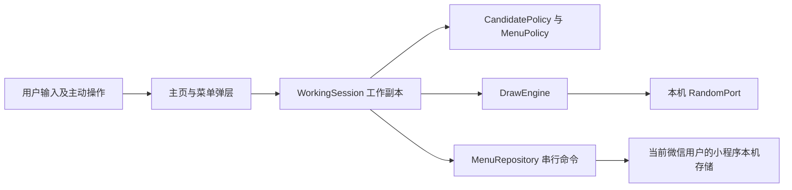
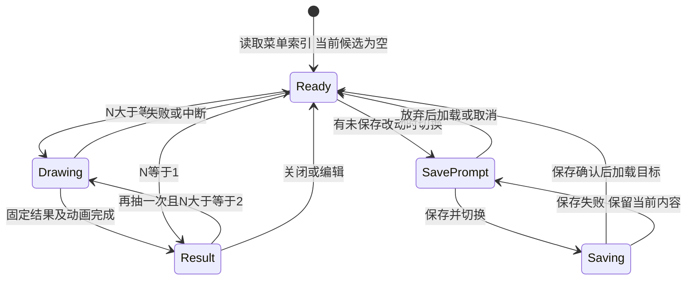

# 今天吃什么首版系统架构与交互设计

- 项目：eating-everyday（今天吃什么）
- 成果 ID：A-006
- 负责人：architect
- 关联任务：[T-002](../TASKS.md#t-002数据源可行性验证与首版界面方案)；变更交接 [H-005](../HANDOFFS.md#h-005按全手动候选需求同步架构)。
- 版本：0.5
- 更新日期：2026-10-22（Asia/Shanghai）
- 状态：draft
- 适用范围：全手动候选首版的架构、接口、页面及实现/测试一致性复核；本轮只读审查源码、既有日志和截图，未重跑产品测试或亲自操作手机。
- 来源及输入版本：[A-001 v0.9](product-requirements.md)、[A-007 v0.3](product-decision-options.md)、D-005/D-011/D-014/D-016/D-017、WORKSPACE、T-010～T-013、[A-012 v0.3](core-test-report.md)、[A-013 v0.2](miniprogram-preview-handoff.md)、[A-014 v0.3 第7节](miniprogram-test-report.md#7-v03专项收尾与手机用户自测2026-10-22)。本轮按 T-002 两条 2026-10-22 项目经理安排接续，实际接手 OPC d7882660bab261865c2d1d02e36d864d8097a07d，分支 feature/eating-everyday/t-002-readiness-review，工作树初始干净；目标基线 a735031c37c09e75fb9478681aaf42010a82f378 不变。v0.4 的 19fd36e9 接手及更早 f838dab 工作树事实保留在 Git/任务历史，不作为当前状态。
- 输入指纹：UTF-8、LF 归一化 SHA-256：A-001 为 b03a037cade0c90066ce18c9f72c222baf36f68250d09f114908687c611f731e；A-007 为 017838c96ee955b332fdb0ee46e43d8c08069247115e74a61c064a34ab08286c，已与 H-005 核对一致。
- 存储位置：OPC projects/eating-everyday/artifacts/system-architecture.md。
- 批准依据：D-016 确认范围变更，D-014 菜单规则继续有效；尚无整份架构批准。旧 v0.1/v0.2 的 15/9/26、15/13/35 设计通过 Git 历史保留，本版替代其现行设计。

## 1. 架构结论及边界

采用原生微信小程序，候选编辑、独立等概率抽取和菜单持久化均在当前设备完成。全部名称来自用户输入或其已保存菜单；首次进入从空候选开始。核心流程为“输入 → 抽取 → 明确保存 → 原样加载”，对应 11 项有效需求、11 条规则、27 项验收。

本版不包含定位、距离、附近搜索、餐厅数据入口、地图来源标识或许可策略，不设置餐厅查询网关，不发起餐厅数据请求。核心功能不需要用户注册产品账号、微信登录业务接口、地图开发者账号或云端菜单；小程序自身账号与 AppID 是后续平台测试/发布条件，详见 [A-008](accounts-access-checklist.md)。平台能够打开小程序后，核心流程不等待网络。

WORKSPACE.yaml 的 git 声明仍锁定已交付 main：git@github.com:yinzhongkai/eating-everyday.git，checkout=../eating-everyday，revision=8fa87fe4cb8f7f33aacf2842798a486150a6105e。该提交仅 README，是主线基线；**当前活动候选已有完整原生工程、核心、页面、wx 适配和测试**。本轮只读核对产品 feature/t-002-readiness-review 的 HEAD=10f52d40bb8a62b04a8f84793e44117fe3c28e46，固定实现为8e4472006f1d3cdff5b774052e01ce8db5a96453；两者差异仅测试证据，本地 main/已有 origin/main 仍为声明基线。本轮未联网刷新远端，不把活动候选称为已合入版本。

T-010～T-013 已由实际 developer/tester 接收并完成；原“无初始化、无应用、无入口、未测试”的当前结论解除。工具编译预览、真实 wx 和模拟器专项已有记录，手机基础操作、正常关闭重开加载、离线、输入法/软键盘、大字/安全区和旋转切后台由用户明确自测正常。依据本轮逐项复核，T-002 原约定设计及关键验证证据已具备，本轮 completed；整份成果保持 draft，不代替用户批准或全设备验收。

产品 project.config.json 仅保留用户已授权的本机配置差异，本轮不修改、暂存或提交。具体测试差异、证据层级及后续责任见第9节；账号入口已实际使用，不再索取 AppID、登录、扫码或菜单业务选择。

## 2. 系统与模块



| 模块 | 职责及依赖 | 失败处理 |
|---|---|---|
| MainPage / Dialogs | 转盘、名称输入、完整候选列表、保存及菜单管理；派发命令，不直接改存储。 | 提示具体错误，保留输入、工作候选及旧菜单。结果区域仅名称。 |
| WorkingSession | 当前候选、加载菜单 ID、基线版本/内容、dirty、界面阶段和抽取代次。 | 迟到回调不覆盖当前状态；仅明确保存成功才替换保存基线。 |
| CandidatePolicy | trim、非空、同一列表逐字名称去重、24 项上限。 | 不查地图，不要求真实门店、地址或类别；拒绝时不改变已有项。 |
| MenuPolicy | 菜单名 1～20 可见字符、不同菜单名唯一、非空快照、覆盖/另存语义。 | 不截断、隐式覆盖或以固定菜单份数拒绝保存。 |
| MenuRepository / StoragePort | CRUD、不可变快照、容量检查、写入确认及格式验证。 | 不以删除旧菜单腾空间；失败保留编辑态和已提交版本，保存并切换停止。 |
| DrawEngine / RandomPort | 固定候选快照、均匀索引和动画结果分离。 | 熵源失败不出结果；不根据历史调整概率，不写回菜单。 |
| GraphemeSegmenter | 对菜单名称按固定 Unicode 扩展字素簇版本计数。 | 不依赖未经验证的运行时内建能力；分段不可用时不绕过菜单校验。 |

领域规则不依赖界面、网络和存储实现。StoragePort 与 RandomPort 便于后续故障注入；首版没有服务端部署单元或外部餐厅适配器。

## 3. 数据模型与不变量

| 对象 | 字段及含义 | 约束 |
|---|---|---|
| Candidate | candidateId、displayName。ID 为内部生成，用户只填名称。 | displayName 在添加时 trim 且非空；同列表逐字唯一，顺序稳定；0～24 项。 |
| MenuSnapshot | menuId、name、schemaVersion、revision、orderedCandidates、createdAt、updatedAt。 | name trim 后 1～20 个可见字符；不同 menuId 名称唯一；完整保存 1～24 项及顺序。 |
| WorkingSession | candidates、currentMenuId 可空、baselineRevision、baselineCandidates、dirty、phase、generation。 | 不持久化未保存副本或抽取结果。dirty 按有序名称内容与基线比较；内部 ID、动画和抽取不造成内容变更。 |
| DrawResult | drawId、generation、selectedCandidateId、displayName。 | 只属一次抽取；重新编辑候选或开始新抽取时清除旧结果。 |
| StoreRoot / StoredChunk | schemaVersion、storeRevision、索引/内容引用、校验值、最近提交信息。 | 存储格式校验、分块和版本恢复使用；不增加用户输入字段或菜单份数业务限制。 |

去重只在同一份当前候选中执行：trim 后字符串逐字相同则拒绝；不同菜单可包含相同候选。不做大小写、全半角、同音或模糊合并，不再有跨来源同名例外。菜单名唯一性与候选名称唯一性分别校验，重命名菜单排除自身 ID。

加载只校验保存格式和不变量，按保存顺序恢复，不重新 trim、分类、筛选或自动生成名称。异常快照中的空名、重复、超 24 项或未知格式不静默修复成另一份菜单；提示记录不可用并保留原存储。当前实现采用 schemaVersion=1；本轮不做迁移或删除用户数据。旧 v0.2 设计字段的撤销不等于运行时迁移授权。

本版不保存位置、地址、门店来源/标识、许可、搜索状态、电话或历史抽取记录。菜单存储域按当前微信用户与小程序隔离；换微信用户不能被描述为同一存储域。正常关闭后可加载是目标，主动清除及平台清理后的找回不在承诺范围。

## 4. 输入与菜单接口

### 4.1 候选命令

| 命令 | 输入/成功结果 | 拒绝或异常 |
|---|---|---|
| addCandidate | 原始名称 → trim 后的名称及新 candidateId，追加末尾。 | 空白、同列表重名或已有 24 项时拒绝，原候选和旧菜单不变；不要求对应地图门店。 |
| removeCandidate | candidateId → 仅删除该当前项。 | 允许删除最后一项；不自动覆盖已保存菜单。未知 ID 不误删其他项。 |

名称没有 20 字符业务上限。官方 input 默认 maxlength=140，因此候选输入须显式取消该默认限制；菜单名称也先接收完整输入再按字素计数，不用控件 maxlength=20 冒充可见字符规则。[S-03](https://developers.weixin.qq.com/miniprogram/dev/component/input.html) 超长内容引起的平台资源/写入失败须明确反馈，不截断后假称原样保存；实际极端长度可用性待验证。

### 4.2 菜单仓储契约

所有菜单写操作通过同一串行队列执行，唯一性检查和 store revision 核对属于同一命令。每次操作固定 operationId、目标 ID 和 expectedRevision；新建/覆盖还保留完整有序候选快照。相同完整意图回放持久回执，不新增记录或回退当前工作态；复用 ID 但更改命令、参数或版本拒绝。公开入口须先查回执，再判断目标当前是否存在；001/002已独立复测关闭，见第9节。

| 命令 | 成功语义 | 前置及失败语义 |
|---|---|---|
| listMenus | 返回 ID、名称、revision、候选数。 | 只读本机；读取失败不能被当作空库并覆盖原数据。 |
| loadMenu | 校验并完整恢复选定 ID 的名称和顺序，设定基线、dirty=false。 | 切换前处理未保存改动；读取失败保留原工作副本和当前关联。 |
| createMenu | 以新 ID 保存非空完整候选并关联新基线。 | 校验菜单名及唯一性、候选 1～24 项；不因第 21 份或其他固定份数拒绝。 |
| overwriteMenu | 用户明确覆盖指定 ID、版本成功后更新该记录与基线。 | 不能按重名推断目标；空候选、版本或空间失败保留全部旧记录与工作副本。 |
| renameMenu | 仅更改目标菜单名。 | 与新建相同的名称校验，排除自身 ID；自身原名无变化成功；不改候选内容和其他菜单。 |
| deleteMenu | 明确确认后仅删目标保存记录。 | 取消或写入失败全不变；若删当前菜单，保留当前完整候选，清 currentMenuId/基线，标未保存。再次保存须新 ID，不能复活已删关联。 |

菜单名使用 trim 后的原字符串比较，不自动标准化为另一名称。长度按 Unicode 扩展字素簇计数，采用 [UAX #29 修订 49](https://www.unicode.org/reports/tr29/tr29-49.html) 的固定分段口径；汉字、ASCII、组合字符与合法 ZWJ emoji 分别按规则验证。20 字符不约束候选名称。实现已锁定 Unicode 18.0.0/UAX #29 rev49，使用本地属性表及等值 JS 表；独立853条语料与目标基础库/用户手机证据分别见第9节。

切换时 dirty=true 提供保存并切换、放弃并切换、取消。保存并切换在命名、非空、写入和回读确认全部成功后才加载目标；保存尚未确认的任一步失败均保持当前编辑态和菜单关联，不清 dirty、不加载目标；结果不明先核验。若源保存已经确认而目标读取失败，保留当前已保存副本和新基线，不把它误报为未保存，也不切到不可读目标。已知未提交失败后，用户仍可另选取消或明确放弃。无关联的未保存副本须先另存命名。

删除当前菜单时，无论有无修改、是否最后一份，均保留当前候选为未保存副本；若候选已删空，继续保留 0 项并按空保存规则拒绝保存。退出前未保存不要求下次恢复。删除/重命名其他菜单不改变当前候选或其保存内容。

### 4.3 本机持久化与空间失败

官方文档支持本机键值读写，并说明同一微信用户、同一小程序的存储域上限；setStorage 给出普通存储单 key 1MB、总计 10MB，以及用户删除或系统空间清理的边界。[S-01](https://developers.weixin.qq.com/miniprogram/dev/framework/ability/storage.html)、[S-02](https://developers.weixin.qq.com/miniprogram/dev/api/storage/wx.setStorage.html) 这些是平台上限，不是本项目已测可用容量或永久留存保证。

采用不可变内容块与固定大小提交根的设计，避免把全部菜单打包到单个 key 而提前触及单 key 限制。序列化后按字节分块，初始建议每块不超过 128 KiB 的原始字节，再编码为存储值，核对含元信息后的实际长度；索引同样可分块。当前实现默认128 KiB，按编码后的实际块大小检查，链式内容及索引可分块。它是内部参数，不是名称或菜单份数上限。容量预估及实际写入错误均检查；没有自动回退旧根，历史回执及孤块的容量成本见第9节。

写入流程：读取并校验当前根及 revision → 校验命令与容量 → 向新 key 写入候选副本/索引并回读校验 → 更新提交根并回读 → 才向界面报告成功和替换基线。新块全部确认前不替换可见根，不覆盖旧块，不先删除旧菜单腾空间。空间不足或准备阶段失败时，旧提交与当前编辑态保持不变；未提交块后续可清理，但不删除任何仍被有效根引用的内容。重命名、删除同样经此流程确认，不能仅改列表显示。

官方键值 API 没有在已读文档中承诺跨 key 事务或断电原子性；当前实现与分阶段故障证据支持该应用恢复协议，仍不提供平台未承诺的物理原子性。提交根回调异常但回读为新版本时须按实际提交结果恢复，不能同时宣称保存失败且旧记录必然未变；无法判定时保留编辑态、阻止继续写入/切换，提示保存状态需核验。故障注入须分别验证准备阶段空间不足、根提交异常与进程中断，不能用准备阶段测试代替整个持久性保证。损坏/未知格式时不自动清空数据库，也不悄悄恢复为已确认删除前的列表。

getStorageInfo 可提供存储使用情况；仅作为预估，实际写入仍可能失败。[S-05](https://developers.weixin.qq.com/miniprogram/dev/api/storage/wx.getStorageInfo.html) 首版不主动启用加密存储或新建云服务；如后续增加此能力，需重新核对容量、依赖和需求。正常关闭再开及离线已有用户手机自测反馈；失败恢复有独立L层及真实wx上的注入证据，不能据此称实体满配额或断电已测。

## 5. 等概率抽取与状态控制

draw(candidateSnapshot, randomPort) 返回一次固定结果。0 项提示先输入且不产生结果，1 项直接显示唯一名称。N≥2 时，每次均从快照独立选择索引，不根据历史排除上次结果、调整权重或轮换。

RandomPort 已采用官方 wx.getRandomValues：文档标注基础库 2.15.0 起支持，返回指定字节数的随机内容。[S-04](https://developers.weixin.qq.com/miniprogram/dev/api/device/crypto/wx.getRandomValues.html) 每次取得 4 字节并按固定字节序解释成无符号 32 位整数 x，令 B=floor(2^32/N)×N；x<B 时返回 x mod N，否则重新取样。每个余数有相同数量的可接受输入，避免直接取模偏差。设置有限熵源重试预算，失败报错，不用动画角度或未经核对的替代算法产生结果。

2.15.0 只是旧官方说明中的 API 起点；当前已验证基础库锁定3.17.4，工具2.02.2608080/WebView，不宣称已测试较低版本。实现按大端读取4字节，拒绝预算32次；跨执行域宿主 ArrayBuffer 转为本域 Uint8Array，保留严格类型/长度校验，001已独立复测关闭。先选结果，再确定动画终点；动画帧数、时间和历史结果不影响选择。动画结束只提交一次 drawId；再次抽取必须新建 drawId。后台/页面销毁会使 generation 失效，迟到回调不能显示旧结果或改菜单。

候选增删、菜单切换及写入在抽取期间暂不可提交；菜单写入期间也串行化相互冲突的操作，界面保持内容可见并禁用重复动作。抽取中断恢复可操作状态，不自动保存。抽中结果区域仅完整名称，按钮为再抽一次、关闭，不增加地址、距离或来源说明。



状态图展示主要流程；N=0 保持 Ready 并提示，N=1 再抽仍直接返回唯一名称。加载目标失败不丢失切换前的工作副本。

| 错误类别 | 可恢复行为 |
|---|---|
| EMPTY_CANDIDATES / INVALID_CANDIDATE_NAME / DUPLICATE_CANDIDATE / CAPACITY_FULL | 提示先添加、检查名称或先删除；原候选和已保存记录不变。 |
| INVALID_MENU_NAME / DUPLICATE_MENU_NAME / EMPTY_MENU | 保留输入、编辑态及旧记录；不截断、不继续保存并切换。 |
| STORAGE_FULL / WRITE_FAILED / REVISION_CONFLICT | 不报已保存，不清 dirty，不自动删旧菜单；按实际提交结果判断可安全重试的命令。 |
| STORAGE_UNCERTAIN / STORAGE_CORRUPT / UNSUPPORTED_SCHEMA | 保留当前内容，停止可能覆盖原数据的操作并说明读取/保存状态；不当成空库。 |
| RANDOM_UNAVAILABLE / PLATFORM_UNSUPPORTED | 不产生抽取结果，恢复按钮；说明当前平台能力未满足。 |

## 6. 页面与交互

沿用截图中的奶油纸纹、深蓝绿色轮廓以及橙、黄、浅蓝、米色扇区，主区域为顶部指针、大转盘和中心“开吃”。A-004 及旧 HTML 保留为历史视觉参考，本版不继承其中搜索或演示候选。

```text
今天吃什么？
当前菜单 [未命名 / 菜单名]   [切换 / 管理]   未保存提示
                  指针
             大转盘 / 开吃
候选菜单                                  n / 24
[输入候选名称                            ] [加入]
01  完整候选名称，可换行                         [删除]
02  完整候选名称，可换行                         [删除]
[保存这份菜单]
```

| 场景 | 可检查的呈现及操作 |
|---|---|
| 首次进入 | 候选为 0，不自动加载或预填；保存菜单索引可见，提示输入或主动加载。没有定位、距离、搜索、来源或账号登录入口。 |
| 12/24 项与长名称 | 各项等角扇区；拥挤时以编号对应候选列表，短标签可辅助显示。完整列表始终展示完整名称并换行，编号一一对应；不把完整名称截断后仅留转盘标签。320宽模拟器及用户手机专项已有结果，参数与局限见第9节。 |
| 输入与删除 | 只填名称，成功追加并同步转盘；输入失败保留文本。删除只改当前候选，可删最后一项；达到 24 项提示先删除。 |
| 保存与切换 | 已加载菜单明确区分覆盖、另存；新副本先命名。dirty 切换提供三选项，失败停留；不通过点击另一个菜单隐式丢弃修改。 |
| 菜单管理 | 按菜单 ID 重命名/删除；明确确认删除。删除当前菜单说明候选仍在但未保存，成功后显示未保存副本。其他菜单保持可用。 |
| 抽取结果 | 名称完整可读，可再抽或关闭；只显示候选名称作为结果。 |

候选区域可滚动，删除入口有名称关联和辅助功能标签；输入框、错误和焦点处理须适配键盘。长名称完整性由列表换行及结果区内部滚动保证，转盘以编号对应完整列表。当前采用离屏Canvas导出本机PNG、普通image旋转和原生按钮；只有当前候选图片就绪才允许抽取，过期导出不会替换新图。320宽截图可观察01～24及底部保存入口，详见第9节；截图审查不替代手机实测。

## 7. 有效需求和规则追溯

### 7.1 11 项有效需求

| 编号 | 设计落点 |
|---|---|
| R-01 | 原生小程序、个人选餐闭环；AppID/测试条件见 A-008。 |
| R-03 | 第 5 节固定快照、独立均匀索引、允许重复及 0/1 项。 |
| R-04 | Candidate 仅名称、trim 非空、同列表逐字去重，不查门店。 |
| R-05 | 结果区域仅完整 displayName。 |
| R-06 | 非空完整快照；0 项不新建或覆盖。 |
| R-07 | 多菜单 CRUD、唯一命名及字素计数，无固定份数业务门槛。 |
| R-08 | 工作副本与持久快照分离，loadMenu 原样恢复，抽取只读。 |
| R-10 | 当前微信用户/小程序本机仓储；正常关闭留存有用户自测，清除后不要求恢复。 |
| R-11 | 第 6 节截图配色、指针、大转盘、候选及菜单入口。 |
| R-14 | 所有候选共用 24 项上限，允许手动第 13～24 项，不挤掉旧项。 |
| R-16 | 无位置、距离、餐厅取数或预置候选依赖；平台能打开后核心流程离线。 |

### 7.2 11 条有效操作规则

| 编号 | 设计机制 |
|---|---|
| P-02 | 每次独立 1/N、允许重复；0 项提示、1 项直接返回。 |
| P-03 | 候选 trim、非空、同列表逐字同名拒绝，不作模糊合并。 |
| P-04 | 当前任一项含最后一项可删除；独立菜单重命名、删除。 |
| P-05 | 工作副本不自动覆盖，明确覆盖/另存，dirty 切换三选项。 |
| P-06 | 全部领域和仓储在本机，核心流程不等待联网服务。 |
| P-07 | 已保存记录正常关闭留存；未保存工作副本不承诺退出恢复。 |
| P-09 | 候选和快照不超过 24；满额拒绝第 25 项，无 12 项限制。 |
| P-10 | 菜单 trim 后 1～20 字素簇，跨 menuId 唯一，自身原名及明确覆盖例外。 |
| P-11 | 空候选可存在但不可保存；保存失败停止切换，旧内容不变。 |
| P-12 | 不设固定菜单份数，容量/写入失败保留旧菜单和编辑态。 |
| P-13 | 当前菜单确认删除仅删保存记录、解除关联，保留未保存副本，后续另存新 ID。 |

旧 R-02/R-09/R-12/R-13/R-15、P-01/P-08 与餐厅验证 V-01 至 V-04 已由 D-016 撤销，不是未完成技术待办，也不记为通过。旧来源设计及查询事实见 A-005 的历史归档说明。

## 8. 27 项有效验收的验证设计

下表保留27项验证方法，并补充当前证据及边界。L=独立领域/替身，D=开发工具（真实键鼠、控制器/真实wx及注入分别说明），M=用户手机自测，O=平台可打开后的离线。L、D、M/O不能互相代替；本轮复核不把27项全部宣称为独立真机端到端通过。

| 编号 | 验证输入/操作与对应证据 | 当前证据与限制（详见第9节） |
|---|---|---|
| AC-03 | 空/非空列表仅输入名称，确认加入、参与抽取且无其他必填字段。 | A-012§7 L；A-014§6/7 D实际输入、M基础添加/抽取正常。 |
| AC-04 | 固定随机输入选中某候选，核对结果区域只有其完整名称。 | L完整名称；D鼠标双项与指针对齐、24项长名结果；M抽取正常。 |
| AC-05 | 保存不同内容 M/N，切换后逐项比对名称和顺序。 | L完整快照；D多菜单/保存切换及真实wx记录；M保存加载正常，未逐份提供设备日志。 |
| AC-06 | 修改 M 后放弃并重新加载，核对原快照不变、无自动生成或查询。 | L快照隔离；D明确放弃及重新加载；静态源码无业务查询。 |
| AC-07 | 同手机同微信用户保存多份、正常关闭再开，逐份读取并比对。 | L重建、D页面重进；M用户确认正常关闭重开加载，机型/构建指纹未提供。 |
| AC-08 | 12 项、24 项及长名称，真机窄屏/键盘/大字检查截图风格、编号对应、完整名称和全部操作入口。 | D 0/1/24、320宽及长名截图；M输入法/键盘、大字/安全区正常；非全字号/机型覆盖。 |
| AC-09 | 审查均匀索引与熵源，实现验证拒绝区间和边界；抽取统计不要求有限频数完全相同，检查历史结果不改变概率。 | L全N=2～24边界/重复及源码数学依据；D真实wx双项、跨域修复；不以频数证明熵源。 |
| AC-10 | 0 项无结果并提示；1 项直接显示唯一完整名称。 | L 0/1无熵；D实际空提示/唯一完整长名；M未逐子项留日志。 |
| AC-11 | 空、纯空白、首尾空格名称，核对 trim、拒绝及仅名称即可添加。 | L拒绝/trim；D实际空白/首尾空白/粘贴；M输入法/软键盘专项正常。 |
| AC-12 | 同列表重复“面馆”及带空格同名拒绝；另一菜单可包含“面馆”，旧快照不变。 | L同列表与跨菜单；D真实重复粘贴/名称比较；不归并大小写、全半角或Unicode正规形式。 |
| AC-13 | 删除任一当前项再抽取，确认其他项保留且旧菜单不变。 | L任意/最后项删除；D页面handler及六组合含空副本；不冒充每项均物理点击。 |
| AC-14 | 按 ID 重命名/删除 M，确认不能加载已删 M，其他菜单 N 不变。 | L含001/002回放；D改名/删除、原生取消确认，其他记录不变。 |
| AC-15 | 加载 M 后增删与抽取但不保存，检查持久记录未变，抽取不改候选。 | L深隔离/dirty/抽取只读；D有修改与未保存提示、未自动覆盖。 |
| AC-16 | 明确覆盖 M，再另存 N，比较两个 ID 和完整快照、无隐式覆盖。 | L覆盖/另存；D实际稳定选项覆盖、另存新ID及真实wx核对。 |
| AC-17 | dirty 时依次验证保存成功后切换、放弃后切换、取消；对照工作状态及旧记录。 | L三分支；D实际取消/放弃/保存切换，注入失败另记。 |
| AC-18 | 平台能打开小程序后断网，执行输入/抽取/保存/加载/重命名/删除；确认无网络前置或地图账号。 | M用户在指定保存关闭重开及离线上下文确认正常；静态本机调用支持，未逐管理子分支取得离线日志。 |
| AC-20 | 主动清除本机数据再开，当前为空且不从设备/云端恢复或预填。 | L隔离清除重建；D保存后同域11key清除重建空库；未清用户真实数据或执行手机卸载。 |
| AC-25 | 24 项后添加第 25 项拒绝，删一再加可达 24，旧保存记录不变。 | L 24/25及删后加；D handler填24拒25与鼠标24项抽取，不声称逐项物理输入。 |
| AC-27 | 菜单名空白、trim、20/21 字素簇，覆盖汉字/ASCII/组合字符/ZWJ emoji；候选名称不受该上限，保存不截断。 | L固定853条语料和20/21；D家庭emoji边界及长名往返；M粘贴/IME专项正常。 |
| AC-28 | 新建/另一菜单改名为“ 午餐 ”冲突，自身原名成功、明确覆盖成功；检查无重名新记录。 | L唯一性/版本；D8个命名检查点，自身原名和明确覆盖可用。 |
| AC-29 | 0 项新建、加载 M 后删光再覆盖均拒绝；删最后项本身可成功，旧 M 不变。 | L空新建/空覆盖/切换；D空覆盖及六组合中的空副本拒绝，旧记录保留。 |
| AC-30 | 空间足够时从 20 份增加第 21 份，不因份数拒绝，每份最多 24，其他菜单不变。 | L与D控制器/真实wx均已存21份；不推导无限容量或真实满配额通过。 |
| AC-31 | 新建/覆盖分别注入准备阶段空间不足，核对不报成功、不清 dirty、不删旧记录；提交异常与中断另外验证。 | L分阶段容量/读写/回读/中断模型；D12检查点含容量夹具；实体满配额未制造。 |
| AC-32 | 当前菜单有/无修改、最后一份，分别取消/确认删除及随后另存；候选保留、关联清除、新 ID、其他菜单不变。 | L删除副本及幂等；D实际原生取消/确认＋6状态夹具组合，后续另存新ID。 |
| AC-35 | 空候选和非空空间不足分别保存并切换，核对失败不加载目标；再验证取消/明确放弃。 | L空/容量/不明恢复；D保存前失败targetLoad=0，不明冻结和显式核验。 |
| AC-36 | 12、13、24 个不同用户名称，含非门店名称，全部按容量规则加入，无类别/地图/距离门槛。 | L 12/13/24；D24项handler/显示与原生输入；没有地图或12项门槛。 |
| AC-37 | 无菜单首次为空；静态配置、依赖及真机调用记录确认没有定位请求、距离/搜索界面、餐厅请求或预置候选；全手动闭环可完成。 | L初始/隔离；D首次空/清除重建及完整菜单流程；源码配置无定位/餐厅网络调用，M基础闭环正常。 |

旧 AC-01/AC-02/AC-19/AC-21/AC-22/AC-23/AC-24/AC-26/AC-33/AC-34 已撤销，编号保留而不复用，不以取消记录为验收通过。

## 9. 当前验证结果与实施前置

### 9.1 证据版本、来源与本轮方法

本轮是 architect/system-design 的实现与证据审查，不重跑Node、CLI、SDK或手机场景。完整读取A-012 v0.3、A-013 v0.2、A-014 v0.3（当前结论在第7节），核对T-010～T-013和现行需求/决定；检查核心、wx适配、原生页面/样式、转盘及配置测试源码，审查实际TAP/专项JSON和小屏截图。历史报告前段的open/未执行按其日期保留，当前闭环采用其后续明确复测。

以下产品路径均位于本机仓库 git@github.com:yinzhongkai/eating-everyday.git，checkout=C:/Users/YinZh/Documents/workspace/eating-everyday；用精确提交定位，分支名不代替版本：

| 证据 | 精确版本/路径及范围 |
|---|---|
| 固定核心及独立闭环 | 实现54b720fa920dfcda9a3db5fa0e42378be01f5535；资产f2646b52f7e6746b2814076bfab99e91a5e95f07；test/independent/、test/evidence/tester-retest-t011-002/；A-012§7独立001/002关闭、最终257/257（开发123＋独立134）。 |
| 固定原生修复 | 实现8e4472006f1d3cdff5b774052e01ce8db5a96453；src/、adapters/wx.js、pages/index/、ui/；A-013§5开发跨域随机修复与冒烟，非tester结论。 |
| 原生独立复测与预览 | 资产d212b5908484c47906a3eb62f254b74556175a0e；test/evidence/tester-retest-t013-001/；A-014§6的001原例1/1、相关7/7及292/292，真实鼠标/菜单观察摘录、清理、111012字节预览；旧原始GUI附件缺口保留。 |
| 最新专项 | 资产10f52d40bb8a62b04a8f84793e44117fe3c28e46；test/evidence/tester-t013-special22/（下称S目录），含storage.json、name-rules.json、delete-matrix-fixture.json、native-check-*、clear-rebuild.json、lifecycle.json、small-*、两份TAP及cleanup.json。本轮核对manifest所列48份文件全部字节长度/SHA-256一致，manifest本身使目录共49份；没有重新执行脚本。 |
| 手机及离线 | A-014§7及T-013两条2026-10-22项目经理原记录：用户明确反馈基础、保存/正常关闭重开加载/离线及新增三专项正常。来源是用户自测，非tester或architect亲自手机执行；手机实际机型/版本/构建指纹未取得。 |

工具环境为报告记录的Windows11/Node24.19.0、开发工具2.02.2608080、基础库3.17.4、WebView、SDK0.13.0。390宽及320宽是开发工具模拟器；其iOS/微信模拟字段不得写成实体手机参数。10f52d4相对8e44720只新增65份测试证据，受控实现/原测试未变；本轮本机配置原始SHA-256为97f3a1355a54a3c8875f6da96580357c1fbc3a639079e009acf0aa07c6bae2db，与tester收尾一致。

### 9.2 PV-01 至 PV-06 当前复核

| 编号 | 实现/证据核对 | 结论及实际边界 |
|---|---|---|
| PV-01 范围与追溯 | A-001/A-007双指纹不变，第7/8节逐号11/11/27；T-010～T-013实际完成；全手动本机边界符合D-016。 | 本任务设计与追溯完成；没有新业务取舍或费用差异。旧数据验证是撤销，非通过；整份成果未批准。 |
| PV-02 本机存储 | src/repository.js:34、67、122、193；src/session.js:40、104、116；adapters/wx.js:11。不可变内容/索引逐块回读、根提交完整核验、显式恢复；A-012§6/7分阶段L故障；S/storage.json十二检查点及M正常关闭留存。 | 原实现/失败保护证据缺口解除。准备失败不换根、不丢副本；根实际已写且核验成功按成功，状态不明冻结；源已保存目标读取失败保留源。未证明跨key或断电原子性，也未物理填满手机。 |
| PV-03 字素与长名 | src/policy.js、graphemes.js及固定18.0.0数据；WXML两输入maxlength=-1；A-012§6.3独立853条分界、20/21组合/ZWJ，A-014§6家庭emoji/长名往返及§7真实输入/同名、M三专项。 | 对应字符/平台证据已具备；候选无菜单20字限制，无截断或隐式标准化。不是所有Unicode极端长度/所有输入法覆盖。 |
| PV-04 随机 | src/draw.js:4大端32位拒绝采样/32次预算、0/1无熵；WxRandom跨域合法值复制，严格拒绝伪造和错误长度；A-012全N边界/重复、A-014独立关闭001、D双项和24项。 | 随机实现符合条件均匀契约，历史不改概率；均匀/独立以平台熵源性质为前提，有限频数不作证明。无不安全回退。 |
| PV-05 UI与离线 | pages/index/、ui/wheel-preview.js及wheel.js；S/small-24-top/bottom、small-long-result等截图/JSON，编号01～24、完整列表、保存和结果按钮；lifecycle.json旧回调不污染新页。M三专项及离线正常。 | 原关键界面/离线证据缺口解除。实际查看本轮3张320宽图并对照视觉参考；图片是既有执行的审查，不是本轮重测。手机设备元数据和逐离线管理子分支日志未提供；不宣称全设备通过。 |
| PV-06 入口与承接 | 完整app/page工程、固定打包路径和运行说明；T-010～T-013实际接收与完成；A-013§5、A-014§6/7真实编译/预览及用户扫码。 | 当前开发/预览入口已用，不再要求注册或重新扫码证明；公共占位配置与本机实际AppID分列见9.4。正式发布资格不由预览推定。 |

### 9.3 B-01 至 B-04 解除及任务结论

| 原阻塞 | 解除证据、影响和当前行动 |
|---|---|
| B-01 实施任务/可运行版本 | T-010～T-013已安排、实际接收且completed；上述8e44720工程与10f52d4证据可读取。原“仅README/无成员初始化”不再描述候选；无需用户重建成员或另建实现分支。 |
| B-02 入口/运行资格 | 既有AppID/登录工具实际编译、独立预览和用户扫码基础使用正常；A-014§6/7。当前验证的入口阻塞解除，发布手续仍后置。 |
| B-03 存储/状态 | L完整阶段风险与历史回执复测、D真实wx上12检查点及用户M留存；源码提交/恢复路径一致。原缺少实现和实际验证的阻塞解除，物理边界限制单列。 |
| B-04 字符/随机/UI/离线 | 固定字素语料、D输入/长名/24项/随机/生命周期和M三专项/离线，具体边界见9.2。原缺证据阻塞解除，未测项不扩写为通过。 |

**本轮未发现使T-002原约定设计与关键验证无法完成的剩余技术阻塞；T-002本轮completed。** 完成依据是逐项源码与分层证据复核，不是仅引用T-013 completed。本轮真实阻塞清单为空，因而没有需用户选择的业务差异、费用或补开权限事项；**当前无须用户确认**。保持成果draft，不新增交叉评审或批准门槛，也不等同整份首版验收、全部27项真机独立通过或正式发布。

### 9.4 实现细化及本机291/292差异

| 差异/细化 | 判断与后续责任 |
|---|---|
| 单写入者、分块及格式 | 固定根ee/root与ee/block/*，首存genesis空根；128KiB链式块及分块索引，root.revision映射storeRevision。MenuSnapshot的schema在内容封装中，DrawResult实际为candidateId/index/displayName，名称/顺序与业务语义不变。完整快照/工作副本深隔离；无需改需求。单例repository队列串行，不声称跨进程CAS。 |
| 完整意图持久回放 | 索引保存operationId＋命令/原参数/版本及回执，新建/覆盖可传原candidateNames；历史回放不作用于当前副本。001/002独立关闭而非吞错。该实现落实原幂等契约，不是新业务入口。 |
| 图片及生命周期 | 原可视Canvas改成离屏PNG＋image旋转，避免层级遮挡；旧图片导出/随机/动画均有代次或存活检查。均匀结果先确定再动画，不影响概率；符合原界面目的。 |
| 提交基线292/292 | S/candidate-baseline-292.tap与baseline-export.json：未改d212b59归档，退出0、292/292；8e44720至10f52d4只有证据变更。限定提交基线，不能代称当前本机工作树全通过。 |
| 本机工作树291/292 | S/combined-292.tap及evidence-redactions.json：退出1，唯一失败test/miniprogram-package.test.js:5断言公共appid为touristappid，而本机是已授权实际AppID。该复合工程用例在AppID断言处停止，其后检查不能由本次失败运行推定已执行；提交基线及其他测试证据另列。 |
| 配置与交付影响 | 本轮脱敏比较仅顶层appid、setting、editorSetting、simulatorPluginLibVersion有差异；libVersion/miniprogramRoot/compileType/packOptions未变。实际工具验证走本机配置，Git候选走占位配置。不是功能回归或T-002阻塞，但当前本机套件仍红，不能宣称本机全绿或把配置差异混入交付。保持文件字节，不回退或提交实际AppID。 |
| 最小后续建议 | project-manager后续在既有范围安排developer明确“仓库配置检查”和“本机可运行配置检查”的边界，保留受控占位/打包/入口断言；本机路径校验非空有效配置及相同关键打包条件，不因AppID不同就跳过整个复合用例。tester分别复跑干净提交与保留配置的工作树并留证。若工具持续改公共配置，developer给出最小本机配置隔离方案再实施，避免覆盖用户设置。本轮不改产品/测试、不代开任务或重开他人任务；该维护建议不要求用户现在决定账号或批准代码。 |

### 9.5 非阻塞限制、后续交付与证据责任

| 项目 | 已知影响、下一位行动人及需处理的时点 |
|---|---|
| 实体满配额、强杀/断电、设备清库和全交叉故障 | L故障模型及D注入已测所述路径，未覆盖物理极限和全部组合。当前AC-31/35明确允许模拟，正常关闭有M反馈，不能机械改成新阻塞。未来相应任务由tester在独立测试域/安全设备补证；不破坏用户菜单造故障。 |
| 多设备/全部字号/极端长名与性能 | 当前个人本机范围不要求多设备同步或所有机型认证。320宽D及M专项支持本轮，未来扩大兼容范围时由项目经理安排developer/tester补测。 |
| 手机机型、系统、微信、构建指纹缺失 | 限制复现和精确归因；用户自测反馈本身保留有效来源，不编造参数、不转成独立测试。后续若发生设备问题或固定交付候选，tester记录可取得环境和预览版本；当前不再要求用户重复同一操作或确认菜单规则。 |
| 旧GUI原始附件缺口 | A-014§6部分观察器PNG/JSON未落盘，只剩实际工具摘录。本轮§7新资产及其校验可支持新专项，不能补造旧场景原图；本轮审计限制保留。未来需要严格重演时tester按具体交付范围补证，不对全部旧流程无界重跑。 |
| 历史回执、孤块及全量恢复成本 | 当前不自动清理旧不可达块，幂等回执不压缩且含快照，持续写入会消耗空间，全量验证可能变慢。src/repository.js:183、216及docs/core-api.md:104明示；不违反“无业务份数上限”，失败应保留当前有效记录。后续有实际容量/性能问题时developer评估安全清理/回执保留方案，tester验证不删活块、不复活已删记录；本轮不改格式。 |
| 主线合入和发布 | 两仓库仍在同后缀feature，WORKSPACE仍main README基线。本轮只本地治理提交并停止；后续合入/最终验证/基线推进/清理由项目经理按授权协调，不把它们当本次专业复核尚未交付。正式主体/类目/备案认证及费用保持未核实，实际发布计划出现时查当时官方/账号依据并确认，不由本轮预览推出资格或新增费用结论。 |

本轮只更新本人A-006/A-008、T-002和索引。PROJECT/STATUS中的旧摘要由原维护人后续依据此结果同步，H-005/H-006仍由原发起人核对；过期摘要和未关闭历史交接不改变本轮专业结论。本会话不触发其他会话。

## 版本记录

| 日期 | 版本 | 变化 | 状态 |
|---|---|---|---|
| 2026-10-19 | 0.1 | 形成系统边界、模块、模型、接口、异常和交互方案，覆盖 15 项需求、9 条规则和 26 项验收；列明来源与菜单边界待确认项。 | draft |
| 2026-10-19 | 0.2 | 接收 A-001 v0.8、A-007 v0.2 及 D-012 至 D-015；同步七项选择，区分成功样本与失败残留，落实唯一命名、可见字符、空保存、份数、当前菜单删除和同名概率，追溯扩为 15/13/35。 | draft |
| 2026-10-20 | 0.3 | 接收 A-001 v0.9、A-007 v0.3 和 D-016，改为本机全手动闭环；移除定位/餐厅来源依赖，重建 11/11/27 追溯，补官方存储、输入及随机 API 证据与新范围前置。 | draft |
| 2026-10-21 | 0.4 | 基于实际 git 产品基线复核 PV-01 至 PV-06，解除过期工作区前置；明确 B-01 至 B-04、当前可做工作、用户最少准备和研发/兼职测试衔接，保留旧核实日期与未验证状态。 | draft |
| 2026-10-22 | 0.5 | 基于8e44720实现、10f52d4专项与用户手机反馈复核PV/B并解除原四阻塞；补27项分层证据、实现细化、291/292配置测试差异和非阻塞限制，T-002按原条件completed；未重跑产品或代为批准。 | draft |
