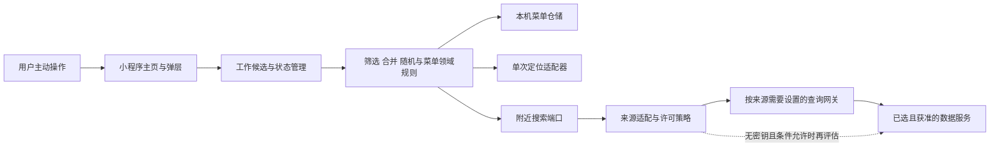
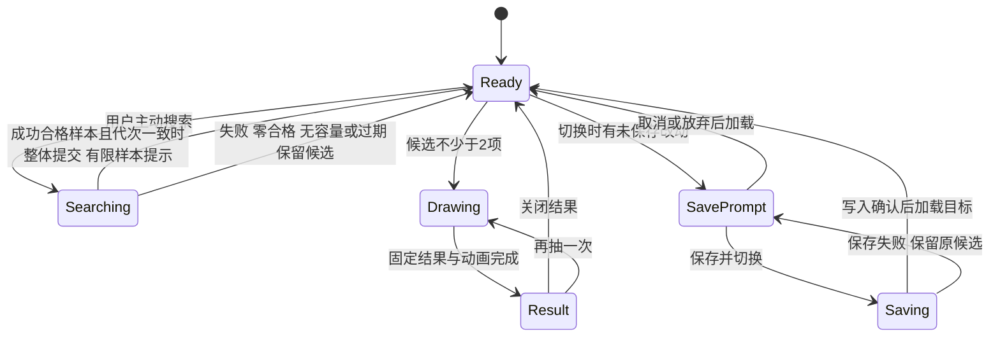

# 今天吃什么首版系统架构与交互设计

- 项目：eating-everyday（今天吃什么）
- 成果 ID：A-006
- 负责人：architect
- 关联任务：[T-002](../TASKS.md#t-002数据源可行性验证与首版界面方案)
- 版本：0.2
- 更新日期：2026-10-19
- 状态：draft
- 适用范围：首版系统边界、模块、数据模型、接口、状态及页面交互；供后续需求取舍、评审与研发使用，不是产品实现。
- 来源及输入版本：当前为 [A-001 v0.8](product-requirements.md)、[A-007 v0.2](product-decision-options.md)、D-001 至 D-015、T-006、H-003 及 [A-005 v0.2](architecture-data-verification.md)；实际读取提交 71c4b4eccb0b9f1a99ab5b576845d1d3f17c44de。A-001 的 UTF-8、LF 归一化 SHA-256 为 7c57128f600c73a1ae028e40d277cf447233d055cf8095291951759e04ba530d，A-007 为 d102cf95f9deb26d45604fc554a71dde053f467a85b759818f12824b5ca46a05，均已实际核对。A-002 v0.2、A-003 v0.1、A-004 v0.1 和已查看截图继续作为参考；原 v0.7 接收与 H-002 指纹保留为历史。
- 存储位置：OPC projects/eating-everyday/artifacts/system-architecture.md。
- 批准依据：D-012 至 D-015 确认验证顺序、成功样本及菜单与同名候选的七项业务选择，已在本版落实；不等于整份架构、具体供应商、费用、平台或真实覆盖获批准，成果仍为 draft。

## 1. 架构结论和实施条件

建议采用**原生微信小程序、本机菜单存储、供应商可替换的数据入口**。候选处理、随机抽取、菜单保存与加载在客户端完成；附近搜索通过独立适配接口取得已获许可的门店。菜单加载不依赖账号、定位或网络，也不主动刷新旧候选。

目前没有已通过的数据来源；用户此前确认尚未注册或开通开发者账号与 AppID，未取得改变这一事实的新证据。来源项目资格、保存许可、餐厅数据可达性与真实覆盖、微信定位和存储仍待补证。本版对应 15 项需求、13 条规则、35 项验收；按 D-012 先验证开放数据路线，保留高德候选，不选定当前失败的端点。

实施前须落实来源和适用许可、有效地区样本、AppID 及平台接口、获授权成果物工作区。TBD-05、TBD-06 的业务选择已由 D-014、D-015 收敛，剩余为技术实现验证，不重复请求业务选择。当前 WORKSPACE 为 none，本轮仅形成治理文档；时间、规模和性能 SLA 尚未约定。

## 2. 系统边界与部署选项



小程序负责用户交互、候选来源区分、容量和抽取规则、本机菜单，以及结果只显示店名。定位仅由用户搜索动作触发，不建立后台位置监听。第三方服务负责其收录的门店记录；来源不保证现实世界全部门店或实际营业状态，本设计也不增加营业状态硬筛选。

网关是待落实基础设施的设计选项：密钥型服务应由受控服务端保管密钥、限制调用和费用，客户端不打包服务端秘密；网关不存用户菜单或手动店名。是否采用微信云开发、其他 HTTPS 服务或免密钥直连，需在来源、平台能力和费用明确后确定，本轮未部署。选择直连也必须核对 HTTPS 域名、访问条件和位置处理要求，不能仅因无需 Key 就视为可接入。

OSM + Private.coffee 的运行接入应特别处理该运营者“不含个人可识别信息”的条件。建议评估由网关获取固定公共区域/网格数据、客户端用实时位置精确过滤的方式；外部查询使用公共区域，避免发送用户标识及私人精确位置。网格须覆盖原搜索圆，不能改变用户的 1/3/5 公里筛选规则。该方案仍需验证数据完整性、位置隐私与网关运行成本；代理转发本身不等于已经满足服务条件。

首版不增加用户注册、云端菜单同步、导航、评分推荐、广告或支付。后续若提出这些内容，另行确认范围。

## 3. 模块及依赖职责

| 模块 | 职责及输入输出 | 失败影响与隔离 |
|---|---|---|
| MainPage / Dialogs | 呈现转盘、完整候选、搜索和菜单操作；只派发命令。 | 显示错误不修改保存数据；结果文本仅店名。 |
| WorkingSession | 持有当前候选、已加载菜单 ID、基线版本、dirty、请求代次和抽取状态。 | 过期搜索、重复点击及动画回调不能改写新状态。 |
| CandidatePolicy | 校验名称、门店去重、距离和分类、12/24 项合并；不发网络请求。 | 校验失败返回明确原因，当前候选整体保留。 |
| NearbySearch | 编排定位、来源查询、成功/失败判定及样本限制提示。 | 成功合格有限样本可更新；定位/网络/分页失败完整保留旧候选，手动和本机菜单仍可用。 |
| LocationPort | 获取带坐标参考系和精度说明的一次定位。 | 未授权、不可用、参考系未知分别返回错误，不编造坐标。 |
| RestaurantSourcePort | 将所选来源转换为统一门店及证据格式；核查来源策略。 | 某来源失败不自动改用未批准供应商，不混入模拟门店。 |
| MenuRepository | 管理非空完整快照，校验名称唯一性、版本及恢复。 | 空保存或空间不足不报成功、不清 dirty、不删旧项，无固定业务份数门槛。 |
| DrawEngine / RandomPort | 从固定候选快照选择等概率索引；动画只表现结果。 | 熵源失败不产生假结果，重复回调不重抽；从不写回菜单。 |
| SourceNotice | 记录来源、许可及必须呈现的标注，与手动项区分。 | 必需标注无法落实时阻止选用该来源，反馈需求差异。 |

领域规则保持为不依赖 UI、网络和存储的可验证函数，便于用 AC-21 至 AC-26 的确定输入验证。技术栈和适配器版本在实际工作区落实后锁定；本轮没有引入依赖库或产品代码。

## 4. 数据模型及不变量

以下为设计契约字段，非已实现代码或新的用户必填项。

| 对象 | 关键字段及含义 | 生命周期和约束 |
|---|---|---|
| Candidate | candidateId、displayName、sourceKind=manual/map；地图项另有 provider、providerPoiId、provenanceRef。 | 名称去首尾空白且非空；保持稳定身份与顺序。manual 不要求地址，map 不因同名就合并。最多 24 项。 |
| Provenance | provider、licenseId、policyVersion、fetchedAt、attributionRef。 | 与地图候选快照一同保存，供加载后的来源标注使用；不把来源改写成用户原创。 |
| MenuSnapshot | menuId、name、schemaVersion、revision、orderedCandidates、createdAt、updatedAt、provenance。 | name 经 trim 后为 1～20 个可见字符且不与其他菜单重名；保存 1～24 项完整候选、两类来源及顺序；加载不查询供应商。 |
| WorkingSession | candidates、currentMenuId 可空、baselineRevision、baselineCandidates、dirty、epoch、searchState、drawState。 | 只属当前操作会话；抽取结果、半径选择不自动覆盖菜单。dirty 以候选及明确纳入保存的字段与基线比较。 |
| LocationFix | latitude、longitude、crs、accuracy、obtainedAt。 | 内存短期使用，不附入保存菜单；每次用户主动搜索重新获取。未知参考系不参与距离运算。 |
| SearchBatch | requestId、epoch、origin、radiusMeters、provider、sourceDataTime、policyVersion、retrievalStatus、sampleCompleteness、limitReasons、restaurants。 | 请求成败和样本完整性分开；成功有限样本可使用，失败残留禁止提交，不混同保存菜单。 |
| RestaurantRecord | providerPoiId、name、point、crs、category、unroundedDistance、pointRole。 | 缺关键身份/名称/位置或类别不明时记录排除原因；距离在统一参考系下计算。 |
| SourcePolicy | evidenceRefs、allowedFields、retention、offlineReuse、attribution、publicDistribution、verifiedAt。 | 外部许可证据，不是用户可自行勾选的授权。与原样加载不兼容时先解决差异。 |
| StoreEnvelope | schemaVersion、revision、menuSnapshots、checksum、commit 元信息。 | 用于一致性核对、故障恢复和格式迁移；不能据此声称平台存储具备 ACID 或永久留存保证。 |

持久化不包含当前搜索中心、用户轨迹、定位精度、供应商完整响应、地址电话、评分或历史抽中记录；这些不属于本次保存闭环所需字段。菜单只存在当前手机的小程序存储域，许可与留存条件仍须验证。清除本机数据后不要求恢复，存储容量不足时不能自动删除旧菜单。

标识及去重：地图项使用 provider + providerPoiId；同一来源同店合并，不按名称合并不同门店。OSM node/way 可能重复描述同店，须结合来源关系、地址和位置证据识别，不能以对象数冒充真实门店数。手动项之间按 trim 后名称比较，不作模糊匹配。按 D-015，手动与地图同名两项分别保留、计数，并提示同名及来源，保存加载不变；每项为 1/N，N=3 时两个同名项对应名称合计为 2/3。抽中结果仍仅店名。

## 5. 接口契约

### 5.1 附近搜索边界

客户端领域接口：searchNearby({requestId, epoch, radiusMeters})，半径仅允许 1000、3000、5000；定位由 LocationPort 取得，用户不填写坐标。来源接口输入包含 center 的坐标和 crs、radiusMeters、分类策略版本与期望数量 K。K=min(12,24-M)，M 是本次候选快照中的手动项数；M=24 时不发定位或供应商请求，返回容量提示。

来源响应须包含门店 ID、名称、类别、位置及参考系、来源/查询时间和分页信息。retrievalStatus 取 success/failed；sampleCompleteness 取 full/limited/unknown。success 指本次计划执行的取数请求均正常完成且响应通过校验，不要求证明来源全量。limitReasons 记录接口或预设预算取数上限、漏店风险；unknown 仅指覆盖范围未知，不是请求是否完成未知。

按 D-013，success 且有合格门店时，limited/unknown 也可参与样本内排序，并提示“返回样本，结果可能不完整”。预先计划最多取 p 页，正常完成后停止属于成功受限样本；已发起的某页失败或缺失则整批 failed，残留不得提交，不能事后改称预算停止。HTTP 200 仍须核对业务错误、Overpass remark、错误正文及 JSON 完整性。许可缺失、批次结构损坏或中心/参考系错误不因接受有限样本而通过。

来源适配层先确认许可与请求条件，再取得足量数据，按下列顺序输出：

1. 核对来源许可、响应成败和参考系；逐条核对门店身份、非空名称、合法位置及 R-12 分类。记录级不合格项排除并记原因，不进入合格样本；批次、中心或参考系无法可靠解析时整批失败。排除纯茶饮/咖啡/甜品/酒吧及无具体门店的合集。
2. 按已定义门店身份去重，分析同名不同门店和跨对象重复；不增加评分、人均或营业状态筛选。
3. 使用一致参考系计算直线距离，以未四舍五入距离 d≤r 判定；不使用步行/驾车距离。坐标转换方式及误差在适配器验证中记录。
4. 对成功返回样本按距离升序，同距离按稳定来源 ID 排序，取最多 K 项；不足按实数，不扩半径，不推断样本外没有更近门店。
5. retrievalStatus=success、结果非空、许可与有效性通过且 epoch 一致时，一次替换全部地图项，保留手动顺序；新地图项附后，同名两项保留并提示，总数≤24。样本有限或范围未知时同时提交完整性提示。
6. 定位/网络/分页失败、零合格、无容量、许可缺失、批次关键数据错误或请求过期时，候选及保存不变；成功受限样本本身不是失败原因。

手动添加、删除、加载菜单或再次搜索使 epoch 递增。搜索期间用户仍能处理本机候选；迟到响应因 epoch 不同被丢弃，不覆盖新选择。半径变化不会自行搜索；若已有查询，其响应不得冒充新半径结果。重复点击搜索采用单飞与请求代次，取消本地请求不意味着供应商未扣量。

### 5.2 本机菜单接口

| 命令 | 输入与成功含义 | 校验、冲突和失败 |
|---|---|---|
| listMenus | 返回菜单 ID、名称、版本及候选数量。 | 不请求定位或来源；损坏记录单独标明，不当作空库覆盖。 |
| loadMenu | menuId → 完整候选与来源快照。 | dirty 时先处理保存/放弃/取消；校验格式、数量和来源字段，不重新筛选或刷新地图项。 |
| createMenu | operationId、name、当前完整候选。 | 校验 1～24 项、trim 后 1～20 可见字符及名称唯一，创建新 ID；同 operationId 重试不重复创建，无固定业务份数门槛。 |
| overwriteMenu | operationId、menuId、expectedRevision、非空候选。 | 按 ID 明确覆盖，自身原名不算重名，不能覆盖其他 ID；空候选、版本或空间失败保留旧记录与编辑态，成功才更新基线。 |
| renameMenu | menuId、expectedRevision、newName。 | 与新建一致的名称校验，唯一性比较排除自身 ID；自身原名是无变化成功，不改变其他菜单。 |
| deleteMenu | menuId、expectedRevision、明确删除确认。 | 成功后仅删目标记录；若为当前菜单则保留完整编辑候选，解除 currentMenuId/基线，标为未保存，后续另存新 ID；取消或写入失败全不变。 |

名称提交时再次 trim，不截断。重名按 trim 后字符串逐字相同比较，不作大小写、全半角或同音模糊合并。唯一性检查与写入在同一本机队列中串行执行并核对 store revision，避免两个异步操作同时通过旧名单校验。

可见字符计数采用 Unicode 扩展字素簇，不用 UTF-16 码元长度或简单码点数量；依据 [UAX #29 修订 49](https://www.unicode.org/reports/tr29/tr29-49.html)。汉字、ASCII、组合字符和合法 ZWJ emoji 按对应字素簇计数，不能拆分或 substring 截断。仅不可呈现内容不能当作有效名称；实施时明确控制/格式字符校验并保留合法组合序列。研发阶段锁定分段表和版本，在目标基础库及手机验证，不假定已有兼容内建能力。20 字符限制不用于店名。

0 项不得新建/覆盖，但允许删除当前最后一项；保存失败保留实际编辑态与旧记录。保存并切换先完成校验、写入和回读确认，任一步失败均不加载目标；仍可明确放弃后切换或取消。删除最后一份菜单也保留当前未保存副本，不自动另存，退出前未保存不要求下次恢复。

写入恢复方案为设计建议：在两个存储槽中向非活动槽写入新 revision 和校验值，回读验证后更新活动指针，再回读确认；保存完成才向 UI 报成功。旧有效槽保留供中断恢复；初始化只加载具有有效提交标记和校验值的记录，不能把未完成写入当作已保存版本。容量评估包含双槽及元信息开销；不够时返回错误并保留旧版本，不先删除旧数据腾空间。

此方案并未证明微信底层写入具备断电原子性或持久化刷新保证。实际适配器需按官方能力和真机故障注入验证写入中断、指针中断、损坏及恢复。平台支持、容量和回收条件未核实前，不给出具体 MB 或菜单份数保证。未来格式迁移先验证副本，失败回退，不静默丢字段或强行加载超过 24 项的异常数据。

### 5.3 抽取接口

draw(candidateSnapshot, randomPort) → {drawId, selectedCandidateId, displayName}。0 项返回 EMPTY_CANDIDATES，1 项直接返回唯一名称；N≥2 时从固定快照等概率选择索引，每次独立，不根据历史加权或排除上次结果。

RandomPort 应提供均匀整数。若采用均匀 32 位随机数，令 B=floor(2^32/N)×N，只接受 x<B，再取 x mod N，避免直接取模偏差；平台熵源及具体 API 在研发时验证，不声称当前已有可用实现。先选定索引再规划旋转终点，动画时长和帧率不参与概率。抽取期间锁定候选变更、搜索及菜单切换；通过 drawId 防重复完成回调。中断只取消展示，不覆盖菜单；结果仅显示完整店名。

## 6. 状态、并发与错误语义



状态图是主要命令流程；1 项抽取直接进入 Result，0 项停留 Ready 并提示。搜索与手动编辑的交错由 epoch 处理；保存和菜单变更串行化，不能让两个异步写入按回调顺序覆盖版本。

| 错误 | 处理与可恢复路径 |
|---|---|
| LOCATION_DENIED / LOCATION_UNAVAILABLE | 提示本次搜索不可用，保留手动添加、加载与已有候选抽取；用户下次主动重试。 |
| SOURCE_UNCONFIGURED / LICENSE_UNVERIFIED | 显示来源未就绪，记录缺口；不选用未知许可服务或模拟数据。 |
| NETWORK_TIMEOUT / RATE_LIMIT / QUOTA_EXCEEDED | 保留候选；明确未更新。重试须有次数和费用预算，不无限自动重试或自动购买。 |
| INVALID_SOURCE_DATA / UNKNOWN_CRS / SOURCE_REQUEST_FAILED | 关键结构、参考系或请求失败不提交残留；错误响应不能改称成功受限样本。 |
| SAMPLE_LIMITED（成功提示） | 可更新合格样本并提示可能不完整，不作异常拒绝；结果弹层仍仅店名。 |
| NO_ELIGIBLE_RESULTS / CAPACITY_FULL | 不清空旧地图项、不挤掉手动项；容量满时建议先删除。 |
| STALE_SEARCH / REVISION_CONFLICT | 丢弃旧结果或拒绝覆盖，提示按当前状态重新操作；不静默重放旧命令。 |
| STORAGE_FULL / WRITE_FAILED | 不报已保存，不清 dirty，不删除旧菜单；保留当前内容以便重试。 |
| INVALID_MENU_NAME / DUPLICATE_MENU_NAME / EMPTY_MENU | 提示换名、检查长度或先添加候选；保留编辑态与旧记录，保存并切换停止。 |
| STORAGE_CORRUPT / UNSUPPORTED_SCHEMA | 优先恢复已验证的旧版本；无法恢复时说明受影响菜单，不把坏数据当成用户主动清空。 |
| RANDOM_UNAVAILABLE | 不产生结果，恢复按钮可用状态；不以动画角度补造抽取。 |

## 7. 页面与交互方案

沿用用户截图的奶油纸纹、深蓝绿色轮廓及橙/黄/浅蓝/米色扇区；实际截图中的 12 项布局已查看。继续采用 A-004 的单主页和弹层方向，不修改其历史作者与版本。

```text
今天吃什么？
当前菜单 [未命名 / 菜单名] [切换/管理]   未保存提示
[1公里] [3公里 默认] [5公里]  [搜索附近餐厅]
             指针
        大转盘 + 中心 开吃
候选菜单                                  n / 24
[只填写店名                    ] [加入]
完整候选列表：编号、完整店名、来源提示、删除入口
[保存这份菜单]
地图数据来源与许可入口（有地图项时可见）
```

| 场景 | 可检查的交互约定 |
|---|---|
| 首次进入 | 显示空候选及搜索、手动添加、加载入口；默认 3 公里，不自动触发定位。 |
| 12/24 项及长名称 | 候选列表完整显示名称并换行；转盘在名称拥挤时用编号对应完整列表，候选与扇区一一对应。编号呈现为待评估设计建议，不取代 AC-08 的可辨认要求。 |
| 搜索反馈 | 显示正在搜索、样本内加入数量或未更新原因；成功受限时提示“结果可能不完整”，不宣称附近总量。已有候选保持可见，改半径只影响下一次主动搜索。 |
| 候选增删 | 添加仅店名；成功同步转盘和列表，跨来源同名分别保留并显示“手动/附近”来源及同名提示。删除只改当前候选，不暗中保存。 |
| 抽中结果 | 弹层主内容仅完整店名，提供“再抽一次”“就这家/关闭”；不添加地址、评分、距离或导航。 |
| 保存 | 新菜单校验 trim 后 1～20 可见字符、不同菜单不重名、候选非空；明确区分覆盖与另存，防重复提交；失败保留内容和旧记录，无固定份数上限。 |
| 切换菜单 | dirty 时提供保存并切换、放弃并切换、取消；保存失败不得继续切换。新未命名候选选择保存时先完成命名。 |
| 管理菜单 | 按 ID 操作、名称唯一；删除当前菜单前说明只删保存记录、候选保留且需另存才能下次加载。取消不变，删除成功显示未保存副本，不能覆盖已删除 ID。 |
| 来源标注 | 放在候选和菜单来源上下文，提供许可入口；结果显示规则继续遵守 R-05，不能以弹层遮挡为由绕开来源要求。 |

键盘弹起时保留输入与提交可见性；删除按钮有可读标签，错误与焦点可被辅助功能识别。动画为结果表现，可提供减少动画的实现选项；上述为设计目标，尚未在小程序真机验证。没有新增 HTML 或模拟店名作为本轮验证证据。

## 8. 需求和规则追溯

### 8.1 15 项需求

| 编号 | 设计落点与当前限制 |
|---|---|
| R-01 | 微信小程序边界、个人饭点选餐流程；AppID 与平台准入待落实。 |
| R-02 | LocationPort、半径枚举、统一参考系及 d≤r；真实样本待验证。 |
| R-03 | RestaurantRecord 的具体门店约束，DrawEngine 单个候选选择。 |
| R-04 | 手动项仅店名、不受地图筛选；跨来源同名两项保留、提示并计入容量和概率。 |
| R-05 | 结果弹层仅 displayName；来源标注在候选/菜单上下文核对。 |
| R-06 | 保存完整非空候选及来源；0 项禁止新建/覆盖，许可见 A-005 V-02。 |
| R-07 | 多菜单 CRUD；trim 后 1～20 可见字符且名称唯一，无固定业务份数上限，空间不足保留旧项。 |
| R-08 | loadMenu 只读本机快照，不定位、不刷新；位置变化无更新命令。 |
| R-09 | epoch 校验、手动保留和整体提交；成功有限样本可更新，网络/分页失败或零合格保留旧列表。 |
| R-10 | 本机仓储、写入确认与恢复设计；正常退出留存待官方能力和真机验证。 |
| R-11 | 第 7 节截图风格、转盘和完整候选列表。 |
| R-12 | 分类策略适配和审计；不加入评分、人均、营业状态门槛。 |
| R-13 | D-013 成功样本契约，去重筛选后样本内距离前 K，提示限制，不比较未知门店。 |
| R-14 | K=min(12,24-M)、总数 24 的领域不变量；满额拒绝加入。 |
| R-15 | D-012 开放数据优先、高德保留；数据许可与查询/运行成本分开，尚无最终满足来源。 |

### 8.2 13 条操作规则

| 编号 | 设计机制 |
|---|---|
| P-01 | 半径枚举及含边界的未取整距离比较。 |
| P-02 | 固定快照、独立均匀索引、0/1 项；同名两项各为 1/N，名称合计依项数增加。 |
| P-03 | trim 非空、同来源去重；跨来源同名不合并/改标，提示同名及来源。 |
| P-04 | 当前候选删除与独立菜单重命名/删除接口。 |
| P-05 | 工作副本与保存快照分离、expectedRevision、dirty 切换提示。 |
| P-06 | 网络/分页失败及零合格保留全部旧候选，不采用失败残留；手动与本机加载独立。 |
| P-07 | 本机持久化与正常关闭再加载目标；主动清除后无恢复要求。 |
| P-08 | 在成功样本内分类、半径、去重和排序并提示限制；加载不再次筛选。 |
| P-09 | 手动优先与 12/24 容量公式；满手动项时不发搜索、不挤掉。 |
| P-10 | 菜单名 trim、1～20 字素簇、不同菜单唯一，自身原名及明确覆盖例外，不截断。 |
| P-11 | 空候选可存在但不能保存；失败保留编辑态和旧记录，保存并切换停止。 |
| P-12 | 不设固定份数门槛；实际空间不足明确失败，不淘汰、不清 dirty。 |
| P-13 | 当前菜单确认删除只删记录，保留未保存副本并解除 ID；取消不变，后续另存。 |

## 9. 35 项验收的验证设计

本表给出后续验证方法，**全部尚未作为小程序实现执行或通过**。领域夹具可以验证确定规则；涉及平台、真实来源、视觉及留存的条件还须小程序真机证据。既有 HTML 自查不能替代这些证据。

| 编号 | 组件与验证方式 | 所需证据/前提 |
|---|---|---|
| AC-01 | 半径控件与搜索请求逐一核对 1/3/5 公里和默认值。 | UI 与适配请求日志，来源已配置。 |
| AC-02 | A/B 地图项、C 手动项输入，成功响应 D/E，检查原子合并。 | 领域规则及小程序集成结果。 |
| AC-03 | 只输入名称，检查表单与混合候选抽取路径。 | 无地址必填及参与抽取证据。 |
| AC-04 | 地图/手动分别选中，核对结果仅为名称。 | 受控随机输入及结果界面。 |
| AC-05 | 保存 M/N 并逐一加载，比对完整候选快照。 | 真机仓储成功回执与内容比对。 |
| AC-06 | 换位置后加载 M，检查无定位/查询请求且候选不变。 | 请求记录及快照对比。 |
| AC-07 | 同一手机保存多份、正常退出再开，逐一加载。 | 真机正常关闭与留存记录。 |
| AC-08 | 12、24、长店名、窄屏、键盘和来源标注逐屏检查。 | 与实际截图对照的真机视觉记录。 |
| AC-09 | 核对均匀整数算法；对 N=2/12/24 做独立抽取统计检查。 | 实现依据、熵源依据及事先约定统计方法，不要求频数完全相同。 |
| AC-10 | 0 项无结果、1 项直接唯一名称。 | 边界分支与交互验证。 |
| AC-11 | 空白和首尾空格输入，核对 trim 与非空校验。 | 确定输入输出。 |
| AC-12 | 重复手动名称、同 POI 重复、同名不同门店三个夹具。 | 来源 ID 与去重记录；跨来源另见 TBD-06。 |
| AC-13 | 删除当前地图/手动项后抽取，保存快照仍不变。 | 当前与已保存状态对比。 |
| AC-14 | 按 ID 重命名/删除 M，对比 N 未变。 | 真机仓储及界面结果。 |
| AC-15 | 对 M 搜索、增删、抽取但不保存，回读 M。 | 菜单不可变快照与 dirty 状态。 |
| AC-16 | 先覆盖 M 再另存 N，检查不同 ID 与版本。 | 重复点击、写失败和成功用例。 |
| AC-17 | dirty 切换的保存/放弃/取消，补保存失败场景。 | 失败不继续切换、无误覆盖。 |
| AC-18 | 拒绝定位与断网后添加、加载、抽取。 | 真机权限拒绝及离线流程。 |
| AC-19 | 网络失败、分页中途失败和成功零合格响应分别执行。 | 当前及保存均不变，失败前残留不提交。 |
| AC-20 | 主动清除小程序本机数据再开，不要求找回。 | 不从未约定云端恢复。 |
| AC-21 | 2999/3000/3001 米领域夹具，核对≤边界；另测参考系。 | 未取整比较与坐标适配证据。 |
| AC-22 | 用餐/饮品/咖啡/甜品/酒吧及手动同名分类夹具。 | 分类映射版本、排除原因、不含额外硬筛选。 |
| AC-23 | 成功样本内 >12 家合格门店，核对样本内最近 12 和独立抽取。 | 不比较未知门店；记录取数上限和漏店提示。 |
| AC-24 | M=0/12/16/23，分别核对 K=12/12/8/1。 | 领域合并结果及手动顺序不变。 |
| AC-25 | 总数 24 添加、手动数 24 搜索，检查拒绝与保存不变。 | 无第 25 项、不挤掉手动项。 |
| AC-26 | 成功样本仅 3 家及零合格，核对按实数、不扩半径及零结果保留。 | 不宣称现实只有 3 家；受限样本提示，真实覆盖另见 V-03。 |
| AC-27 | 空白、trim、20/21 可见字符及汉字/ASCII/组合字符/ZWJ emoji。 | 分段版本和真机计数一致，不截断，不对店名施加上限。 |
| AC-28 | 新建/重命名“ 午餐 ”冲突、自身原名、明确覆盖及并发命名。 | 唯一性校验串行执行，排除自身 ID，不隐式覆盖。 |
| AC-29 | 0 项新建、删光后覆盖 M，核对允许删最后一项。 | 两次保存拒绝，编辑态保留，旧 M 不变。 |
| AC-30 | 实际空间足够时由 20 份增加第 21 份。 | 无固定份数门槛，名称合法唯一，每份≤24，其他记录不变。 |
| AC-31 | 新建与覆盖分别注入空间不足。 | 不报成功、不清 dirty、不删旧项，当前编辑态保留。 |
| AC-32 | 当前菜单有/无修改时取消/确认删除，含最后一份及随后另存。 | 取消全不变；成功仅删记录、来源与候选保留、解除 ID，新保存新 ID。 |
| AC-33 | 两种先后顺序的跨来源同名，3 项中 2 项同名、保存加载及再搜索。 | 两项保留并提示，来源/手动优先不变；各 1/3，名称合计 2/3。 |
| AC-34 | 正常合格受限样本，与分页失败但存在相同前缀残留的响应对照。 | 前者更新并提示，后者旧列表完全不变；许可或关键错误不能借有限样本通过。 |
| AC-35 | 空候选或空间不足时保存并切换，再分别取消/明确放弃。 | 保存失败不加载目标且不改记录；取消及明确放弃仍按对应路径处理。 |

## 10. 业务确认落点与剩余技术条件

| 编号 | 对应未决/需求 | 依据与影响 | 建议及确认边界 |
|---|---|---|---|
| AR-01 | TBD-03，D-012 | 已确认开放数据优先、高德保留；具体服务未选定。 | 继续补许可、服务条件、账号、实际请求及运行费用，不重问验证路线。 |
| AR-02 | TBD-04 | 查询失败，1/3/5 公里数量及名单均未验证。 | 取得有效数据后再判断日常可用性，不用模拟数据或搜网页片段代替。 |
| AR-03 | TBD-05，D-014 | 已确认 trim 后 1～20 可见字符且不同菜单不重名，原允许重名建议已被用户选择替代。 | 本版按 P-10、AC-27/28 落实字素计数、唯一性和自身 ID 例外；实现验证待执行。 |
| AR-04 | TBD-05，D-014 | 已确认 0 项不能新建/覆盖，仍可把当前候选删至 0。 | 按 P-11、AC-29/35 保留编辑态与旧记录，保存并切换失败不继续。 |
| AR-05 | TBD-05，D-014 | 已确认不设固定份数门槛，不自动淘汰。 | 按 P-12、AC-30/31/35 落实；空间、双槽开销和故障恢复待真机核验。 |
| AR-06 | TBD-06，D-015 | 已确认跨来源同名两项保留、提示、来源不变，每项等概率。 | 按 P-02/03、AC-33 落实；同名名称合计随项数增加，同来源去重及手动优先保留。 |
| AR-07 | R-13，D-013 | 已接受成功合格有限样本，不再要求证明全量或前 K 完整。 | 拆分请求成败与样本完整性，样本内排序并提示；网络/分页失败或许可/关键错误不能改称成功样本。 |
| AR-08 | R-02 / R-10 平台条件 | 用户尚无 AppID；本轮未取得当前微信官方接口正文、账号准入或真机留存证据。 | 开发前核对定位资格、隐私配置、HTTPS 和存储留存/容量；能力不符时提交差异，不能绕过平台或降低验收。 |
| AR-09 | R-05 来源标注 | 数据许可可能要求界面标注；结果只显示店名已确认。 | 优先放在常驻候选区及菜单来源页；若服务要求与 R-05 冲突，先由用户取舍。 |
| AR-10 | 当前菜单删除，D-014 | 已确认仅删保存记录、保留未保存副本，取消不变。 | 按 P-13、AC-32 解除 ID、另存新记录、其他菜单不变；不自动保存或复活删除项。 |
| AR-11 | 位置与来源条件 | Private.coffee 不接受个人可识别信息，公开站点验证不等于实时定位接入许可。 | 评估固定公共区域数据与本机精确过滤；核对完整性及成本后再选运行接入方式。 |

TBD-05、TBD-06 的业务选择已收敛并同步，不再作为待用户选择项；TBD-03、TBD-04 及 A-007 的 E-01 至 E-05 外部证据仍未闭环。新功能/费用差异继续交产品经理整理、用户确认，不把业务确认当作技术通过，也不改写 A-001 或既有决定。

## 11. 验证顺序与交付边界

1. 先补齐数据来源可达性、林萃桥具名结果、保存许可及账号用途；单独核对来源数据许可和服务免费条件。
2. 按已确认菜单、同名及成功样本规则补技术验证；发现新许可、费用或能力差异时再交产品经理，不重问已确认选择。
3. 在已声明并获授权的成果物工作区选择平台适配版本，完成领域规则、仓储故障恢复和随机实现验证。
4. 在真实 AppID 与手机上验证定位、接口、保存加载及 35 项验收；覆盖、文档自查、专业评审及用户批准分别记录。

本版已完成 v0.8 与确认记录指纹核对、七项业务选择的系统/接口/交互同步及 15/13/35 追溯；官方站点中心核验与餐厅查询见 A-005 v0.2。未执行产品编码、真机验收、交叉评审、采购、部署或来源批准，T-002 仍需补齐真实覆盖等完成条件。architect 已按实际满足范围关闭本人发起的 H-003；H-002 仍由其发起人核对关闭。

## 参考与平台适配复核入口

- 本轮数据来源、许可和查询证据统一见 [A-005](architecture-data-verification.md)，避免将不同来源的条款混用。
- 微信官方待复核入口：[wx.getLocation](https://developers.weixin.qq.com/miniprogram/dev/api/location/wx.getLocation.html)、[存储说明](https://developers.weixin.qq.com/miniprogram/dev/framework/ability/storage.html)、[wx.setStorage](https://developers.weixin.qq.com/miniprogram/dev/api/storage/wx.setStorage.html)。本轮网页读取失败，这些是后续核对入口，不是已经验证通过的接口能力依据。

## 版本记录

| 日期 | 版本 | 变化 | 状态 |
|---|---|---|---|
| 2026-10-19 | 0.1 | 形成系统边界、模块、模型、接口、异常和交互方案，覆盖 15 项需求、9 条规则和 26 项验收；列明来源与菜单边界待确认项。 | draft |
| 2026-10-19 | 0.2 | 接收 A-001 v0.8、A-007 v0.2 及 D-012 至 D-015；同步七项选择，区分成功样本与失败残留，落实唯一命名、可见字符、空保存、份数、当前菜单删除和同名概率，追溯扩为 15/13/35。 | draft |
